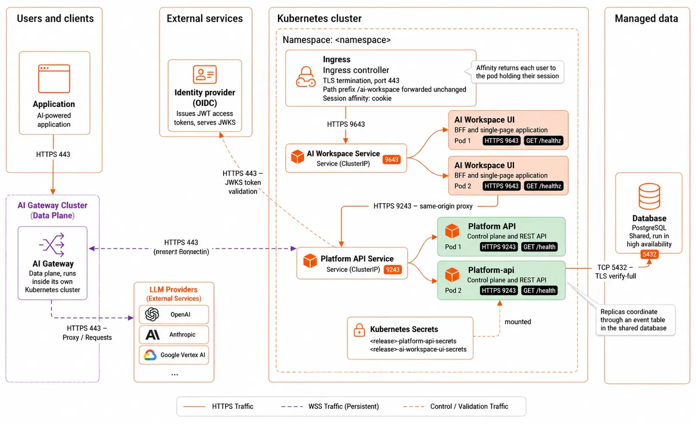

A single instance of each service is enough to serve users, but it makes every restart an outage. This page adds redundancy: a shared database, more than one instance of each service, and rules that keep a node or host failure from taking the deployment down.

Work through the steps in order. Adding replicas before moving off SQLite corrupts data.

## What limits each service

| Service | Holds state? | What lets it scale |
|---------|--------------|--------------------|
| Platform API | Yes, in its database | A shared PostgreSQL or SQL Server instance, instead of the SQLite file |
| AI Workspace | Yes, in memory: user sessions | Session affinity, so each user keeps reaching the instance holding their session |

The Platform API coordinates across replicas through an event table in the shared database. Each replica polls it, so a change one replica makes reaches the others without direct communication between them.

The following diagram shows the resulting topology, with both services replicated behind ClusterIP Services, an ingress in front, and the shared database behind:

## Step 1: Move to a shared database

SQLite is a file on one disk. Two instances writing to it corrupt it, so it caps the Platform API at one replica.

Move to a database server before anything else on this page. The examples below use PostgreSQL; Microsoft SQL Server works the same way with its own driver value and connection settings. For the full procedure, covering how to create the database and role, provision the schema, and enable TLS, see [Connect a database to the Platform API](../../setup/database.mdx).

Two settings matter for availability once the database server is in place:

- **Run the database itself in high availability.** A single database server leaves the whole control plane dependent on one machine. Use a managed service with automatic failover, or a replicated cluster.
- **Size the connection pool per replica, not per deployment.** `max_open_conns` applies to each Platform API instance. Three replicas at 25 connections each need at least 75 connections on the server, plus headroom for maintenance and other clients.

For the configuration on each platform, see [Deploy on VMs](../deploy-on-vms.mdx#step-6-write-the-configuration), [Deploy on Kubernetes](../deploy-on-kubernetes/deploy-on-kubernetes.mdx#step-6-write-the-configuration), and [Deploy on OpenShift](../deploy-on-kubernetes/openshift.mdx#production-step-6).

## Step 2: Give every instance the same key material

All instances must use the same at-rest encryption key so they can decrypt data written by other instances. If an instance uses a different key, it cannot read data encrypted by another instance.

- Kubernetes: This is handled automatically when all pods use the same Kubernetes Secret containing the encryption key.
- VM deployments: Copy the same encryption key files to every host and verify that the files are identical before routing traffic to the instances. See [Provision secrets and keys](./secrets-and-keys.mdx).

## Step 3: Add replicas

For the configuration on each platform, see [Deploy on VMs](../deploy-on-vms.mdx#ha-step-3-add-replicas), [Deploy on Kubernetes](../deploy-on-kubernetes/deploy-on-kubernetes.mdx#ha-step-3-add-replicas), and [Deploy on OpenShift](../deploy-on-kubernetes/openshift.mdx#openshift-ha-step-3-add-replicas).

:::warning[Configure session affinity for multiple replicas]
When deploying the workspace with multiple replicas, enable session affinity (sticky sessions) on the ingress or load balancer.

Session affinity ensures that requests from the same user are consistently routed to the same workspace instance, providing reliable session handling across replicas.
:::

## Step 4: Autoscale on demand

Set CPU requests first. Without them the autoscaler has no baseline to compute utilization against.

For the configuration on each platform, see [Deploy on VMs](../deploy-on-vms.mdx#ha-step-4-autoscale-on-demand), [Deploy on Kubernetes](../deploy-on-kubernetes/deploy-on-kubernetes.mdx#ha-step-4-autoscale-on-demand), and [Deploy on OpenShift](../deploy-on-kubernetes/openshift.mdx#openshift-ha-step-4-autoscale-on-demand).

## Step 5: Survive a node or host failure

For the configuration on each platform, see [Deploy on VMs](../deploy-on-vms.mdx#ha-step-5-survive-a-node-or-host-failure), [Deploy on Kubernetes](../deploy-on-kubernetes/deploy-on-kubernetes.mdx#ha-step-5-survive-a-node-or-host-failure), and [Deploy on OpenShift](../deploy-on-kubernetes/openshift.mdx#openshift-ha-step-5-survive-a-node-or-host-failure).

## Step 6: Tune the health probes

Both services answer a health endpoint: `/healthz` for AI Workspace, `/health` for the Platform API. The chart defaults suit a fast start. If your first start is slow, such as during a large schema migration, add a startup probe rather than lengthening the liveness delay. A startup probe gives the process time to come up without weakening the liveness check afterward.

For the configuration on each platform, see [Deploy on VMs](../deploy-on-vms.mdx#ha-step-6-tune-the-health-probes), [Deploy on Kubernetes](../deploy-on-kubernetes/deploy-on-kubernetes.mdx#ha-step-6-tune-the-health-probes), and [Deploy on OpenShift](../deploy-on-kubernetes/openshift.mdx#openshift-ha-step-6-tune-the-health-probes).

## Verify

Confirm replicas are serving, then confirm a failure doesn't sign users out.

For the configuration on each platform, see [Deploy on VMs](../deploy-on-vms.mdx#ha-verify), [Deploy on Kubernetes](../deploy-on-kubernetes/deploy-on-kubernetes.mdx#ha-verify), and [Deploy on OpenShift](../deploy-on-kubernetes/openshift.mdx#openshift-ha-verify).

## Related

- [Connect a database to the Platform API](../../setup/database.mdx): the shared database this page depends on
- [Expose AI Workspace](./expose-the-workspace.mdx): the ingress that carries the affinity settings
- [Operate the deployment](./operate.mdx): rolling upgrades across replicas
