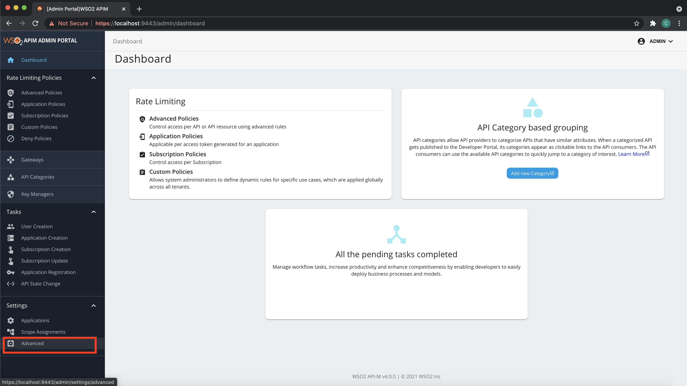
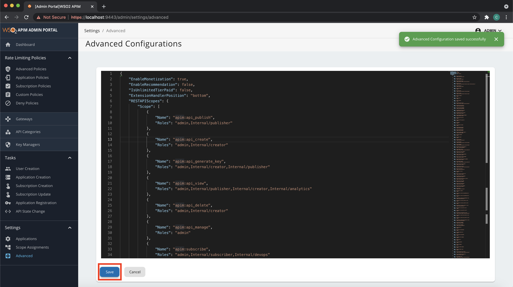

# **Advanced Configurations**

This section covers how to change and configure several features related to the advanced tenant configurations.

## Step 1 - Navigate to the Admin Portal Advanced Configuration Section {#step-1-navigate-to-the-admin-portal-advanced-configuration-section}

1.  Sign in to the WSO2 Admin Portal via `https://<Server-Host>:9443/admin`.
2.  Click **Settings** --> **Advanced**.

    

## Step 2 - Change the Advanced Configurations per use case {#step-2-change-the-advanced-configurations-per-use-case}

1. Change the relevant configuration accordingly and click **Save**.

    

    

    
Setting custom Linter rules

    You can add your custom rules in JSON with the key “LinterCustomRules”.

    

2.  You can revert the unsaved changes by clicking **Cancel**.

:::tip
Before clicking **Save**, check and fix any schema validation errors visible in the editor due to the changes made.
:::
