WSO2 API Manager supports multiple Key Managers. As a result, WSO2 API Manager is prepacked with an inbuilt resident Key Manager and with the use of connectors it is capable of supporting any authorization server as a Key Manager.

Therefore, WSO2 API Manager can connect Keycloak out-of-the-box using the [WSO2 API-M Keycloak Connector](https://github.com/wso2-extensions/apim-keymanager-keycloak).

Follow the instructions given below to configure Keycloak as a third-party Key Manager. 

:::info
For more information, see the [Getting Started Guide, which is under the official Keycloak documentation](https://www.keycloak.org/guides#getting-started).
:::

## Step 1 - Configure Keycloak {#step-1-configure-keycloak}

1. Sign in to the Keycloak Management Console.

    `http://localhost:8080/`

    :::note
    The documentation provides steps to configure the KeyCloak version 24.0.1. If you are using a different version, the screenshots could be different. Moreover, The steps which have been provided is to a local docker image of Keycloak. If you are using a different setup, the URL may vary.
    :::

2. Click **Client Scopes** and create client scope named "default".

     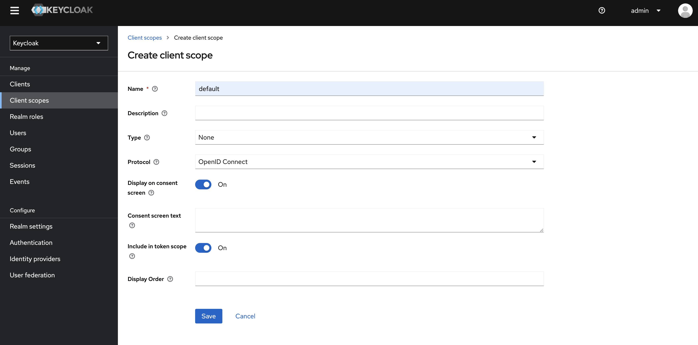

3. Click **Clients** and create a client with the Redirect URIs https://localhost:9443/.

    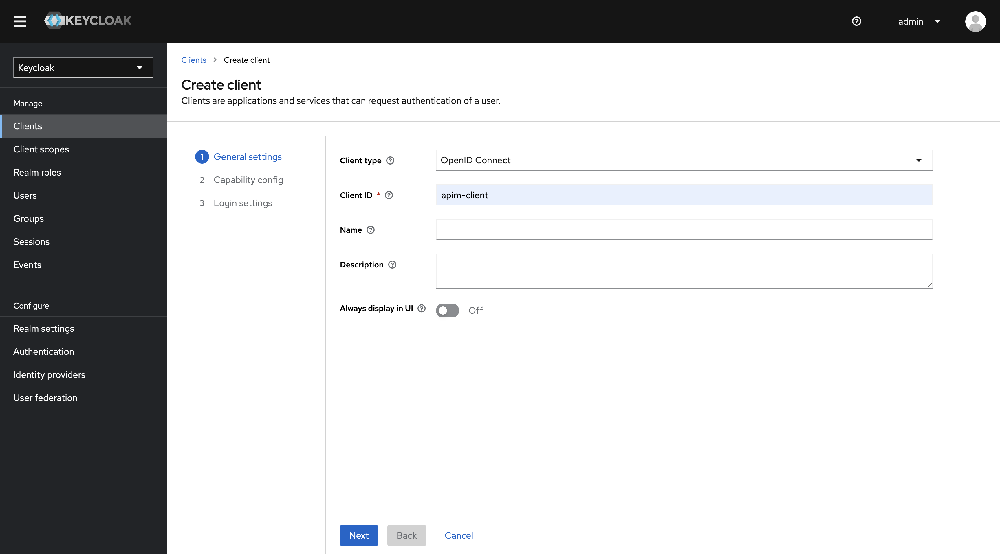

    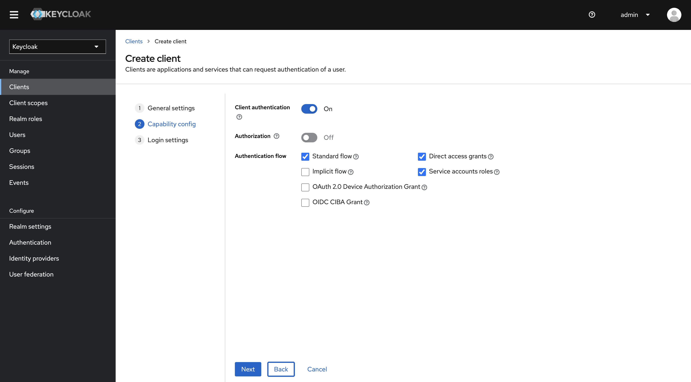

    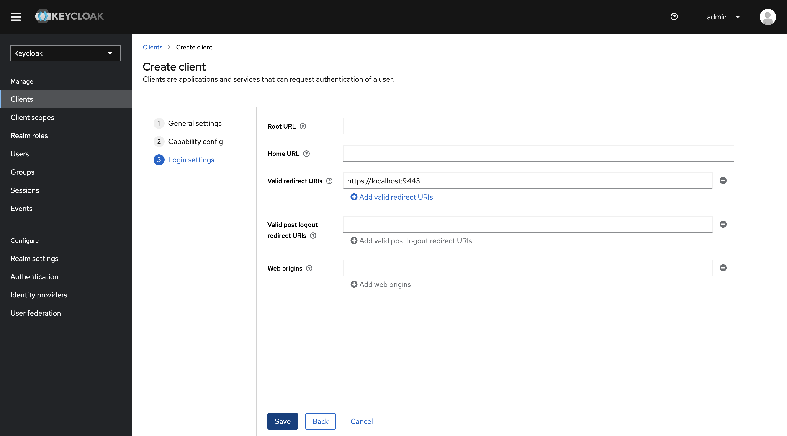

4. Optionally, define a longer value as the **Access Token Lifespan** in the client settings in the **Advanced** tab under **Advanced settings** section.

     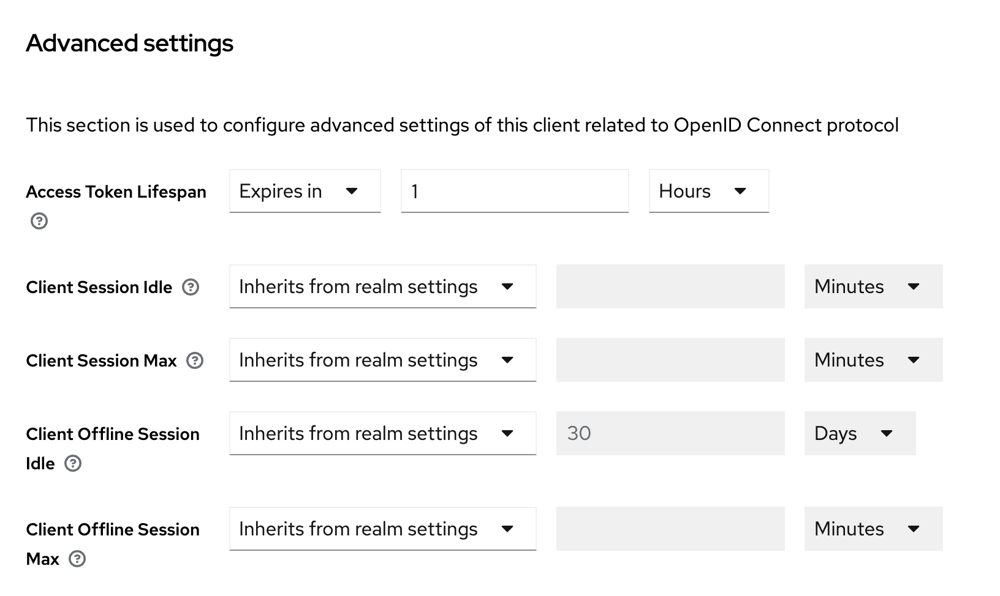

5. Click **Client Scopes** and add the default scope created previously to the client as default scope.

     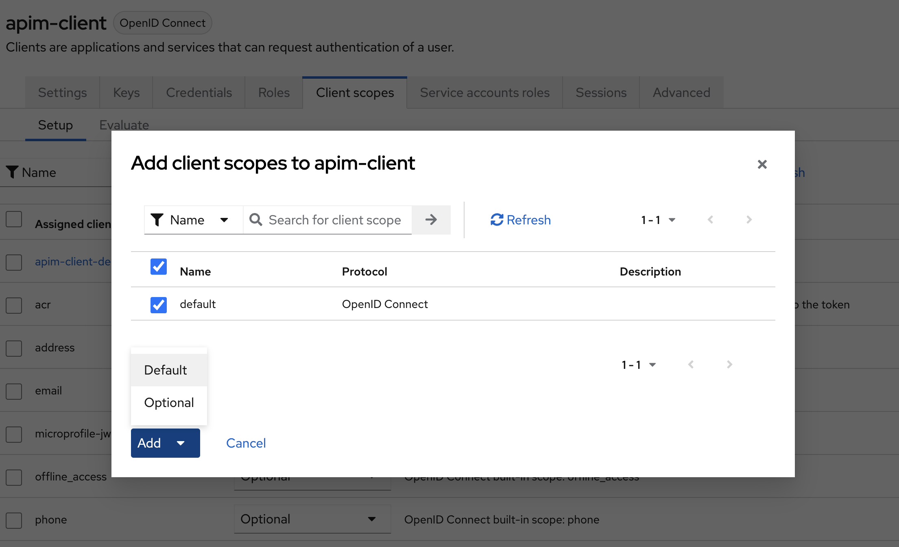

6. Click **Service Account Roles** and assign the `admin` role as an assigned role.

     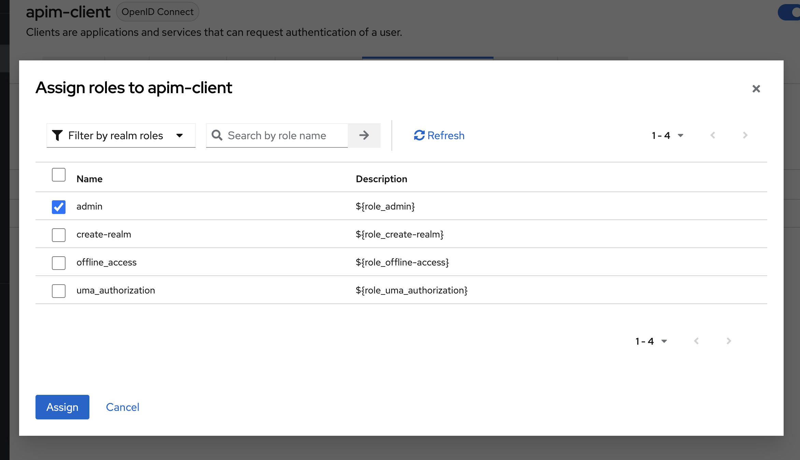

    <Anchor id="confidentialclient" />

7. Copy the client credentials.

     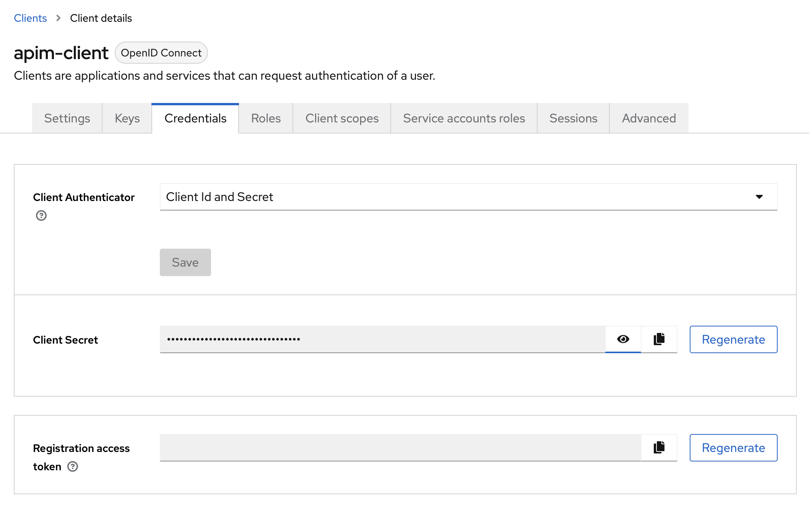

## Step 2 - Configure WSO2 API Manager {#step-2-configure-wso2-api-manager}

1. If you are configuring TLS between Keycloak and WSO2 API Manager, add the Keycloak cert to the API Manager truststore and vice versa.

    :::note
    For information on [Configuring TLS in Keycloak](https://www.keycloak.org/server/enabletls), see the Keycloak official documentation.
    :::

2. Start WSO2 API Manager.

     `<API-M_HOME>` refers to the root folder of the extracted WSO2 API-M distribution.

3. Add a Key Manager.

    1. Sign in to the Admin Portal. 

         `https://<hostname>:9443/admin`

         `https://localhost:9443/admin`

    2. Click Key Manager and then click **Add Key Manager**.

         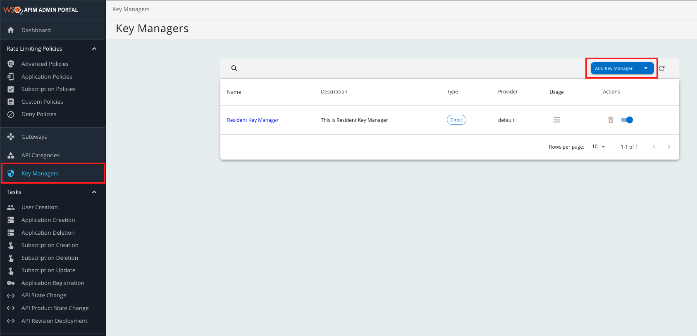

    3. Add the following configuration to add a new Key Manager.

         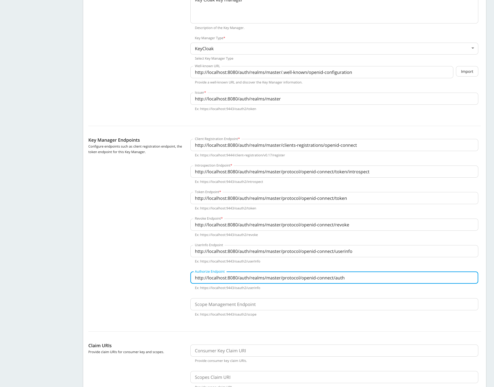

        :::tip
            * Configuring the well-known URL populates all the default configurations in the table once you click **Import**. 
            * It is mandatory to provide the **Client Id** and **Client Secret**.

        The following table provides definitions for each of the configurations.

        | Configuration | Description |  |
        | --- | --- | --- |
        | Name | The name of the authorization server. | Mandatory |
        | Display Name | A name to display on the UI. | Mandatory |
        | Description | A brief description of the Key Manager. | Optional |
        | Key Manager Type | The type of the Key Manager to be selected. | Mandatory |
        | Well-known-url | The well-known URL of the authorization server (Key Manager).   If the well-known URL is provided, other endpoints can be imported. | Optional |
        | Issuer | The issuer that consumes or validates the access tokens   e.g., https://localhost:8443/realms/master  http://localhost:8080/realm | Mandatory |
        | **Key Manager Endpoints** |  |  |
        | Client Registration Endpoint | The endpoint to verify the identity and obtain profile information of the end-user based on the authentication performed by an authorization server.  e.g., https://localhost:8443/realms/master/clients-registrations/openid-connect | Mandatory |
        | Introspection Endpoint | The endpoint that allows authorized protected resources to query the authorization server to determine the set of metadata for a given token that was presented to them by an OAuth client.   e.g., http://localhost:8080/realms/master/protocol/openid-connect/token/introspect   https://localhost:8443/realms/master/protocol/openid-connect/token/introspect | Mandatory |
        | Token Endpoint | The endpoint that issues the access tokens.   e.g., http://localhost:8080/realms/master/protocol/openid-connect/token  https://localhost:8443/realms/master/protocol/openid-connect/token | Mandatory |
        | Revoke Endpoint | The endpoint that revokes the access tokens. | Optional |
        | Userinfo Endpoint | The endpoint that allows clients to verify the identity of the end-user based on the authentication performed by an authorization server, as well as to obtain basic profile information about the end-user. | Mandatory |
        | Authorize Endpoint | The endpoint used to obtain an authorization grant from the resource owner via user-agent redirection. | Optional |
        | Scope Management Endpoint | The endpoint used to manage the scopes. | Mandatory |
        | **Connector Configurations** |  |  |
        | Client ID | The client ID obtained in Keycloak for the [confidential type client](#confidentialclient) e.g., apim-client. | Mandatory |
        | Client Secret | The client secret obtained in generated from [Keycloak for the confidential type client](#confidentialclient). | Mandatory |
        | **Claim URIs** | Provide the claim URIs for the consumer key and the scopes. |  |
        | Consumer Key Claim URI | The claim URI for the consumer key. | Optional |
        | Scopes Claim URI | The claim URI for scopes. | Optional |
        | Grant Types | The supported grant types. | Optional |
        | **Certificates** |  |  |
        | PEM | Either copy and paste the certificate in PEM format or upload the PEM file. | Optional |
        | JWKS | The JSON Web Key Set (JWKS) endpoint is a read-only endpoint. This URL returns Keycloak's public key set in JSON web key set format. This contains the signing key(s) the Relying Party (RP) uses to validate signatures from Keycloak. | Optional |
        | **Permissions** |  |  |
        | Key Manager Permission | Permission type for role-based Key Manager restriction.  e.g., `PUBLIC`, `ALLOW`, `DENY` | Optional |
        | Roles | Roles to Whitelist or Blacklist | Optional |
        | **Advanced Configurations** | Token Generation |  |
        | Token Generation | Enables token generation via the authorization server. | Optional |
        | Out Of Band Provisioning | This enables the provisioning of Auth clients that have been created without the use of the Developer Portal, such as previously created Auth clients. | Optional |
        | Oauth App Creation | This enables the creation of Auth clients. | Optional |
        | **Token Validation Method** | The method used to validate the JWT signature. |  |
        | Self Validate JWT | The kid value is used to validate the JWT token signature. If the kid value is not present, \`gateway_certificate_alias\` is used. | Optional |
        | Use introspect | The JWKS endpoint is used to validate the JWT token signature. If this option is used to validate the tokens it is mandatory to add a Token Handling Option. For the Okta it should be **JWT** and it is required to specify a claim mapping as a unique identifier.  e.g.,; Claim Key : iss  Claim Value : https://localhost:8443/realms/master | Optional |
        | **Token Handling Options** | Provides a way to validate the token for this particular authorization server. This is mandatory if the Token Validation Method is **introspect** |  |
        | REFERENCE | The tokens matching a specific regular expression (regEx) is validated. | Optional |
        | JWT | The tokens matching a specific JWT is validated. | Optional |
        | CUSTOM | The token matching a custom pattern is validated. | Optional |
        | **Claim Mappings** | Local and remote claim mapping. | Optional |
        :::

## Step 3 - Generate keys using the Keycloak Key Manager {#step-3-generate-keys-using-the-keycloak-key-manager}

1. Sign in to the Developer Portal.

    `https://<hostname>:9443/devportal`

    `https://localhost:9443/devportal`

2. Click **Applications**.

3. Create a new application or use the default application.

4. Click **Sandbox Keys**.

     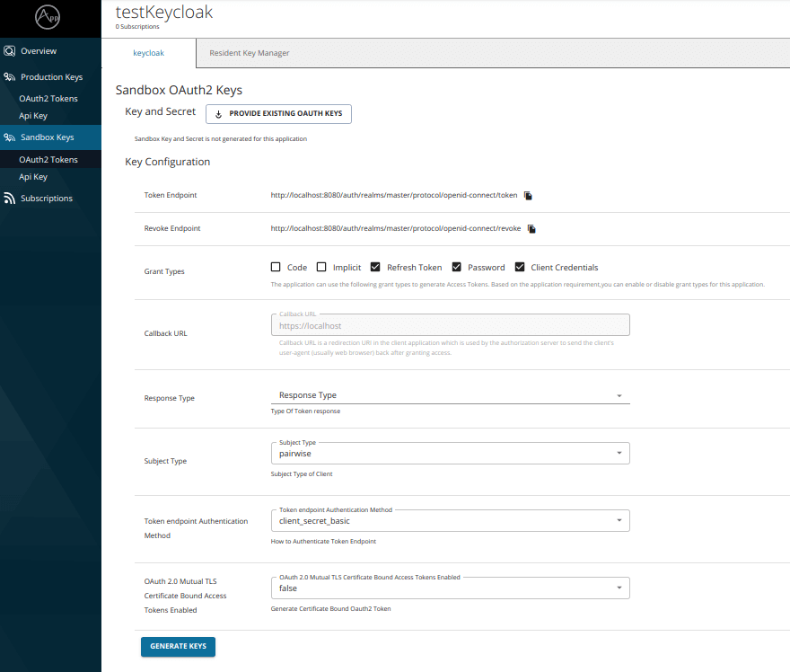

5. Select the **Response Type**.

6. Click **Generate Keys**.

:::tip
* If you want to generate the tokens with scopes, those scopes should have been defined in Keycloak as mentioned in the Step 1 - (2).
* When generating a token in the Developer Portal, you need to have the `code` and `implicit` grant types selected and you need to enter the response type as `none`. Without these, the token generation process fails.
:::
