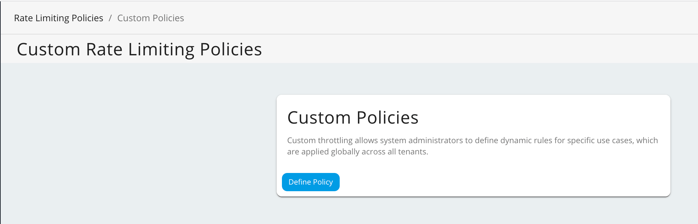
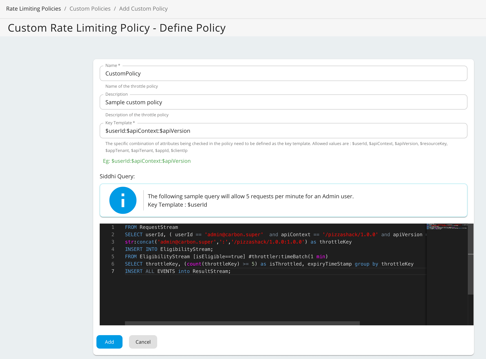

Custom rate limiting allows system administrators to define dynamic rules for specific use cases, which are applied globally across all tenants. When a custom rate limiting policy is created, it is possible to define any policy you like. The Traffic Manager acts as the global rate limiting engine and is based on the same technology as WSO2 Complex Event Processor (CEP), which uses the Siddhi query language. Users are therefore able to create their own custom rate limiting policies by writing custom Siddhi queries.

## Key Template

The specific combination of attributes being checked in the policy need to be defined as the key (also called the key template). The key template usually includes a predefined format and a set of predefined parameters. It can contain a combination of allowed keys separated by a colon (:), where each key must start with the prefix $. The following keys can be used to create custom rate limiting policies:

`resourceKey, userId, apiContext, apiVersion, appTenant, apiTenant, appId, clientIp`

## Adding a Custom Throttling Policy

For example, the following sample custom policy allows the admin user to send 5 requests per minute to the Pizza Shack API. 

1.  Sign in to the Admin Portal using the URL (`https://<ip_address>:<port>/admin`) and your admin credentials (admin/admin by default).

     Example:

     `https://localhost:9443/admin`

2.  Click **Rate Limiting Policies** tab and click **Custom Policies** tab.

     [](../../../../assets/img/learn/custom_policy_left_tag.png)

3.  To add a new policy, click **Define Policy**.

    

4.  Fill in the required details and click **Save**.

    | **Field** | **Description** |
    | --- | --- |
    | **Name** | CustomPolicy |
    | **Description** | Sample custom policy |
    | **Key Template** | `$userId:$apiContext:$apiVersion` |

    **Siddhi query**

    ```text
    FROM RequestStream
    SELECT userId, ( userId == 'admin@carbon.super'  and apiContext == '/pizzashack/1.0.0' and apiVersion == '1.0.0') AS isEligible ,
    str:concat('admin@carbon.super',':','/pizzashack/1.0.0:1.0.0') as throttleKey
    INSERT INTO EligibilityStream;
    FROM EligibilityStream [isEligible==true] #throttler:timeBatch(1 min)
    SELECT throttleKey, (count(throttleKey) >= 5) as isThrottled, expiryTimeStamp group by throttleKey
    INSERT ALL EVENTS into ResultStream;
    ```

    

:::warning[Important]
As shown in the above Siddhi query, the throttle key must match the key template format. If there is a mismatch between the key template format and the throttle key, requests will not be throttled.
:::
