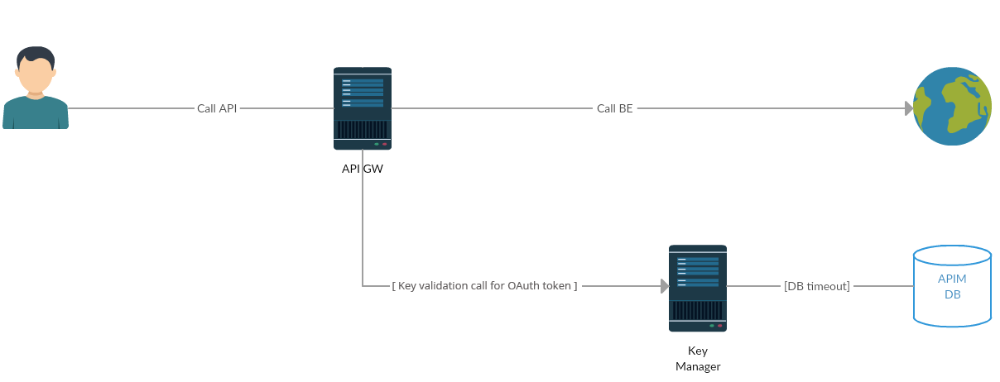

This section describes some recommended performance tuning configurations to optimize WSO2 API Manager. It assumes that you have set up the API Manager on Unix/Linux, which is recommended for a production deployment.

:::warning
Performance tuning requires you to modify important system files, which affect all programs running on the server. WSO2 recommends that you familiarize yourself with these files using Unix/Linux documentation before editing them.
:::

:::info
The values that WSO2 discusses here are general recommendations. They might not be the optimal values for the specific hardware configurations in your environment. WSO2 recommends that you carry out load tests on your environment to tune the API Manager accordingly.
:::

:::note
Over time, databases accumulate large volumes of data including invalid access tokens, revoked access tokens, registry transaction-related logs, authorization codes, and user sessions. Therefore, cleaning up outdated and unnecessary data helps maintain optimal database performance by reducing storage overhead, improving query execution times, and ensuring that the system can handle higher loads effectively. WSO2 API Manager provides mechanisms to manage data growth and improve performance.
:::

## OS-level settings

When it comes to performance, the OS that the server runs plays an important role.

:::info
If you are running MacOS Sierra and experiencing long startup times for WSO2 products, try mapping your Mac hostname to 127.0.0.1 and ::1 in the `/etc/hosts` file as described. For example, if your Macbook hostname is "john-mbpro. local", then add the mapping to the canonical 127.0.0.1 address in the `/etc/hosts` file, as shown in the example below.

```java
127.0.0.1 localhost john-mbpro.local
```
:::

Following are the configurations that can be applied to optimize the OS-level performance:

1.  To optimize network and OS performance, configure the following settings in the `/etc/sysctl.conf` file of Linux. These settings specify a larger port range, a more effective TCP connection timeout value, and a number of other important parameters at the OS-level.

    :::info
    It is **not recommended** to use `net.ipv4.tcp_tw_recycle = 1` when working with network address translation (NAT), such as if you are deploying products in EC2 or any other environment configured with NAT.
    :::

    ```java
    net.ipv4.tcp_fin_timeout = 30
    fs.file-max = 2097152
    net.ipv4.tcp_tw_recycle = 1
    net.ipv4.tcp_tw_reuse = 1
    net.core.rmem_default = 524288
    net.core.wmem_default = 524288
    net.core.rmem_max = 67108864
    net.core.wmem_max = 67108864
    net.ipv4.tcp_rmem = 4096 87380 16777216
    net.ipv4.tcp_wmem = 4096 65536 16777216
    net.ipv4.ip_local_port_range = 1024 65535      
    ```

    For more information on the above configurations, see [sysctl](https://wiki.archlinux.org/index.php/Sysctl).

2.  To alter the number of allowed open files for system users, configure the following settings in the `/etc/security/limits.conf` file of Linux (be sure to include the leading \* character).

    ```java
    * soft nofile 4096
    * hard nofile 65535
    ```

    Optimal values for these parameters depend on the environment.

3.  To alter the maximum number of processes your user is allowed to run at a given time, configure the following settings in the `/etc/security/limits.conf` file of Linux (be sure to include the leading \* character). Each Carbon server instance you run would require up to 1024 threads (with default thread pool configuration). Therefore, you need to increase the nproc value by 1024 per each Carbon server (both hard and soft).

    ```java
    * soft nproc 20000
    * hard nproc 20000
    ```

## JVM-level settings

When an XML element has a large number of sub-elements and the system tries to process all the sub-elements, the system can become unstable due to a memory overhead. This is a security risk.

To avoid this issue, you can define a maximum level of entity substitutions that the XML parser allows in the system. You do this using the `entity expansion limit` as follows in the `<API-M_HOME>/bin/api-manager.bat` file (for Windows) or the `<API-M_HOME>/bin/api-manager.sh` file (for Linux/Solaris). The default entity expansion limit is 64000.

```java
-DentityExpansionLimit=10000
```

In a clustered environment, the entity expansion limit has no dependency on the number of worker nodes.

## WSO2 Carbon platform-level settings

In multi-tenant mode, the WSO2 Carbon runtime limits the thread execution time. That is, if a thread is stuck or taking a long time to process, Carbon detects such threads, interrupts, and stops them. Note that Carbon prints the current stack trace before interrupting the thread. This mechanism is implemented as an Apache Tomcat valve. Therefore, it should be configured in the `<PRODUCT_HOME>/repository/conf/tomcat/catalina-server.xml` file as shown below.

```xml
<Valve className="org.wso2.carbon.tomcat.ext.valves.CarbonStuckThreadDetectionValve" threshold="600"/>
```

-   The `className` is the Java class used for the implementation. Set it to `org.wso2.carbon.tomcat.ext.valves.CarbonStuckThreadDetectionValve`.
-   The `threshold` gives the minimum duration in seconds after which a thread is considered stuck. The default value is 600 seconds.

## API-M-level settings

### Timeout configurations for an API call

The following diagram shows the communication/network paths that occur when an API is called. The timeout configurations for each network call are explained below.



:::info
The Gateway to Key Manager network call to validate the token only happens with the OAuth token. This network call does not happen for JSON Web Tokens (JWTs). JWT access tokens are the default token type for applications. As JWTs are self-contained access tokens, the Key Manager is not needed to validate the token, and the token is validated from the Gateway.
:::

-   **Client call Universal Gateway + Universal Gateway call Backend**

    For backend communication, the API Manager uses PassThrough transport. This is configured in the `<API-M_HOME>/repository/conf/deployment.toml` file. For more information, see Configuring PassThrough properties. Add the following section to the `deployment.toml` file to configure the Socket timeout value.
            ```java
                [passthru_http]
                http.socket.timeout=180000
            ```

    :::info
    The default value for `http.socket.timeout` differs between WSO2 products. In WSO2 API-M, the default value for `http.socket.timeout` is 180000ms.
    :::

### General API-M-level recommendations

Some general API-M-level recommendations are listed below:

<table>
  <thead>
    <tr>
      <th>**Improvement Area**</th>
      <th>**Performance Recommendations**</th>
    </tr>
  </thead>
  <tbody>
    <tr>
      <td>Universal Gateway nodes</td>
      <td>

        Increase memory allocated by modifying the `/bin/api-manager.sh` file with the following setting:

        <table>
          <tbody>
            <tr>
              <td>

                - ` -Xms2048m -Xmx2048m -XX:MaxMetaspaceSize=1024m `

                Set the following in the ` <API-M_HOME>/repository/conf/deployment.toml ` file:

                :::note
                The default values mentioned are the values identified at the time of releasing API-M. However, if you want high concurrency, use the values mentioned below:
                :::

                ```text
                [transport.client]
                default_max_connection_per_host = 1000
                max_total_connections = 30000 
                ```

              </td>
            </tr>
            <tr>
              <td>

                For the default JWT tokens (from APIM 3.2.0 onwards, the default token type is JWT), the key validation takes place within GW node itself, as the JWT token is self-contained. So no key validation call is made for JWT tokens. But if the token used is a reference token (if the deployment is migrated from older version which used reference tokens), the key validation http calls will be made to the Key manager component for token introspection. A dedicated http client is used for this purpose.

                :::note
                Because of this architecture, the axis2 based client, which is used in older APIM versions is not used further on. So previous axis2 based configs are not applicable for key validation in APIM 3.2.0 onwards.
                :::

                The configurations related to this http client are as below with the default recommended values.

                ```text
                [apim.http_client]
                max_total = 100
                default_max_per_route = 50
                ```

                **max_total:** The maximum number of connections that will be created for the key validation calls. If there is a considerable latency, the connections in use at a given time will take a long time to be released and added back to the connection pool. As a result, connections may not be available for some requests. In such situations, it is recommended to increase the value for this parameter.

                **default_max_per_route:** The maximum number of connections that will be created per host server by the client. Will have to increase this too, when required as similarly for the config **max_total**.

              </td>
            </tr>
          </tbody>
        </table>

      </td>
    </tr>
    <tr>
    </tr>
    <tr>
      <td>PassThrough transport of Universal Gateway</td>
      <td>

        Recommended values for the `<API-M_HOME>/repository/conf/deployment.toml` file are given below. Note that the commented out values in this file are the default values that will be applied if you do not change anything. These properties need to be added under `[passthru_http]` file.

        **Property descriptions**

        <table>
          <colgroup>
          </colgroup>
          <tbody>
            <tr>
              <td>

                `worker_thread_keepalive_sec`

              </td>
              <td>Defines the keep-alive time for extra threads in the worker pool</td>
            </tr>
            <tr>
              <td>`worker_pool_queue_length`</td>
              <td>Defines the length of the queue that is used to hold runnable tasks to be executed by the worker pool</td>
            </tr>
            <tr>
              <td>`io_threads_per_reactor`</td>
              <td>Defines the number of IO dispatcher threads used per reactor</td>
            </tr>
            <tr>
              <td>

                ` 'http.max.connection.per.host.port'`

              </td>
              <td>Defines the maximum number of connections per host port</td>
            </tr>
            <tr>
              <td>`'http.connection.timeout'`</td>
              <td>Defines a maximum time period to establish a connection with the remote host. The `http.connection.timeout` and the `http.socket.timeout`, which is explained below, are two different configuration definitions used to handle connection time out and read timeout for Sockets respectively.</td>
            </tr>
            <tr>
              <td>

                `'http.socket.timeout'`

              </td>
              <td>Defines the waiting time for data after establishing the connection, which refers to the maximum time of inactivity between two data packets.</td>
            </tr>
          </tbody>
        </table>

        **Recommended values**

        - ` worker_thread_keepalive_sec: ` Default value is 60s. This should be less than the Socket timeout.
        - ` worker_pool_queue_length: ` Set to -1 to use an unbounded queue. If a bound queue is used and the queue gets filled to its capacity, any further attempts to submit jobs will fail, causing some messages to be dropped by Synapse. The thread pool starts queuing jobs when all the existing threads are busy and when the pool has reached the maximum number of threads. So, the recommended queue length is -1.
        - ` io_threads_per_reactor: ` Value is based on the number of processor cores in the system. (`Runtime.getRuntime().availableProcessors()`)
        - ` 'http.max.connection.per.host.port' : ` Default value is 32767, which works for most systems, but you can tune it based on your operating system (for example, Linux supports 65K connections).
        - ` core_worker_pool_size: 400 `
        - ` max_worker_pool_size: 500 `
        - ` io_buffer_size: 16384 `
        - ` 'http.socket.timeout' : 180000 `

        :::tip
        Make the number of threads equal to the number of processor cores.
        :::

      </td>
    </tr>
    <tr>
      <td>Timeout configurations</td>
      <td>

        The Universal Gateway routes the requests from your client to an appropriate endpoint. The most common reason for your client getting a timeout is when the Gateway's timeout is larger than the client's timeout values. You can resolve this by either increasing the timeout on the client's side or by decreasing it on the Universal Gateway's side.

        Here are a few parameters, in **addition to the timeout parameters discussed in the previous sections**.

        <table>
          <colgroup>
            <col width="50%" />
            <col width="50%" />
          </colgroup>
          <tbody>
            <tr>
              <td>`Synapse global timeout interval`</td>
              <td>

                Defines the maximum time that a callback waits in the Gateway for a response from the backend. If no response is received within this time, the Gateway drops the message and clears out the callback. This is a global level parameter that affects all the endpoints configured in the Gateway.

                The global timeout is defined in the ` <API-M_HOME>/repository/conf/deployment.toml ` file. The recommended value is 120000 ms.

                ```text
                [synapse_properties]
                'synapse.global_timeout_interval' = 120000
                ```

              </td>
            </tr>
            <tr>
              <td>`Endpoint-level timeout`</td>
              <td>

                You can define timeouts per endpoint for different backend services, along with the action to be taken in case of a timeout.

                You can set this through the Publisher UI by following the steps below:

                1. Sign in to the API Publisher (`https://<HostName>:9443/publisher`). Select your API and click **Endpoints**.

                2. Click the cogwheel icon next to the endpoint you want to re-configure.

                3. In the **Advanced Settings** dialog box that appears, increase the duration by modifying the default property set as 3000 ms.

                   :::note
                   Note that when the endpoint is suspended, the default action is defined here as invoking the fault sequence.
                   :::

                   

                4. Click **Save**.

                :::note
                The ` http.socket.timeout ` parameter needs to be adjusted based on the endpoint-level timeout so that it's value is equal or higher than the highest endpoint-level timeout.
                :::

                ::::warning
                If your API is marked as the default version, it has a different template (without the version number) that comes with a predefined timeout for the endpoint. This timeout does not change with the changes you do to the API by editing the Advanced Endpoint Configuration. Therefore, if this predefined timeout (60 seconds) is less than the actual API timeout, it triggers the timeout before the actual configured API timeout.

                To overcome this, update the ` default_api_template.xml ` residing in the ` <API-M_HOME>/repository/resources/api_templates ` directory by removing the endpoint timeout configuration from the default API. Then, the APIs marked as the default version also trigger the timeout when the actual API timeout is met.

                Follow the steps below to update the ` default_api_template.xml ` to remove the endpoint configuration for the default APIs.

                :::tip
                If you are using a distributed (clustered) setup, follow these steps in the Publisher node as it is the API Publisher that creates the API definition and pushes it to the Gateway.
                :::

                1. Open the ` <API-M_HOME>/repository/resources/api_templates/default_api_template.xml ` file and remove the following configuration:

                   ```text
                   <timeout>
                       <duration>60000</duration>
                       <responseAction>fault</responseAction>
                   </timeout>
                   <suspendOnFailure>
                       <progressionFactor>1.0</progressionFactor>
                   </suspendOnFailure>
                   <markForSuspension>
                       <retriesBeforeSuspension>0</retriesBeforeSuspension>
                       <retryDelay>0</retryDelay>
                   </markForSuspension>
                   ```

                2. Add the following configuration to the same place in the ` default_api_template.xml ` file.

                   ```text
                   <suspendOnFailure>
                       <errorCodes>-1</errorCodes>
                       <initialDuration>0</initialDuration>
                       <progressionFactor>1.0</progressionFactor>
                       <maximumDuration>0</maximumDuration>
                   </suspendOnFailure>
                   <markForSuspension>
                       <errorCodes>-1</errorCodes>
                   </markForSuspension>
                   ```

                   :::info
                   By adding this configuration, you ensure that the APIs marked as the default version never timeout or are suspended using the endpoint configuration defined in the synapse file of the API.
                   :::

                3. Go to the API Publisher and republish the default API by clicking **Save and Publish**.
                ::::

              </td>
            </tr>
          </tbody>
        </table>

      </td>
    </tr>
    <tr>
      <td>Key Manager nodes</td>
      <td>

        Set the MySQL maximum connections:

        ```text
        mysql> show variables like "max_connections"; 
         max_connections was 151 
         set to global max_connections = 250; 
        ```

        Set the open files limit to 200000 by editing the ` /etc/sysctl.conf ` file:

        ```text
        sudo sysctl -p
        ```

        Set the following in the ` <API-M_HOME>/repository/conf/deployment.toml ` file.

        :::info
        If you use WSO2 Identity Server (WSO2 IS) as the Key Manager, then the root location of the above path and the subsequent path needs to change from ` <API-M_HOME> ` to ` <IS_HOME>`.
        :::

        ```text
        [transport.https.properties]
        maxThreads="750" 
        minSpareThreads="150" 
        disableUploadTimeout="false" 
        enableLookups="false" 
        connectionUploadTimeout="120000" 
        maxKeepAliveRequests="600" 
        acceptCount="600" 
        ```

        Set the following connection pool elements in the same file. Time values are defined in milliseconds.

        ```text
        [database.apim_db.pool_options]
        maxActive = 51
        maxWait = 60001
        testOnBorrow = true
        validationInterval = 30001

        [database.apim_db]
        validationQuery = "SELECT 2"
        ```

        Note that you set the ` <testOnBorrow> ` element to ` true ` and provide a validation query (e.g., in Oracle, ` SELECT 1 FROM DUAL ` ), which is run to refresh any stale connections in the connection pool. Set a suitable value for the ` <validationInterval> ` element, which defaults to 30000 milliseconds. It determines the time period, after which the next iteration of the validation query will be run on a particular connection. It avoids excess validations and ensures better performance.

      </td>
    </tr>
  </tbody>
</table>

### Registry indexing configurations

The registry indexing process, which indexes the APIs in the Registry, is only required to be run on the API Publisher and Developer Portal nodes. To disable the indexing process from running on the other nodes (Gateways and Key Managers), you need to add the following configuration section in the `<API-M_HOME>/repository/conf/deployment.toml` file.

```java
[indexing]
enable = false
```

### Optimizing database indexing for case-sensitive and case-insensitive user stores

One key aspect of performance optimization is database indexing. While API Manager includes essential database indexes in its default database scripts, certain scenarios may require additional indexing. Database Administrators (DBAs) are responsible for implementing these additional indexes to ensure optimal performance.

For user stores configured with case-insensitive usernames in databases such as Oracle, PostgreSQL, or SQL Server, the DBA should create the necessary indexes using the `LOWER(UM_USER_NAME)` function.

If a case-sensitive database is in use, only the indexes listed below should be added. Note that these indexes may not cover all possible indexing needs.

```sql
[apim_db]
CREATE INDEX IDX_AT_CK_AU_LO ON IDN_OAUTH2_ACCESS_TOKEN(CONSUMER_KEY_ID, LOWER(AUTHZ_USER), TOKEN_STATE, USER_TYPE);
CREATE INDEX IDX_AT_TI_UD_LO ON IDN_OAUTH2_ACCESS_TOKEN(LOWER(AUTHZ_USER), TENANT_ID, TOKEN_STATE, USER_DOMAIN);
CREATE INDEX IDX_AT_AU_TID_UD_TS_CKID_LO ON IDN_OAUTH2_ACCESS_TOKEN(LOWER(AUTHZ_USER), TENANT_ID, USER_DOMAIN, TOKEN_STATE, CONSUMER_KEY_ID);
CREATE INDEX IDX_AT_AU_CKID_TS_UT_LO ON IDN_OAUTH2_ACCESS_TOKEN(LOWER(AUTHZ_USER), CONSUMER_KEY_ID, TOKEN_STATE, USER_TYPE);
CREATE INDEX IDX_AT_CIDAUTID_UD_TSH_TS_LO ON IDN_OAUTH2_ACCESS_TOKEN(CONSUMER_KEY_ID, LOWER(AUTHZ_USER), TENANT_ID, USER_DOMAIN, TOKEN_SCOPE_HASH, TOKEN_STATE);
CREATE INDEX IDX_AUTH_CODE_AU_TI_LO ON IDN_OAUTH2_AUTHORIZATION_CODE (LOWER(AUTHZ_USER), TENANT_ID, USER_DOMAIN, STATE);
CREATE INDEX IDX_AUTH_USER_UN_TID_DN_LO ON IDN_AUTH_USER (LOWER(USER_NAME), TENANT_ID, DOMAIN_NAME);
CREATE INDEX IDX_OCA_UM_TID_UD_APN_LO ON IDN_OAUTH_CONSUMER_APPS(LOWER(USERNAME),TENANT_ID,USER_DOMAIN, APP_NAME);
CREATE INDEX INDEX_IDN_USER_DK_LO_UNIQUE ON IDN_IDENTITY_USER_DATA (TENANT_ID, LOWER(USER_NAME), DATA_KEY);
CREATE INDEX INDEX_IDN_USER_LO_UNIQUE ON IDN_IDENTITY_USER_DATA (TENANT_ID, LOWER(USER_NAME));

[shared_db]
CREATE INDEX IDX_UU_LO_UI_UUN_TI ON UM_USER(UM_ID,LOWER(UM_USER_NAME),UM_TENANT_ID);
CREATE INDEX INDEX_UM_USER_LO_UNIQUE ON UM_USER (LOWER(UM_USER_NAME), UM_TENANT_ID);
CREATE INDEX INDEX_UM_SYSTEM_USER_LO_UNIQUE ON UM_SYSTEM_USER (LOWER(UM_USER_NAME), UM_TENANT_ID);
CREATE INDEX INDEX_UM_ACC_MAPPING_LO_UNIQUE ON UM_ACCOUNT_MAPPING (LOWER(UM_USER_NAME), UM_TENANT_ID, UM_USER_STORE_DOMAIN, UM_ACC_LINK_ID);
CREATE INDEX INDEX_UM_HYBRID_UR_LO_UNIQUE ON UM_HYBRID_USER_ROLE (LOWER(UM_USER_NAME), UM_ROLE_ID, UM_TENANT_ID);
CREATE INDEX INDEX_UM_SYSTEM_UR_LO_UNIQUE ON UM_SYSTEM_USER_ROLE (LOWER(UM_USER_NAME), UM_ROLE_ID, UM_TENANT_ID);
```

For case-insensitive databases like MySQL or MSSQL, add the following configuration to avoid using the `LOWER` function in queries. This configuration should be applied across all user stores that function as case-insensitive databases, and API Manager must be restarted afterward for the changes to take effect.

In the `<APIM_HOME>/repository/conf` directory, set the following property to `false` in the `deployment.toml` file, according to the specific user store.

```toml
[user_store]
properties.CaseInsensitiveUsername = false
properties.UseCaseSensitiveUsernameForCacheKeys = false
```
