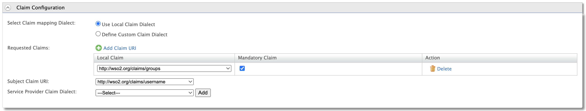
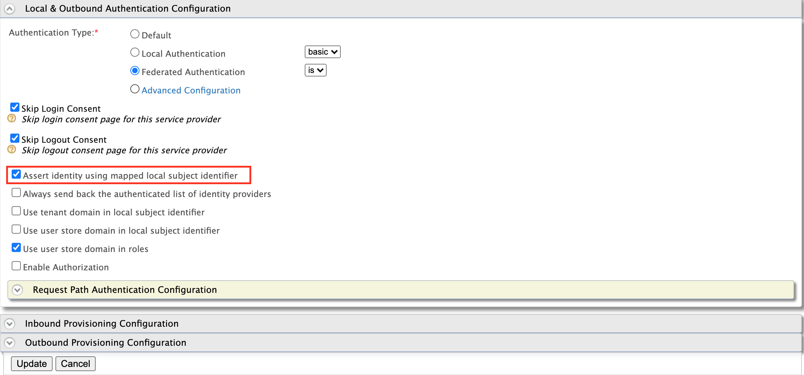
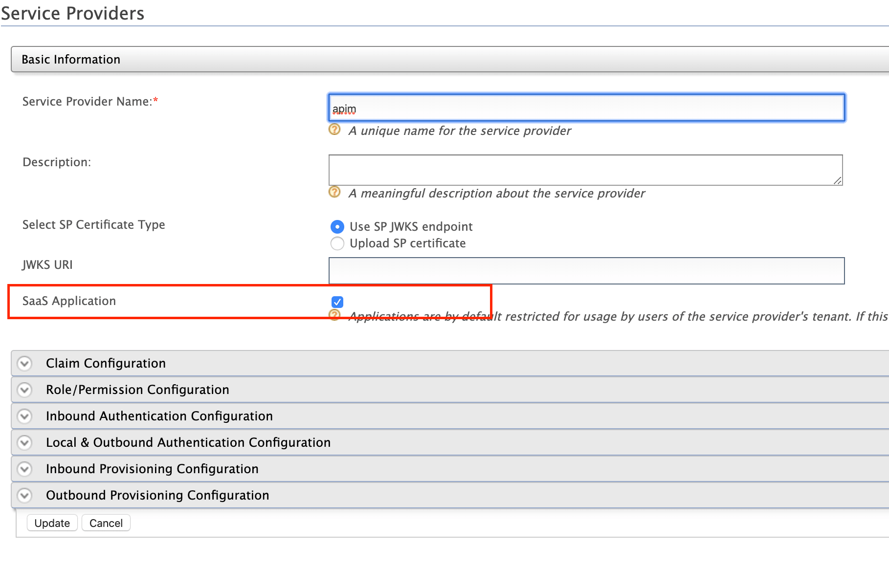
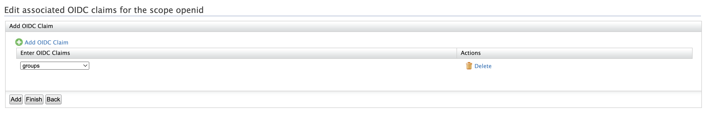
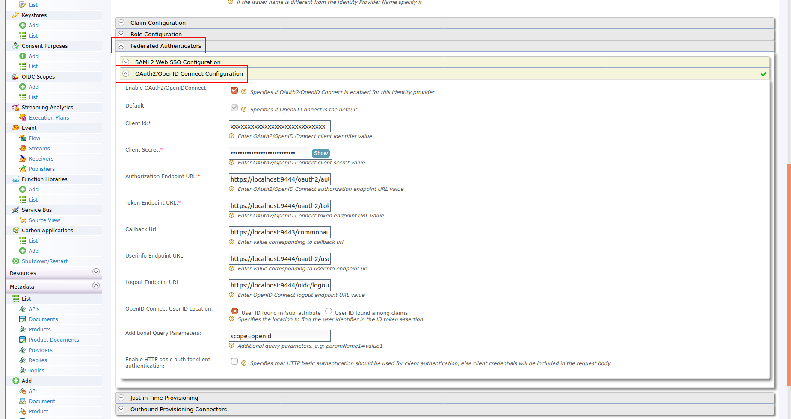
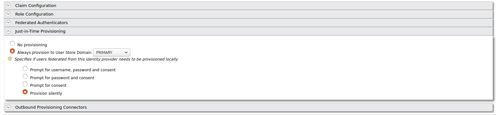
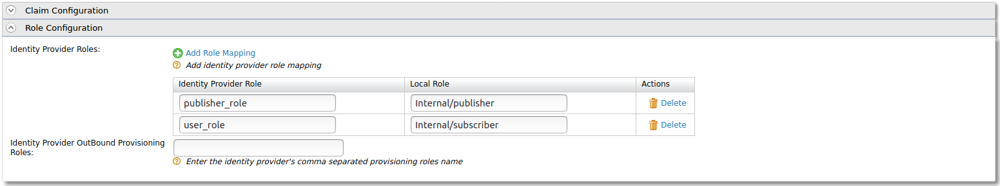
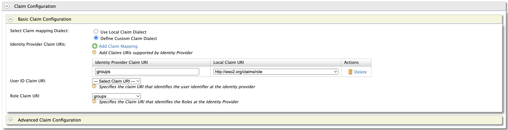
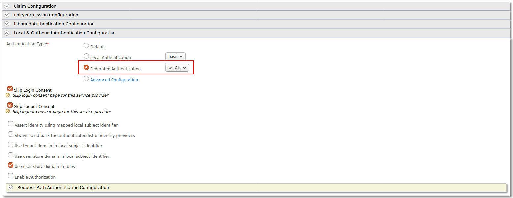

import Tabs from '@theme/Tabs';
import TabItem from '@theme/TabItem';

WSO2 API Manager uses the OIDC Single Sign-On feature by default. This document explains how to connect WSO2 Identity Server (or WSO2 Identity Server as a Keymanager) as a third party Identity provider to API-Manager.

## prerequisites

-   Download the API Manager distribution from [https://wso2.com/api-management/](https://wso2.com/api-management/).
-   Download the Identity Server distribution from [https://wso2.com/identity-and-access-management/](https://wso2.com/identity-and-access-management/).

    :::tip
    For **testing purposes** if you want to run both the WSO2 API Manager and WSO2 Identity Server on the same server, go to the `<IS_HOME>/repository/conf/deployment.toml` file and offset the port by 1 as by adding following configuration:

    ```toml
    [server]
    offset=1
    ```
    :::

-   Start the servers using the following commands:

    <Tabs groupId="tabs">
    <TabItem value="on-windows" label="On Windows">

    ```text
    wso2server.bat --run
    ```

    </TabItem>
    <TabItem value="on-linux-mac-os" label="On Linux/Mac OS">

    ```text
    sh wso2server.sh
    ```

    </TabItem>
    </Tabs>

## Configure the Identity Server

### Step - 1 Configure the Service Provider {#step-1-configure-the-service-provider}

1.  Sign in to the Management Console of WSO2 IS by browsing the following URL:  

    ```text
    https://{is-ip}:9444/carbon
    ```

2.  Navigate to the **Service Providers** section under Main → Identity and create new Service Provider.

3.  Edit the created Service Provider:

    1.  Expand the **Claim Configuration** section. Add the **http://wso2.org/claims/groups** as mandatory claim. In addition, add the **http://wso2.org/claims/username** claim as the **Subject Claim URI**.

        

    2.  Expand the **Inbound Authentication Configuration** section and configure **OAuth/OpenID Connect Configuration** with callback URL - `https://{apim-ip}:9443/commonauth`

        :::info[Enable a tenant-specific SSO for the Publisher and Developer Portal]
        To enable a tenant-specific SSO with IS 5.10.0 for Publisher and the Developer Portal, enable the **Use tenant domain in local subject identifier** option under the **Local & Outbound Authentication Configuration** section.

        
        :::

        :::note[Options available for **Local & Outbound Authentication Configuration** ]
        -   **Assert identity using mapped local subject identifier** :
            Select this to use the local subject identifier when asserting the identity.
            Note that it is **mandatory** to enable the above option to authorize scopes for provisioned federated users. 
        -   **Always send back the authenticated list of identity providers** : Select this to send back the list of  identity providers that the current user is authenticated by.
        -   **Use tenant domain in local subject identifier** : Select this to append the tenant domain to the local subject identifier.
        -   **Use user store domain in local subject identifier** : Select this to append the user store domain that the user resides to the local subject identifier.
        -   **Use user store domain in roles** : This is selected by default, and appends the userstore domain name to user roles. If you do not want to append the userstore domain name to user roles, clear the check box.

            If a user role is not mapped to a service provider role, and you clear the **Use user store domain in roles** check box, the userstore domain name will be removed from the role claim value unless the userstore domain name is APPLICATION, INTERNAL, or WORKFLOW.
        :::

    3. Update the Service Provider configurations.

    :::info[In Multi-tenanted environments]
    Carry out the instruction given below for all the tenants to be able to login to the API-M Web applications in a multi-tenanted environment.

    1.  Click the **SaaS Application** option that appears after registering the service provider.

     

    If you do not select the **SaaS Application** option, only users in the current tenant domain will be allowed to login to the portals. You will need to register separate service providers for portals from each tenant.
    :::

### Step - 2 Create users and roles {#step-2-create-users-and-roles}

1. Create the required users and roles in Identity Server. Assume, following users are created in Identity Servers with the given roles.

    | User | Role |
    | --- | --- |
    | api_publisher | publisher_role |
    | api_user | user_role |

### Step 3 - Update the OpenID OIDC scope {#step-3-update-the-openid-oidc-scope}

1. Navigate to the **OIDC Scopes** section under **Main** → **Manage** and list the available scopes.

2. Click **Add Claims** for `openid` scope, click **Add OIDC Claim**, select `groups` claim from the dropdown and click on **Add**.
   

## Configure the API Manager

### Step - 1 Configure the Identity Provider {#step-1-configure-the-identity-provider}

1.  Sign in to the Management Console of API Manager by browsing the following URL: 

    ```text
    https://{apim-ip}:9443/carbon
    ```

2.  Navigate to the **Identity Providers** section under Main → Identity and create a new Identity Provider.

    1.  Expand the **Federated Authenticators** section and add the following configurations under **OAuth2/OpenIDConnect Configuration**:

        <table>
          <tbody>
            <tr>
              <td>Enable OAuth2/OpenIDConnect</td>
              <td>True</td>
            </tr>
            <tr>
              <td>Client Id</td>
              <td>Client Id of the Service Provider created in Identity Server</td>
            </tr>
            <tr>
              <td>Client Secret</td>
              <td>Client Secret of the Service Provider created in Identity Server</td>
            </tr>
            <tr>
              <td>Authorization Endpoint URL</td>
              <td>https://is.wso2.com:9444/oauth2/authorize</td>
            </tr>
            <tr>
              <td>Token Endpoint URL</td>
              <td>https://is.wso2.com:9444/oauth2/token</td>
            </tr>
            <tr>
              <td>Callback Url</td>
              <td>https://apim.wso2.com:9443/commonauth</td>
            </tr>
            <tr>
              <td>Userinfo Endpoint URL</td>
              <td>https://is.wso2.com:9444/oauth2/userinfo</td>
            </tr>
            <tr>
              <td>Logout Endpoint URL</td>
              <td>https://is.wso2.com:9444/oidc/logout</td>
            </tr>
          </tbody>
        </table>

        The following image shows the sample values for OAuth2/OpenIDConnect Configurations:

        

    2.  Enable Just-in-Time Provisioning to provision the users in API Manager:

        

    3.  Add the following role mapping under the **Role Configuration** section:

        | Identity Server Roles | Roles Mapped in API Manager |
        | --- | --- |
        | user_role | Internal/Subscriber |
        | publisher_role | Internal/publisher |

        

        :::tip
        Instead of using the default internal roles, you can also create new roles in API Manager and map it to the provisioned users. 
        :::

    4. Add the following claim mapping under the **Claim Configuration** section.
        | Identity Provider Claim URI | Local Claim URI |
        | --- | --- |
        | groups | http://wso2.org/claims/role |

        Also select **groups** as the **Role Claim URI**.

    

### Step - 2 Configure the Service Provider {#step-2-configure-the-service-provider}

1.  Navigate to **Service Providers** section and list the Service Providers. There are two service providers created for Publisher portal and Developer portal named as `apim_publisher` and `apim_devportal`. Edit the `apim_publisher` service provider.

    :::warning[Attention]
    You will have to log into the Developer Portal and Publisher at least once for the two service providers to appear as it is created during first login.
    :::

2.  Expand the **Local & Outbound Authentication Configuration** section and select **Federated Authentication** as Authentication Type and select the name of the Identity Provider you created in previous step and update.

    

3.  Repeat the same step for `apim_devportal` Service Provider as well.

Now you will be able to login to Publisher and Devportal using the users in WSO2 Identity Server.

:::note
If your Identity Provider has multiple secondary user stores (such as LDAP) and you want to include the user domain in the subject identifier (`LDAP_DOMAIN/username`), you must also connect the same user stores to the API Manager in read-only mode. This is required when the secondary user stores contain users with the same name and you cannot provision those users to the API Manager primary user store.
:::

:::tip[Troubleshooting]
When using Identity Server as external IdP, following error can be observed in API Manager, when logging in to Portals.

```text
    invalid_request, The client MUST NOT use more than one authentication method in each
```

This is because the MutualTLS authenticator is enabled by default in the Identity Server, from version 5.8.0 onwards. Since the OIDC specification does not allow to use more than one authentication, the login fails with the above error. To resolve this issue, add following the configuration in the `deployment.toml` file in the `<IS-Home>/repository/conf` directory to disable the MutualTLS authenticator in the Identity Server.

```toml
[[event_listener]]
id = "mutual_tls_authenticator"
type = "org.wso2.carbon.identity.core.handler.AbstractIdentityHandler"
name = "org.wso2.carbon.identity.oauth2.token.handler.clientauth.mutualtls.MutualTLSClientAuthenticator"
order = "158"
enable = false
```
:::
