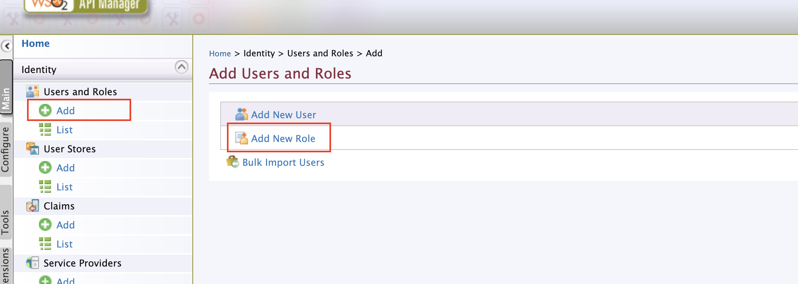
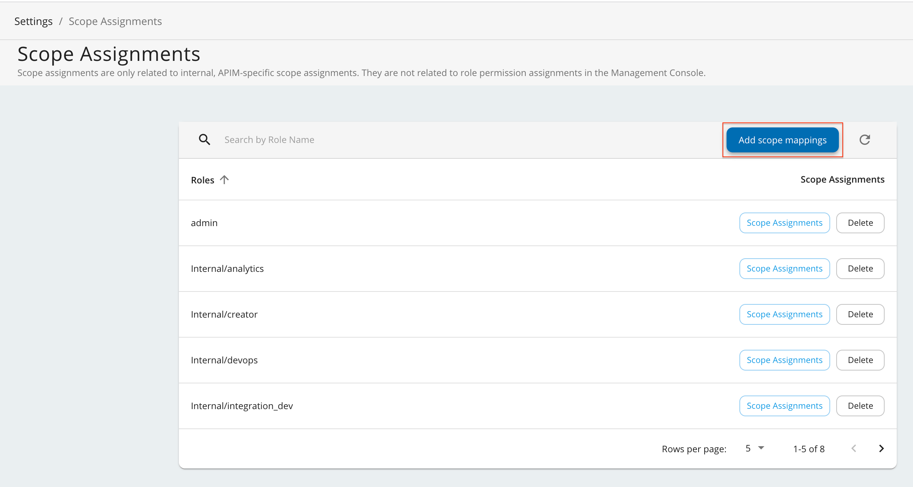
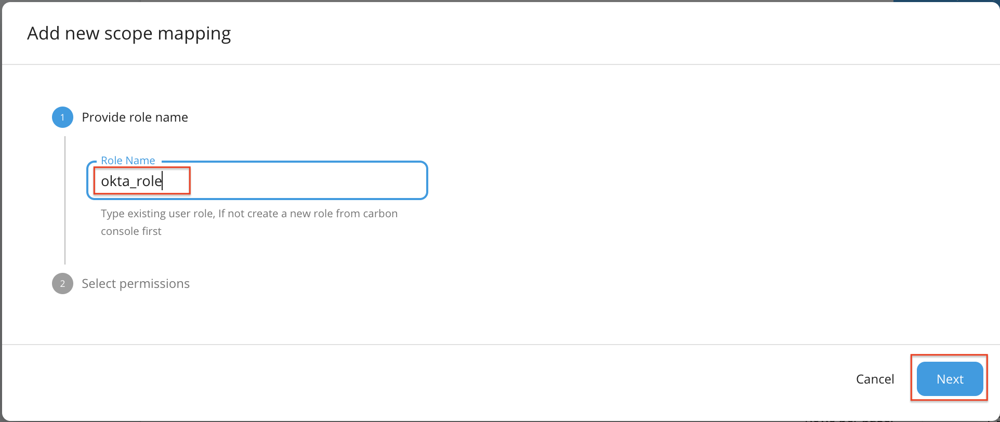
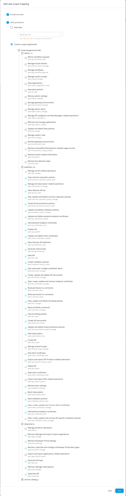
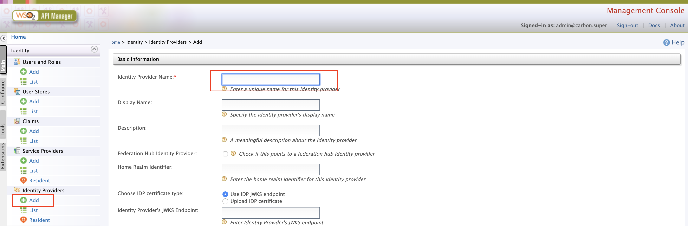
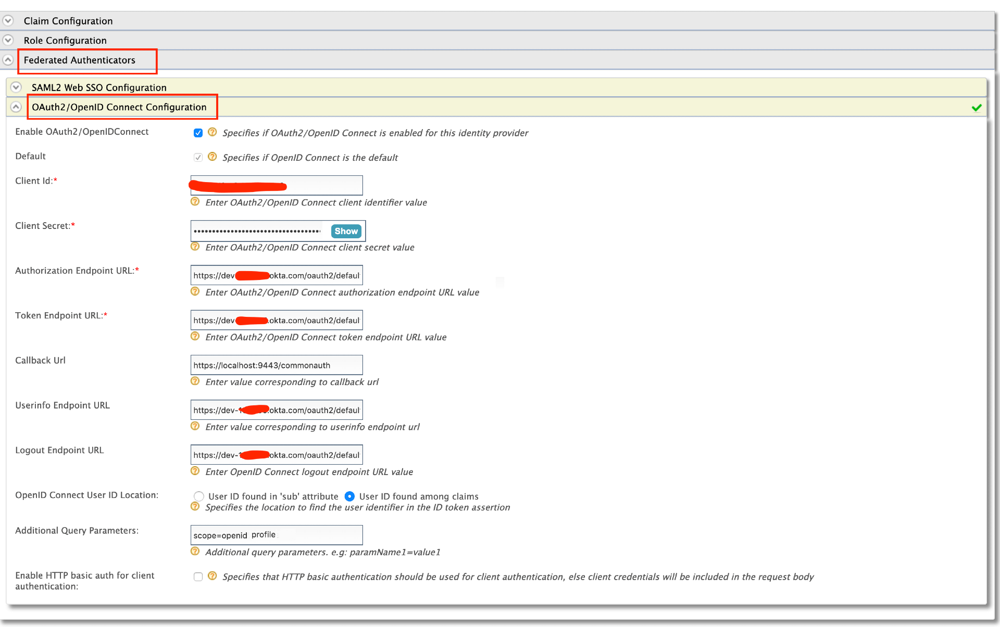
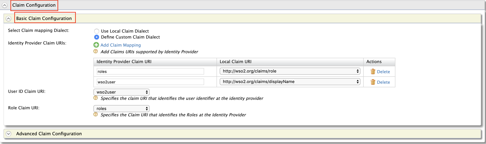
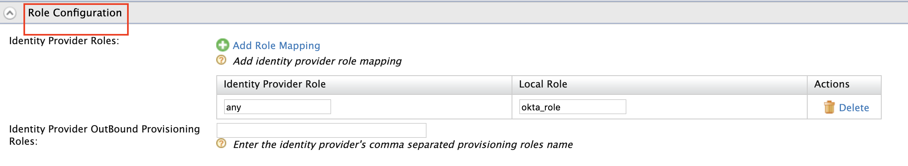
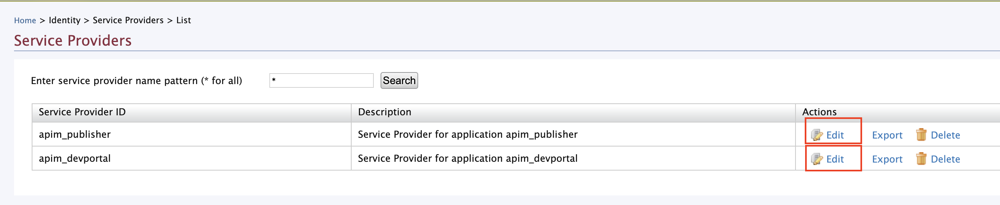
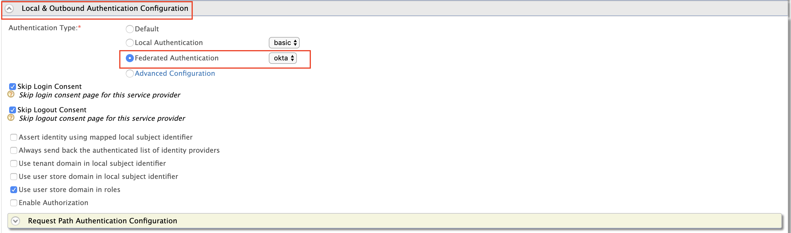

Follow the instructions below to connect Okta as a third-party Identity Provider to WSO2 API Manager.

## Prerequisites

Before you begin, make sure you do the following.

1. Create an account in [https://developer.okta.com/](https://developer.okta.com/)
2. Download the WSO2 API Manager distribution from [https://wso2.com/api-management/](https://wso2.com/api-management/).
3. Enable the email domain on WSO2 API Manager.

     You need to enable this because Okta uses the email as the username by default. As the email domain is not enabled by default, you have to enable it to  use the email as the username in WSO2 API Manager. Once enabled, you can use your email or a normal username as your username.

     Follow the instructions below:

     1. Unzip the WSO2 API Manager distribution.
     2. Open the `deployment.toml` file, which is located in the `<API-M_HOME>/repository/conf/` directory. 
     3. Add the following configuration.

        ```text
        [tenant_mgt]
        enable_email_domain= true
        ```

4. Start the WSO2 API Manager server.

## Step 1 - Configure Okta {#step-1-configure-okta}

:::note
For more information on working with the Okta Admin Portal, see the official Okta documentation.
:::

1. Navigate to the Okta Admin Portal.

2. Add an application in Okta.

     Select **Web** as the platform type of the application and create an application based on the following application settings.

    | **Field** | **Value** |
    | --- | --- |
    | Name | `oidc_app` |
    | Base URIs | Let's not add a new base URI |
    | Login Redirect URIs | `https://localhost:9443/commonauth` |
    | Logout Redirect URIs | `https://localhost:9443/commonauth` |
    | Group Assignments | `Everyone` |
    | Grant type allowed | `Authorization Code` |

3. Add an attribute to the default user profile.

     Add a new attribute, with the following details, to the default user profile of Okta to represent the user role.

    | **Field** | **Value** |
    | --- | --- |
    | Data Type | `String` |
    | Display Name | Role |
    | Variable Name | `role` |
    | Description |  |
    | Attribute Length | `Between` |
    | min |  |
    | max |  |

4. Add the claims that need to be returned from the ID Token in Okta. 

     These claims will be used to map the user details with WSO2 API Manager for authentication and authorization purposes.

     Let's add two claims that have the following details.

     **Claim 1**

     | **Field** | **Value** |
     | --- | --- |
     | Name | `wso2user` |
     | Include in token type | `ID Token`<br /> `Always` |
     | Value Type | `Expression` |
     | Value | `user.login` |
     | Include in | `The following scopes:`<br />`openid` |

    **Claim 2**

     | **Field** | **Value** |
     | --- | --- |
     | Name | `roles` |
     | Include in token type | `ID Token`<br /> `Always` |
     | Value Type | `Expression` |
     | Value | `user.login` |
     | Include in | `The following scopes:`<br />`openid` |

5. Add a role to the provisioned user in Okta.

     This will enable WSO2 API Manager to map an internal role to the provisioned user. Edit the provisioned user's profile and add `any` as the Role.

## Step 2 - Configure API Manager {#step-2-configure-api-manager}

1. Sign in to the WSO2 API-M Management Console.

     `https://localhost:9443/carbon`.

2. Create a role that needs to be assigned to users that will be provisioned from Okta. 

    1. Click **Main**, **Identity**, and then click **Add** under **Users and Roles**.

    2. Click **Add New Role**.

         

    3.  Add a new role based on the following details and click **Finish**.

         | **Field** | **Value** |
         | --- | --- |
         | Domain | `Primary` |
         | Role Name | `okta_role` |

         [](../../../../../../assets/img/learn/okta-apim-add-role-name.png)

3. Add scope mapping via the WSO2 API Manager Admin Portal.

    1. Sign in to the WSO2 API Manager Admin Portal.

         `https://localhost:9443/admin`

    2. Click **Settings** and then click **Scope Assignments**.

          

    3. Click **Add Scope Mappings**.

          

    4. Enter `okta_role` as the role name and click **Next**.

          

    5. Go to **Select permissions**, click  **Custom permissions**, and start assigning the permissions as shown below. 

         These permissions will allow a user having the `okta_role` to log in to the Publisher and the Developer Portal.

         <table>
           <tbody>
             <tr>
               <th>**Hiererchy**</th>
               <th>**Permissions**</th>
             </tr>
             <tr>
               <td>**admin**</td>
               <td>

                 - Retrieve and publish Monetization related usage records<br /> `apim:monetization_usage_publish`

               </td>
             </tr>
             <tr>
               <td>**publisher**</td>
               <td>

                 - Manage all API related operations<br /> `apim:api_manage`
                 - View common operation policies<br /> `apim:common_operation_policy_view`
                 - Manage all Subscription related operations<br /> `apim:subscription_manage`
                 - View, Retrieve API list<br /> `apim:api_list_view`
                 - Add, Update and Delete common operation policies<br /> `apim:common_operation_policy_manage`
                 - Create threat protection policies<br /> `apim:threat_protection_policy_create`
                 - Update and delete mediation policies<br /> `apim:mediation_policy_manage`
                 - Update and delete backend endpoint certificates<br /> `apim:ep_certificates_update`
                 - View backend endpoint certificates<br /> `apim:ep_certificates_view`
                 - Publish API<br /> `apim:api_publish`
                 - Update and delete client certificates<br /> `apim:client_certificates_update`
                 - View, Retrieve API definition<br /> `apim:api_definition_view`
                 - Generate Internal Key<br /> `apim:api_generate_key`
                 - View API<br /> `apim:api_view`
                 - Create mediation policies<br /> `apim:mediation_policy_create`
                 - Get/ subscribe/ configure publisher alerts<br /> `apim:pub_alert_manage`
                 - Create, update and delete API documents<br /> `apim:document_manage`
                 - View, create, update and remove endpoint certificates<br /> `apim:ep_certificates_manage`
                 - Read permission to comments<br /> `apim:comment_view`
                 - Write permission to comments<br /> `apim:comment_write`
                 - View, update and delete throttling policies<br /> `apim:tier_manage`
                 - Read and Write comments<br /> `apim:comment_manage`
                 - View throttling policies<br /> `apim:tier_view`
                 - Create API documents<br /> `apim:document_create`
                 - Update and delete threat protection policies<br /> `apim:threat_protection_policy_manage`
                 - View Subscription<br /> `apim:subscription_view`
                 - Create API<br /> `apim:api_create`
                 - Add client certificates<br /> `apim:client_certificates_add`
                 - Delete API<br /> `apim:api_delete`
                 - View client certificates<br /> `apim:client_certificates_view`
                 - Retrieve store settings<br /> `apim:publisher_settings`
                 - Block Subscription<br /> `apim:subscription_block`
                 - View mediation policies<br /> `apim:mediation_policy_view`
                 - View, create, update and remove client certificates<br /> `apim:client_certificates_manage`
                 - Add backend endpoint certificates<br /> `apim:ep_certificates_add`
                 - View, create, update and remove API specific mediation policies<br /> `apim:api_mediation_policy_manage`

               </td>
             </tr>
             <tr>
               <td>**devportal**</td>
               <td>

                 - Retrieve, Manage and Import, Export applications<br /> `apim:app_manage`
                 - Retrieve Developer Portal settings<br /> `apim:store_settings`
                 - Retrieve, subscribe and configure Developer Portal alert types<br /> `apim:sub_alert_manage`
                 - Generate API Keys<br /> `apim:api_key`
                 - Retrieve, Manage subscriptions<br /> `apim:sub_manage`
                 - Subscribe API<br /> `apim:subscribe`

               </td>
             </tr>
           </tbody>
         </table>

        

    6. Click **Save** to save your changes.

4. Add an Identity Provider.

     1. Sign in to the WSO2 API-M Management Console.

         `https://localhost:9443/carbon`. 

     2. Click **Main** and then click **Add** under  **Identity Providers**. 

     3. Enter the Identity Provider's Name.  

          

     4. Expand **Federated Authenticators** -> **OAuth2/OpenID Connect Configuration** and add the following details.

        

        <table>
          <colgroup>
            <col />
            <col />
            <col />
          </colgroup>
          <tbody>
            <tr>
              <th colSpan="2">**Field**</th>
              <th>**Sample value**</th>
            </tr>
            <tr>
              <td colSpan="2">Enable OAuth2/OpenIDConnect</td>
              <td>True</td>
            </tr>
            <tr>
              <td colSpan="2">Client ID</td>
              <td>You can find this value from the Okta application that you created.</td>
            </tr>
            <tr>
              <td colSpan="2">Client Secret</td>
              <td>You can find this value from the Okta application that you created.</td>
            </tr>
            <tr>
              <td colSpan="2">Authorization Endpoint URL</td>
              <td>`https://your_okta_url/oauth2/default/v1/authorize`</td>
            </tr>
            <tr>
              <td colSpan="2">Token Endpoint URL</td>
              <td colSpan="1">`https://your_okta_url/oauth2/default/v1/token`</td>
            </tr>
            <tr>
              <td colSpan="2">Callback URL</td>
              <td>`https://localhost:9443/commonauth`</td>
            </tr>
            <tr>
              <td colSpan="2">Userinfo Endpoint URL</td>
              <td colSpan="1">`https://your_okta_url/oauth2/default/v1/userinfo`</td>
            </tr>
            <tr>
              <td colSpan="2">Logout Endpoint URL</td>
              <td colSpan="1">`https://your_okta_url/oauth2/default/v1/logoutcode> `</td>
            </tr>
            <tr>
              <td colSpan="2">Additional Query Parameters</td>
              <td colSpan="1">`scope=openid profile`</td>
            </tr>
          </tbody>
        </table>

     5. Expand **Claim Configuration** -> **Basic Claim Configuration**. 

         Add the claim configurations as shown in the image below.

          

     6. Expand **Role configuration** and add `okta_role` as shown below. 

         You can check if the user logged in has the role `any` and assign the local `okta_role`.

        [](../../../../../../assets/img/learn/okta-apim-role-oidc-role-mapping.png)

     7. Enable **Just-in-Time Provisioning** for the user to be saved in the API Manager user store.

         [](../../../../../../assets/img/learn/okta-apim-role-oidc-jit.png)

    :::info
    When Just-In-Time Provisioning is enabled, the user details will be saved in the API Manager user store. User profile details will be updated via the federation following each login event. To preserve the user profile details without any changes, you need to enable `SystemRolesRetainedProvisionHandler`.

    Add the following to the `<API-M_HOME>/repository/conf/deployment.toml` file and restart the server.

    ```text
    [authentication.framework.extensions]
    provisioning_handler = "org.wso2.carbon.identity.application.authentication.framework.handler.provisioning.impl.SystemRolesRetainedProvisionHandler"
    ```
    :::

5. Update the Service Providers.

    1. Click **Service Providers** -> **List** in the WSO2 API-M Management Console.

        There are two service providers available by default; `apim_publisher` and `apim_devportal`. 

    2. Click **Edit** to edit `apim_publisher`.

        :::warning
        You need to have signed in to the Developer Portal and Publisher at least once for the two service providers to appear, as it is created during the first sign in.
        :::

        

    3. Expand **Local & Outbound Authentication Configuration** under **Federated Authentication** and select the identity provider you created.

         

    4. Repeat the latter mentioned two steps for `apim_devportal`.

         Now you will be able to Sign in to the Publisher and Developer Portal using Okta.

         
