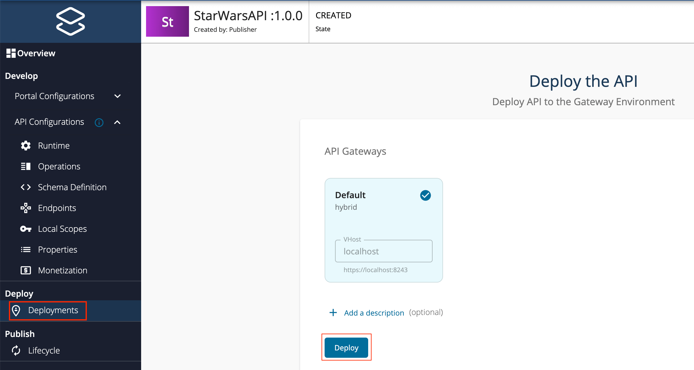
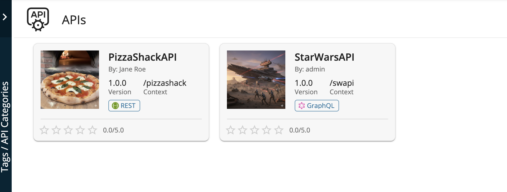
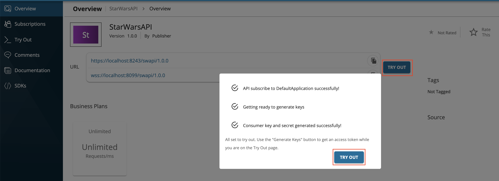
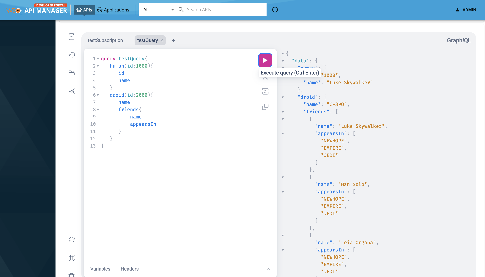
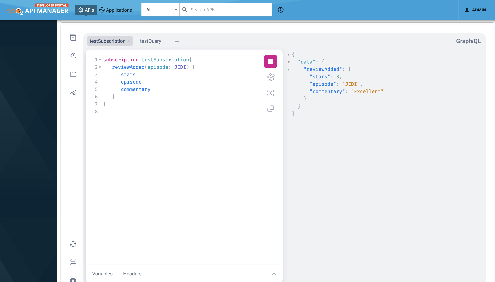

import CreateGraphqlApi from '../../../../partials/design/create-graphql-api.mdx';

Follow the instructions in this tutorial to design, publish, and invoke a GraphQL API.

:::note
For more information on GraphQL APIs, see [Create a GraphQL API](../../../guides/api-design-manage/design-apis/create-api/graphql-apis/create-a-graphql-api.mdx).
:::

<CreateGraphqlApi />

Now, you have created and configured the GraphQL API successfully.

### Step 3 - Deploy the GraphQL API {#step-3-deploy-the-graphql-api}

1. Navigate to **Deploy** and click **Deployments** to navigate to the Deploy the API page. 
2. Click **Deploy** to deploy the API to the API Gateway, which is the default Gateway.

       

       The Deployment page appears.

       

### Step 4 - Publish the GraphQL API {#step-4-publish-the-graphql-api}

1. Navigate to **Publish** and click **Lifecycle**. 

       The API lifecycle page appears.

2. Click **Publish** to publish the API to the API Developer Portal.

       

### Step 5 - Invoke the GraphQL API {#step-5-invoke-the-graphql-api}

1. Sign in to the **Developer Portal**.

       `https://<hostname>:9443/devportal` 

       Example: `https://localhost:9443/devportal`

       Let's use `admin` as the username and password to sign in.

       

2. Click on the GraphQL API.

      The API overview appears.

      

      :::info
      - Note that both the HTTP and the WebSocket URLs of the Gateway are displayed for the GraphQL API.
      - The HTTP Gateway URL is to invoke the query and mutation operations of the GraphQL API.
      - The WebSocket Gateway URL is to invoke the subscription operations of the GraphQL API.
      :::

3. Subscribe to the API.

    1. Click **TRY OUT**.

         

         This will create a subscription for the application named `DefaultApplication` and generate a consumer key and consumer secret pair for `DefaultApplication`. Click **TRY OUT** on the pop-up window to navigate to the Try Out Console.

4. Try out the operations.
       1. Click **GET TEST KEY**.

         

#### Step 5.1 - Optionally, try out a Query operation {#step-51-optionally-try-out-a-query-operation}

:::note
- If you are going to invoke QUERY Operation, you should start the payload with the keyword 'query'.
- If you are going to invoke MUTATION Operation, you should start the payload with the keyword 'mutation'.
:::

 1. Enter the following sample payload as the StarWarsAPI request. Then click on execute button as follows.

      ```text
      query testQuery{
         human(id:1000){
            id
            name
         }
         droid(id:2000){
            name
            friends{
                name
                appearsIn
            }
         }
      }
      ```

      

 2. Click **Execute**.

     

<Anchor id="5.2" />

#### Step 5.2 - Optionally, try out a Subscription operation {#step-52-optionally-try-out-a-subscription-operation}

:::note
If you are going to invoke SUBSCRIPTION operation, you should start the payload with the keyword \`subscription\`.
:::

1. Enter the following sample payload as the StarWarsAPI `reviewAdded` subscription request to get real-time updates about the addition of new reviews.

    ```text
    subscription testSubscription{
       reviewAdded(episode: JEDI) {
          stars
          episode

          commentary
       }
    }
    ```

2. Prepare to inspect the network calls from your browser developer tools.

    For example, if you are using the Google Chrome browser.

    1. Right-click on the browser and click **Inspect**.
    2. Click **Network** to view the network calls via the browser developer tools.

3. Click **Execute**. 

    If you inspect the network calls from your browser developer tools, you can see the messages passed between the GraphiQL client and the backend.

    

    As you can see, a successful WebSocket connection is established between the client and backend via WSO2 API Gateway.

4. While keeping the Developer Portal web browser page opened, separately open a terminal and directly invoke the backend API’s `createReview` mutation operation by executing the following command.

      ```text
      curl -X POST "http://localhost:8080/graphql" -H  "accept: application/json" -H  "Content-Type: application/json" -d '{"query":"mutation {createReview(episode: JEDI, review: { stars: 3, commentary: \"Excellent\"}) { stars   episode   commentary }}","variables":null}' -k
      ```

      When the mutation is successful, the GraphQL backend will send the following response:

      ```text
      {"data":{"createReview":{"stars":3,"episode":"JEDI","commentary":"Excellent"}}}
      ```

5. Now go back to the Developer Portal browser page.

    You can see that you have received the subscription event response that corresponds to the mutation operation you did in [Step 5.2 (4)](#5.2).

    

:::info[Troubleshooting]
If you **cannot invoke the API's WSS endpoint during handshake** (this causes the **SSLPeerUnverified exception**), it could be because the security certificate issued by the server is not trusted by your browser. 

This will result in the following error being printed in the backend.

```text
ERROR - InboundWebsocketSourceHandler Endpoint not found for port : 8099 tenant domain : null
```

To resolve this issue, access the corresponding HTTPS endpoint of the WSS endpoint directly from your browser and accept the security certificate. (e.g., `https://localhost:8099/swapi/1.0.0`) 

If the API Manager has a **certificate signed by a Certificate Authority (CA)**, the WSS endpoints should work out-of-the-box.
:::

You have successfully created and published your first GraphQL API, subscribed to it, obtained an access token for testing, and tested query and subscription operations of your API with the access token.
