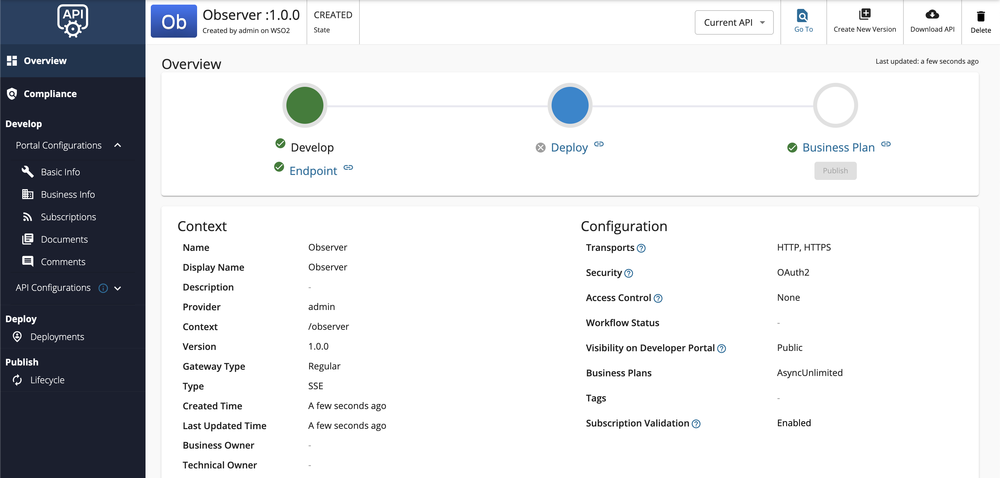
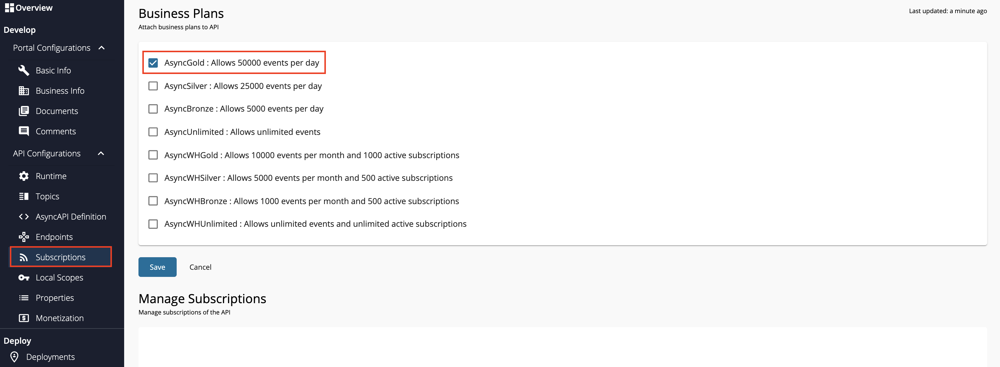

import SignInPublisher from '../../../../../partials/sign-in-publisher.mdx';
import SignInDevportal from '../../../../../partials/sign-in-devportal.mdx';

This tutorial will guide you to create a [SSE Streaming API](../../../../guides/api-design-manage/design-apis/create-api/create-streaming-api/create-a-sse-streaming-api.mdx) which is connected to a backend that observes your system's memory, and gives you the values in a continuous manner. Follow the instructions in this tutorial to design and publish an API with an SSE backend, and thereafter invoke it using a cURL command.

## Step 1 - Design a SSE API {#step-1-design-a-sse-api}

1.  <SignInPublisher />

2.  Click **CREATE API**, go to **Streaming API**, and click **SSE API**.

    

    :::note
    The **CREATE** button will only appear for a user who has the `creator` role permission.
    :::

3.  Enter the details of the new SSE API.

     | **Field** | **Sample value** |
     | --- | --- |
     | Name | Observer |
     | Context | /observer |
     | Version | 1.0.0 |
     | Protocol | SSE |
     | Endpoint | http://localhost:8080 |

4.  Click **CREATE**. 

     The overview page of the created SSE API appears.

     

5. Attach business plans to the SSE API.

      1. Click **Portal Configurations** and click **Subscriptions** to navigate to the Business Plans page.

      2. Select **AsyncGold** and click **Save**.

           

Now, you have created and configured the SSE API successfully.

## Step 2 - Publish the SSE API {#step-2-publish-the-sse-api}

1. Click **Lifecycle** to navigate to the API lifecycle page.

2. Click **Publish** to publish the API to the API Developer Portal.

2. Click **Deployments** to navigate to the Deployments page and click **Deploy New Revision**. 

3. Select **Production and Sandbox**, choose **localhost** as the VHost, and click on **Deploy**.

      [](../../../../../assets/img/tutorials/streaming-api/streaming-api-deploy-new-revision.png)

## Step 3 - Start the SSE Server {#step-3-start-the-sse-server}

1. Download the sample SSE server from [WSO2 APIM Samples - GitHub repository](https://github.com/wso2/samples-apim/raw/master/streaming-api-backends/sse/target/sse-server-1.0.0.jar).

2. Go to the directory where you downloaded the SSE server and run the following command.

     ```bash
     java -jar sse-server-1.0.0.jar --time=5000 --interval=1000
     ```

## Step 4 - Invoke the SSE API {#step-4-invoke-the-sse-api}

1. <SignInDevportal />

2. Click on the SSE API. 

      The API overview appears.

3. Subscribe to the API.

    1. Click **Subscriptions** to go to the Subscriptions page and click **SUBSCRIPTION & KEY GENERATION WIZARD**.

           This wizard takes you through the steps of creating a new application, subscribing, generating keys, and generating an access token to invoke the API. 

           :::note
           You can use any application (e.g., JWT or OAuth) to subscribe to the API.
           :::

         

    2. Copy the authorization token that appears, and click **FINISH**.

         

4. Try out the operations.

      Invoke the API with an authorization header by executing the following cURL command.

     ```bash
     curl http://localhost:8280/observer/1.0.0/memory -H "Authorization: Bearer [accesstoken]" 
     ```

      You will receive continuous stream of events showing your memory usage, from the server.

     ```text
     data:{"heap":67893392,"nonHeap":36260800,"ts":1614803952066,"identifier":"ram_222"}

     data:{"heap":72591160,"nonHeap":37250808,"ts":1614803953067,"identifier":"ram_223"}

     data:{"heap":72591160,"nonHeap":37251544,"ts":1614803954064,"identifier":"ram_224"}
     ```

You have successfully created and published your first SSE API, subscribed to it, obtained an access token for testing, and tested your API with an access token.
