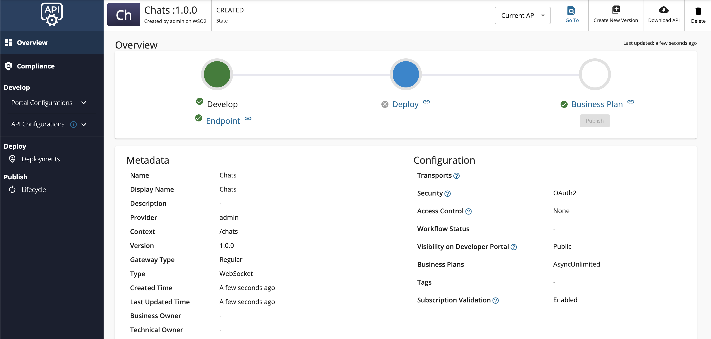
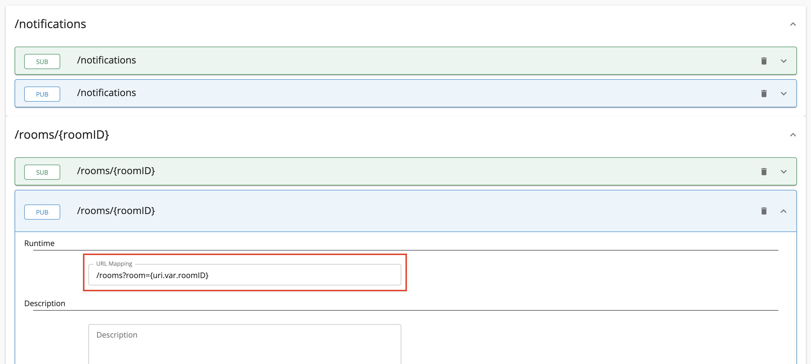
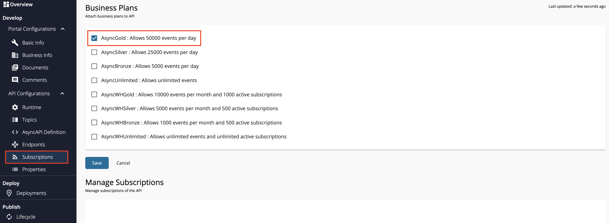
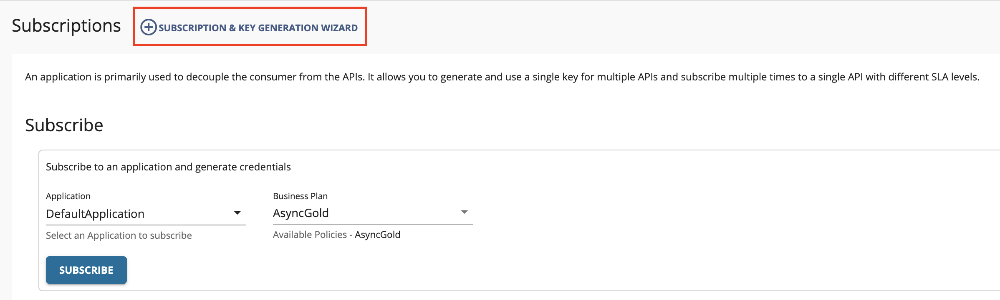
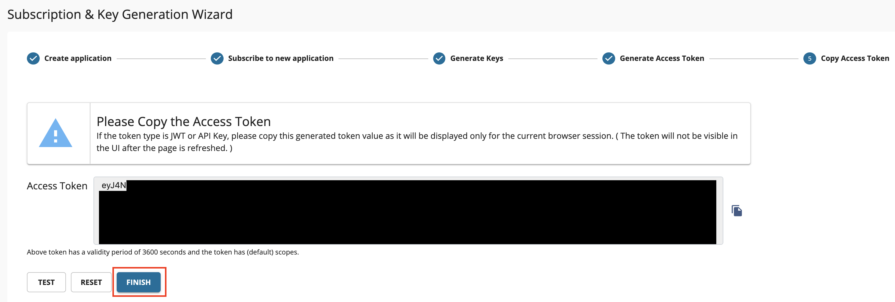

import SignInPublisher from '../../../../../partials/sign-in-publisher.mdx';
import SignInDevportal from '../../../../../partials/sign-in-devportal.mdx';
import Tabs from '@theme/Tabs';
import TabItem from '@theme/TabItem';

This tutorial will guide you to implement a WebSocket based chat application using the WSO2 API Manager.
Follow the instructions in this tutorial to design and publish API via a WebSocket backend, and thereafter 
invoke the [WebSocket API](../../../../guides/api-design-manage/design-apis/create-api/create-streaming-api/create-a-websocket-streaming-api.mdx) using the **wscat** WebSocket client.

This will demonstrate a simple command line based chat room which has two channels: **rooms**, and **notifications**.

:::note
When you create a WebSocket Streaming API it's exposed via both `ws` and `wss` protocols. By default, the `ws` transport uses port 9099, and the `wss` transport uses port 8099.
:::

### Step 1 - Design a WebSocket API {#step-1-design-a-websocket-api}

1.  <SignInPublisher />

2.  Click **Create API**, go to **Streaming API**, and click **WebSocket API**.

     :::note
     The **Create** button will only appear for a user who has the `creator` role permission.
     :::

    

3.  Enter the details of the new WebSocket API.

     | **Field** | **Sample value** |
     | --- | --- |
     | Name | Chats |
     | Context | /chats |
     | Version | 1.0.0 |
     | Protocol | WebSocket |
     | Endpoint | ws://localhost:8080 |

    :::note
    - When you create a WebSocket Streaming API it's exposed via both ws and wss protocols. By default, ws transport uses port 9099, and wss transport uses port 8099.
    - For non-secured WebSockets enter the protocol as `ws://` in the endpoint, or for secured WebSockets enter the protocol as `wss://`
    :::

4.  Click **CREATE**. 

     The overview page of the created WebSocket API appears.

     

5. Configure the runtime configurations.
    1. Click **Runtime** under the **API Configurations** section, select the required authentication type, and click **Save**.

       [](../../../../../assets/img/tutorials/streaming-api/websocket-api-runtime-configurations.png)

6. Add topics to the WebSocket API.

     1. Click **Topics** and navigate to the Topics page.

     2. Delete the existing default topic, which has the name `/*`.

     3. Add the following topics one by one. 

           Select **pub** and **sub** as the **Types**, enter the **Topic Name**, and click **+** to add each topic.

          - /notifications
          - `/rooms/{roomID}`

          

     4. Expand each topic, provide URL Mappings as follows, and click **Save**.

           | **Topic** | **URL Mapping** |
           | --- | --- |
           | /notifications | /notifications |
           | /rooms/\{roomID\} | /rooms?room=\{uri.var.roomID\} |

          URL Mapping provided for a topic will be appended to the WebSocket endpoint URL, which was provided when creating the API, and the traffic via the topic will be sent to & received from the resulting URL.

          

6. Attach business plans to your WebSocket API.

     1. Click **Portal Configurations** and click **Subscriptions** to navigate to the Business Plans page.

     2. Select **AsyncGold** and click on **Save**.

           

Now, you have created and configured the WebSocket API successfully.

### Step 2 - Publish the WebSocket API {#step-2-publish-the-websocket-api}

1. Click **Lifecycle** to navigate to the API lifecycle, and click **Publish** to publish the API to the API Developer Portal.

2. Click **Deployments** to navigate to the Deployments page and click **Deploy New Revision**. 

3. Select **Production and Sandbox**, choose **localhost** as the VHost, and click on **Deploy**.

      [](../../../../../assets/img/tutorials/streaming-api/streaming-api-deploy-new-revision.png)

### Step 3 - Start the WebSocket Server {#step-3-start-the-websocket-server}

1. Download the sample WebSocket server from [WSO2 APIM Samples - GitHub repository](https://github.com/wso2/samples-apim/tree/master/streaming-api-backends/websocket-backend).

2. Go to the `streaming-api-backends/websocket-backend` directory, and install the required dependencies.

     ```bash
     npm install
     ```

3. Start the server.

     ```bash
     npm start
     ```

### Step 4 - Invoke the WebSocket API {#step-4-invoke-the-websocket-api}

1. <SignInDevportal />

2. Click on the WebSocket API. 

      The API overview appears.

3. Subscribe to the API.

    1. Click **Subscriptions** to go to the Subscriptions page and click **Subscription & Key Generation Wizard**.

           This wizard takes you through the steps of creating a new application, subscribing, generating keys, and generating an access token to invoke the API. 

           :::note
           You can use any application (e.g., JWT or OAuth) to subscribe to the API.
           :::

         

    2. Copy the authorization token that appears, and click **Finish**.

         

4. Try out the operations.

      1.  Install **wscat** client. 

           ```bash
           npm install -g wscat
           ```

      2.  Invoke the API's `/notifications` topic using header by executing the following command.

        <Tabs groupId="tabs">
        <TabItem value="ws-oauth2" label="WS-OAuth2">

        ```bash
        wscat -c ws://localhost:9099/chats/1.0.0/notifications -H "Authorization: Bearer [accesstoken]" 
        ```

        </TabItem>
        <TabItem value="wss-oauth2" label="WSS-OAuth2">

        ```bash
        wscat -n -c wss://localhost:8099/chats/1.0.0/notifications -H "Authorization: Bearer [accesstoken]"
        ```

        </TabItem>
        <TabItem value="ws-api-key" label="WS-Api Key">

        ```bash
        wscat -c ws://localhost:9099/chats/1.0.0/notifications -H "apikey: [API_key_value]" 
        ```

        </TabItem>
        <TabItem value="wss-api-key" label="WSS-Api Key">

          ```bash
          wscat -n -c wss://localhost:8099/chats/1.0.0/notifications -H "apikey: [API_key_value]"
          ```

        When the connection is successful, the WebSocket server will send: 
         ```bash
         Subscribed to notifications!
         ```

        </TabItem>
        </Tabs>

      3.  In a separate terminal, invoke the API's `/rooms/{roomID}` topic using header by executing the following command.

        <Tabs groupId="tabs">
        <TabItem value="ws-oauth2" label="WS-OAuth2">

        ```bash
        wscat -c ws://localhost:9099/chats/1.0.0/rooms/room1 -H "Authorization: Bearer [accesstoken]" 
        ```

        </TabItem>
        <TabItem value="wss-oauth2" label="WSS-OAuth2">

        ```bash
        wscat -n -c wss://localhost:8099/chats/1.0.0/rooms/room1 -H "Authorization: Bearer [accesstoken]"
        ```

        </TabItem>
        <TabItem value="ws-api-key" label="WS-Api Key">

        ```bash
        wscat -c ws://localhost:9099/chats/1.0.0/rooms/room1 -H "apikey: [API_key_value]" 
        ```

        </TabItem>
        <TabItem value="wss-api-key" label="WSS-Api Key">

          ```bash
          wscat -n -c wss://localhost:8099/chats/1.0.0/rooms/room1 -H "apikey: [API_key_value]"
          ```

        When the connection is successful, the WebSocket server will send:
         ```bash
         You joined room1!
         ```
        This denotes that the first user has connected to `room1`.

        Additionally, the following message will be shown in the terminal where you invoked the `/notifications` topic. This denotes the notification for the above event.
         ```bash
         Someone joined room1!
         ```

        </TabItem>
        </Tabs>

      4.  In another terminal, invoke the API's `/rooms/{roomID}` topic again. This denotes the second user, who will be connecting to `room1`.

        <Tabs groupId="tabs">
        <TabItem value="ws-oauth2" label="WS-OAuth2">

        ```bash
        wscat -c ws://localhost:9099/chats/1.0.0/rooms/room1 -H "Authorization: Bearer [accesstoken]" 
        ```

        </TabItem>
        <TabItem value="wss-oauth2" label="WSS-OAuth2">

        ```bash
        wscat -n -c wss://localhost:8099/chats/1.0.0/rooms/room1 -H "Authorization: Bearer [accesstoken]"
        ```

        </TabItem>
        <TabItem value="ws-api-key" label="WS-Api Key">

        ```bash
        wscat -c ws://localhost:9099/chats/1.0.0/rooms/room1 -H "apikey: [API_key_value]" 
        ```

        </TabItem>
        <TabItem value="wss-api-key" label="WSS-Api Key">

          ```bash
          wscat -n -c wss://localhost:8099/chats/1.0.0/rooms/room1 -H "apikey: [API_key_value]"
          ```

        You will receive the message: `You joined room1!` in this terminal, along with the corresponding notification in the `notifications` terminal.

        As there are two users connected to `room1`, both of them can send and receive chats via `room1`. Try sending messages from both of these terminals back and forth.

        :::note
        There are clients (especially browsers) that do not allow you to add headers to the WebSocket handshake. In such cases, you can send the access token or API Key for the WebSocket API invocation as a query parameter by using the commands below:
        :::

        </TabItem>
        <TabItem value="ws-oauth2-2" label="WS-OAuth2">

        ```bash
        wscat -c "ws://localhost:9099/chats/1.0.0/notifications?access_token=[accesstoken]" 
        ```

        </TabItem>
        <TabItem value="wss-oauth2-2" label="WSS-OAuth2">

        ```bash
        wscat -n -c "wss://localhost:8099/chats/1.0.0/notifications?access_token=[accesstoken]"
        ```

        </TabItem>
        <TabItem value="ws-api-key-2" label="WS-Api Key">

        ```bash
        wscat -c "ws://localhost:9099/chats/1.0.0/notifications?apikey=[API_key_value]" 
        ```

        </TabItem>
        <TabItem value="wss-api-key-2" label="WSS-Api Key">

          ```bash
          wscat -n -c "wss://localhost:8099/chats/1.0.0/notifications?apikey=[API_key_value]"
          ```

        :::note
        \`BasicAuth\` do not work for the security of WebSocket APIs.
        :::

        </TabItem>
        </Tabs>

You have successfully created and published your first WebSocket API, subscribed to it, obtained an access token for testing, and tested your API with the access token.

### Troubleshooting

If you require more detailed logs in the WebSocket API flow in order to troubleshoot and debug an error in your scenario, see [Troubleshooting WebSocket APIs](../../../../reference/troubleshooting/troubleshooting-websocket-api.mdx).