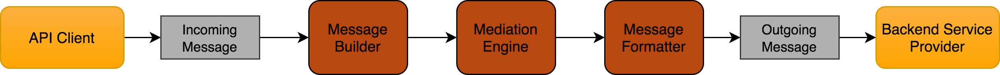

import Tabs from '@theme/Tabs';
import TabItem from '@theme/TabItem';

When a message comes into WSO2 API Manager Gateway, the receiving transport selects a message builder based on the message's content type. It uses that builder to process the message's raw payload data and convert it into SOAP. Conversely, when sending a message out from API Gateway, a message formatter is used to build the outgoing stream from the message. As with message builders, the message formatter is selected based on the message's content type. Given below is the typical workflow:

  

## Default message builders and formatters
Listed below are the message formatters that are enabled for WSO2 API Manager by default:

### Default message builders

| **Content Type** | **Message builder class** |
| --- | --- |
| application/xml | org.apache.axis2.builder.ApplicationXMLBuilder |
| application/x-www-form-urlencoded | org.apache.synapse.commons.builders.XFormURLEncodedBuilder |
| multipart/form-data | org.apache.axis2.builder.MultipartFormDataBuilder |
| application/json | org.apache.synapse.commons.json.JsonStreamBuilder |
| application/json/badgerfish | org.apache.axis2.json.JSONBadgerfishOMBuilder |
| text/javascript | org.apache.axis2.json.JSONBuilder |
| text/html | org.wso2.carbon.relay.BinaryRelayBuilder |
| text/plain | org.apache.axis2.format.PlainTextBuilder |
| application/octet-stream | org.wso2.carbon.relay.BinaryRelayBuilder |

### Default message formatters

| **Content Type** | **Message formatter class** |
| --- | --- |
| application/x-www-form-urlencoded | org.apache.axis2.transport.http.XFormURLEncodedFormatter |
| multipart/form-data | org.apache.axis2.transport.http.MultipartFormDataFormatter |
| application/xml | org.apache.axis2.transport.http.ApplicationXMLFormatter |
| text/xml | org.apache.axis2.transport.http.SOAPMessageFormatter |
| application/soap+xml | org.apache.axis2.transport.http.SOAPMessageFormatter |
| application/json | org.apache.synapse.commons.json.JsonStreamFormatter |
| application/json/badgerfish | org.apache.axis2.json.JSONBadgerfishMessageFormatter |
| text/javascript | org.apache.axis2.json.JSONMessageFormatter |
| text/html | org.apache.axis2.transport.http.ApplicationXMLFormatter |
| application/octet-stream | org.wso2.carbon.relay.ExpandingMessageFormatter |

## Configuring default message builders and formatters

The default message builder or message formatter for a given content type can be changed or configured as follows.

1. Open the `<API-M_HOME>/repository/conf/deployment.toml` file.

2. You can specify a message builder or message formatter class for a given default content type by adding the following configuration.

    <Tabs groupId="tabs">
    <TabItem value="format" label="Format">

    ```toml
    [message_builder]
    <content_type>="<message_builder_class>"

    [message_formatter]
    <content_type>="<message_formatter_class>"    
    ```

    </TabItem>
    <TabItem value="example" label="Example">

    ```toml
    [message_builder]
    application_xml = "org.apache.axis2.builder.ApplicationXMLBuilder"
    form_urlencoded = "org.apache.synapse.commons.builders.XFormURLEncodedBuilder"
    multipart_form_data = "org.apache.axis2.builder.MultipartFormDataBuilder"
    text_plain = "org.apache.axis2.format.PlainTextBuilder"
    application_json = "org.wso2.micro.integrator.core.json.JsonStreamBuilder"
    json_badgerfish = "org.apache.axis2.json.JSONBadgerfishOMBuilder"
    text_javascript = "org.apache.axis2.json.JSONBuilder"
    octet_stream = "org.wso2.carbon.relay.BinaryRelayBuilder"
    application_binary = "org.apache.axis2.format.BinaryBuilder"

    [message_formatter]
    form_urlencoded = "org.apache.synapse.commons.formatters.XFormURLEncodedFormatter"
    multipart_form_data = "org.apache.axis2.transport.http.MultipartFormDataFormatter"
    application_xml = "org.apache.axis2.transport.http.ApplicationXMLFormatter"
    text_xml = "org.apache.axis2.transport.http.SOAPMessageFormatter"
    soap_xml = "org.apache.axis2.transport.http.SOAPMessageFormatter"
    text_plain = "org.apache.axis2.format.PlainTextFormatter"
    application_json = "org.wso2.micro.integrator.core.json.JsonStreamFormatter"
    json_badgerfish = "org.apache.axis2.json.JSONBadgerfishMessageFormatter"
    text_javascript = "org.apache.axis2.json.JSONMessageFormatter"
    octet_stream = "org.wso2.carbon.relay.ExpandingMessageFormatter"
    application_binary = "org.apache.axis2.format.BinaryFormatter"
    ```

    </TabItem>
    </Tabs>

3. Save the changes and [restart the server](../../../../../deploy-and-operate/install-and-setup/install/installing-the-product/running-the-api-m.mdx) to get the changes applied.

## Custom message builders and formatters

In addition to default message formatters and builders, you can implement your own custom message builder or a formatter for a given content type as described in [Writing a custom Message Builder and Formatter](https://ei.docs.wso2.com/en/latest/micro-integrator/setup/message_builders_formatters/message-builders-and-formatters/#writing-a-custom-message-builder-and-formatter).

To enable the custom message builder or formatter, add the following configuration in the `<API-M_HOME>/repository/conf/deployment.toml` file, specifying the message builder/formatter class names against the content type.

<Tabs groupId="tabs">
<TabItem value="format" label="Format">

```toml
[[custom_message_builders]]
content_type = "<content_type>"
class="<message_builder_class>"

[[custom_message_formatters]]
content_type = "<content_type>"
class="<message_formatter_class>"
```

</TabItem>
<TabItem value="example" label="Example">

```toml
[[custom_message_builders]]
content_type = "text/xml"
class="org.test.builder.http.CustomMessageBuilderForTextXml"

[[custom_message_formatters]]
content_type = "text/xml"
class="org.test.builder.http.CustomMessageFormatterForTextXml"
```

</TabItem>
</Tabs>
