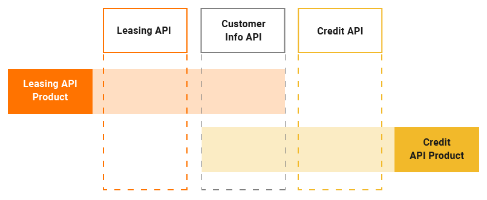

An API Product is a packaging mechanism that you can use when you need to bundle a preferred set of resources from multiple APIs and expose it as a separate API interface, which can be consumed by subscribers. API Products give Publishers the ability to repackage their existing APIs in various combinations to provide a tailor-made experience for their subscribers.

WSO2 API Manager allows Publishers to create API Products via the Publisher Portal. Subscribers will see the API Product via the Developer Portal as a separate entity, which is independent of the APIs with which it shares its resources. From a subscriber's perspective, the API Product will look and function in the same way as any of the standard APIs on the Developer Portal.

:::note
You can only use REST type APIs to create Product APIs.
:::

## How it works

Let's use the following  example to understand how API Products work in WSO2 API Manager.

**Example**

   

A financial institution has the following three APIs.

- **Customer Info API**

    This API is used to access and update the financial information of the customers. The API consists of the following resources.
      | Resources | Description |
      | --- | --- |
      | **GET /customers** | Get the list of all the existing customers. |
      | **GET /customers/\{customerId\}** | Get details of a specific customer based on the customer ID. |
      | **POST /customers** | Add a new customer. |
      | **PUT /customers/\{customerId\}** | Update details of a specific customer based on his/her customer ID. |
      | **DELETE /customers/\{customerId\}** | Delete a specific customer based on his/her customer ID. |

- **Leasing API**

    Used to access and update the information regarding the leases of the institution. The API consists of the following 
    resources.

    | Resources | Description |
    | --- | --- |
    | **GET /assets** | Get the list of all existing assets that can be leased. |
    | **GET /assets/\{assetId\}** | Get details of a specific asset based on an asset ID. |
    | **POST /assets** | Add a new asset. |
    | **PUT /assets/\{assetId\}** | Update a specific asset based on an asset ID. |
    | **DELETE /assets/\{assetId\}** | Delete a specific asset based on an asset ID. |

- **Credit API**

    Used to access and update the credit information with regard to a specific customer. The API consists of the following resources.      

     | Resources | Description |
     | --- | --- |
     | **GET /accounts/\{customerId\}** | Get the list of credit accounts for a customer based on his/her customer ID. |
     | **GET /accounts/\{accountId\}** | Get details of a specific credit account based on an account ID. |
     | **POST /accounts/\{customerId\}** | Add a new credit account for a customer based on a customer ID. |
     | **PUT /accounts/\{accountId\}** | Update a specific credit account based on an account ID. |
     | **DELETE /accounts/\{accountId\}** | Delete a specific credit account based on an account ID. |

The resources of the above mentioned existing APIs can be reused and exposed via API Products as shown below.

- **Leasing API Product**

    <table>
      <thead>
        <tr>
          <th>Resources</th>
          <th>Description</th>
          <th>API</th>
        </tr>
      </thead>
      <tbody>
        <tr>
          <td>**GET /customers**</td>
          <td>Get the list of all the existing customers.</td>
          <td rowSpan="2" style={{verticalAlign: "middle"}}>Customer Info API</td>
        </tr>
        <tr>
          <td>**GET /customers/\{customerId\}**</td>
          <td>Get details of a specific customer based on the customer ID.</td>
        </tr>
        <tr>
          <td>**GET /assets**</td>
          <td>Get the list of all the existing assets that can be leased.</td>
          <td rowSpan="2" style={{verticalAlign: "middle"}}>Leasing API</td>
        </tr>
        <tr>
          <td>**GET /assets/\{assetId\}**</td>
          <td>Get details of a specific asset based on the asset ID.</td>
        </tr>
      </tbody>
    </table>

- **Credit API Product**

    <table>
      <thead>
        <tr>
          <th>Resources</th>
          <th>Description</th>
          <th>API</th>
        </tr>
      </thead>
      <tbody>
        <tr>
          <td>**GET /customers**</td>
          <td>Get the list of all the existing customers.</td>
          <td rowSpan="2" style={{verticalAlign: "middle"}}>Customer Info API</td>
        </tr>
        <tr>
          <td>**GET /customers/\{customerId\}**</td>
          <td>Get details of a specific customer based on the customer ID.</td>
        </tr>
        <tr>
          <td>**GET /accounts/\{accountId\}**</td>
          <td>Get details of a specific credit account based on the account ID.</td>
          <td rowSpan="2" style={{verticalAlign: "middle"}}>Credit API</td>
        </tr>
        <tr>
          <td>**POST /accounts/\{customerId\}**</td>
          <td>Add a new credit account for a customer based on a customer ID.</td>
        </tr>
      </tbody>
    </table>

In this example, a subset of the resources from different APIs have been combined to provide a customized hybrid offering that can appeal to different subscribers. This also ensures that only specific resources are exposed via the API Product.

## More information

Whenever a specific resource of an API is added to an API Product in WSO2 API Manager, the following attributes of the API resource are reused:

- OAuth scope
- Authentication scheme
- Throttling policy

 :::info
 An API Product will share the resource(s) of an existing API.
 :::

When creating an API Product via the Publisher Portal, the Publisher can define a separate set of subscription-level throttling policies that are different from the subscription-level throttling policies that exist at the API-level.

An API Product will share the resource(s) of an existing API. As a result, the same backend endpoint that is defined by the respective resource's API is reused by the API Product. As the API Product may contain resources from multiple APIs, an API Product may route to multiple backend endpoints.

 :::note
 API Products cannot define their own backend endpoints, apart from reusing the existing endpoints belonging to its API resources respective parent API.
 :::

After an API Product is created, it can be deployed to the selected API Gateway as an independent Synapse API artifact, to test it before making it available for consumers. The API Product provider can publish the API Product once the testing is complete.
