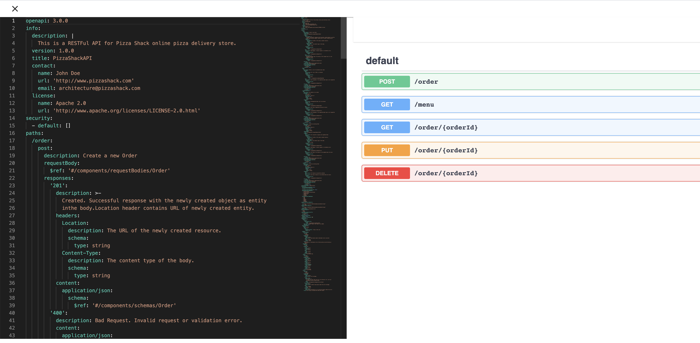
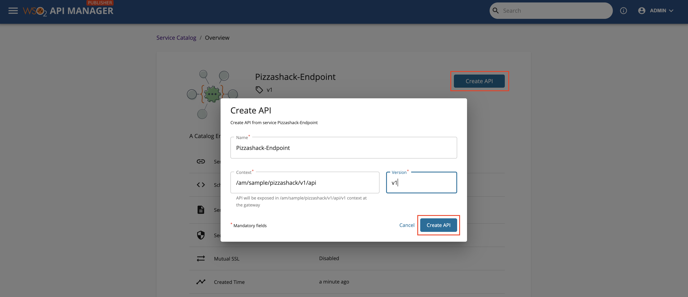
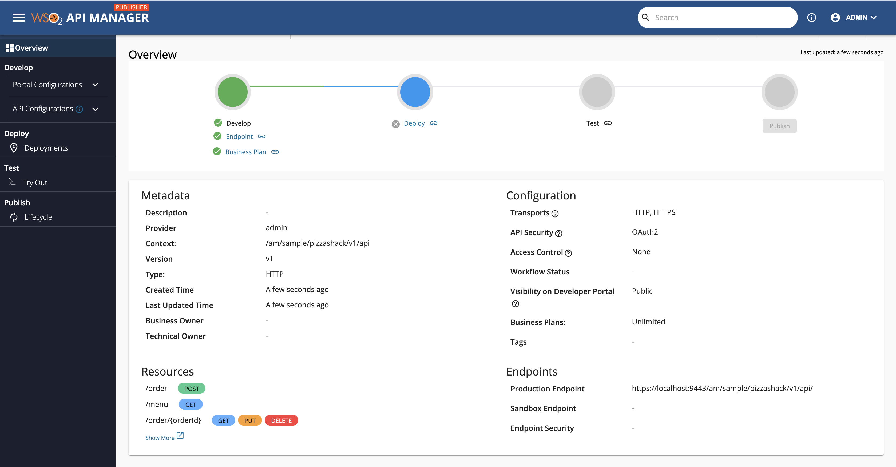

import SignInPublisher from '../../../../../partials/sign-in-publisher.mdx';

The service catalog in WSO2 API Manager contains services that correspond to either the Micro Integrator or the Streaming Integrator. The Micro Integrator services correspond to the REST API backend services, and the Streaming Integrator services correspond to the Streaming API (i.e., WebSocket, WebHook/WebSub or SSE) backend services that are managed by the respective integration layer (Micro Integrator or Streaming Integrator).

Therefore, you can use the respective services to either create REST APIs or Streaming APIs to expose integration services or streaming integration services as managed APIs.

## Step 1 - Create and publish your service to the service catalog {#step-1-create-and-publish-your-service-to-the-service-catalog}

Create and publish your integration service or streaming integration service to the **Service Catalog** of the WSO2 API-M layer via the integration layer.

More information:

- For information on creating and publishing a REST API based on an integration service, see [Exposing an Integration Service as a Managed API](../../../api-developer-portal/integrate/develop/working-with-service-catalog.mdx).

- For information on creating and publishing a Streaming API based on a streaming integration service, see [Exposing a Stream as a Managed API](../../../api-developer-portal/use-cases/streaming-usecase/exposing-stream-as-managed-api-in-service-catalog.mdx).

## Step 2 - Discover the services {#step-2-discover-the-services}

Follow the instructions below to discover the integration services:

1.  <SignInPublisher />

2.  Click **Services**.

      

      The available integration services appear.

      

## Step 3 - Optionally, view the details of the service {#step-3-optionally-view-the-details-of-the-service}

1. Click on the service that is in the service catalog to view the service details. 

     You can view the service name, version, description, usages in APIs, and other important metadata.

     

2. Optionally, **download a service definition**.

     If required, click **Download** to download the service definition.

3. Optionally, **view the service definition**.

     If you want to see the service definition before creating an API, click **View Definition**.

     

## Step 4 - Create an API from the service {#step-4-create-an-api-from-the-service}

1.  Click on the service that is in the service catalog.

2.  Click **Create API**.

     This opens the **Create API** dialog box with the API details that are generated based on the service.

    

3.  Update the API name, context, and version if required, and click **Create API**. 

    The overview page of the API that you just created appears. 

    

4.  Update the portal configurations and API configurations as required.

     Now, you have successfully created an API using a service.

After you complete configuring the API, [Publish the API](../../deploy-and-publish/publish-on-dev-portal/publish-an-api.mdx).

## See Also

Learn more on the concepts that you need to know when creating an API:

 - [Endpoints](../endpoints/endpoint-types.mdx)
 -   [API Security](../api-security/api-authentication/secure-apis-using-oauth2-tokens.mdx)
 -   Rate Limiting:
     -   [Rate Limiting for REST APIs](../rate-limiting/introducing-throttling-use-cases.mdx)
     -   [Rate Limiting for Streaming APIs](../rate-limiting/rate-limiting-for-streaming-apis.mdx)
 -   [Life Cycle Management](../lifecycle-management/api-lifecycle.mdx)
 -   [API Monetization](../api-monetization/monetizing-an-api.mdx)
 -   [API Visibility](../advanced-topics/control-api-visibility-and-subscription-availability-in-developer-portal.mdx)
 -   [API Documentation](../api-documentation/add-api-documentation.mdx)
 -   [Custom Properties](../adding-custom-properties-to-apis.mdx)
