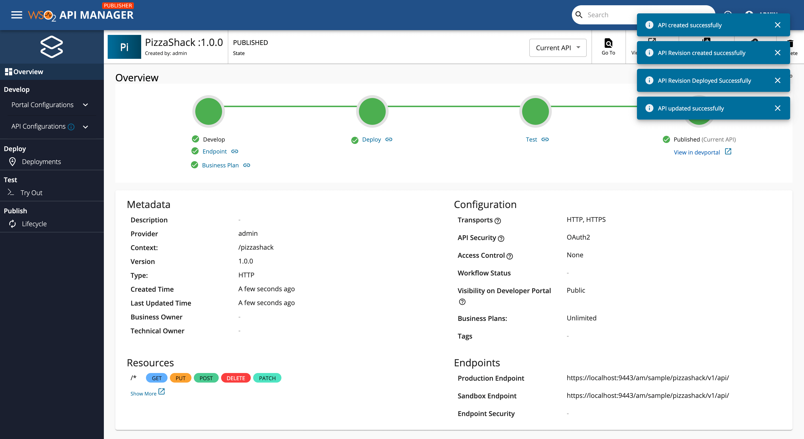
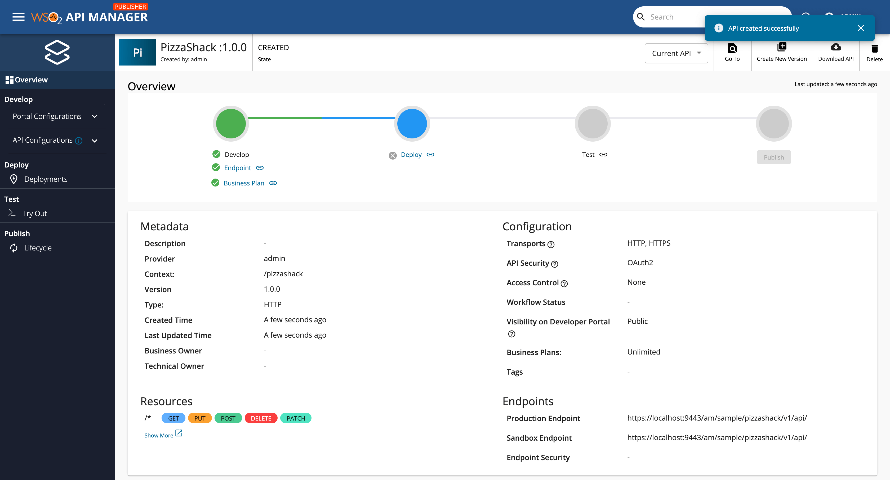
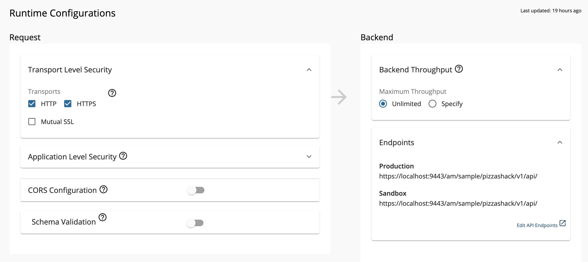
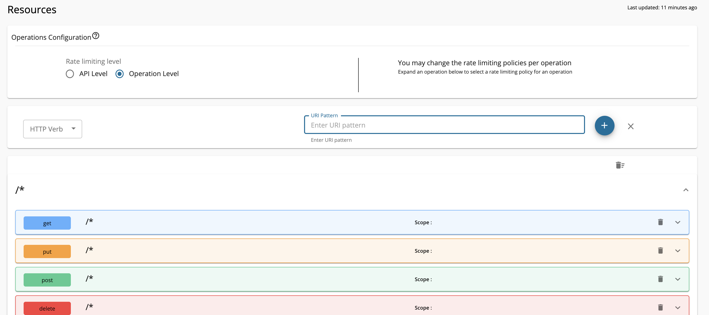
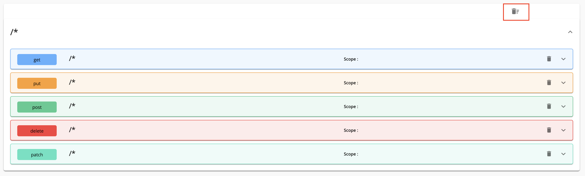
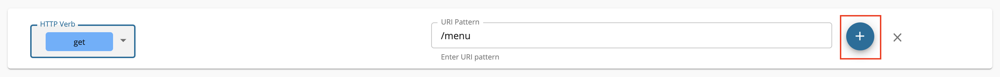
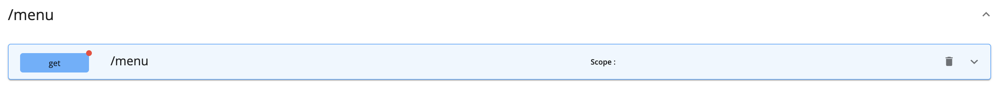
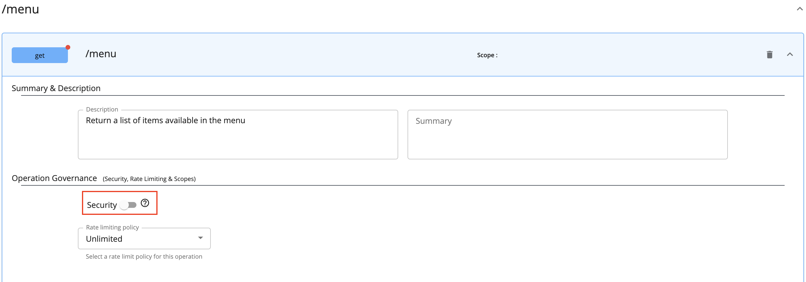
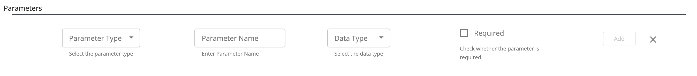
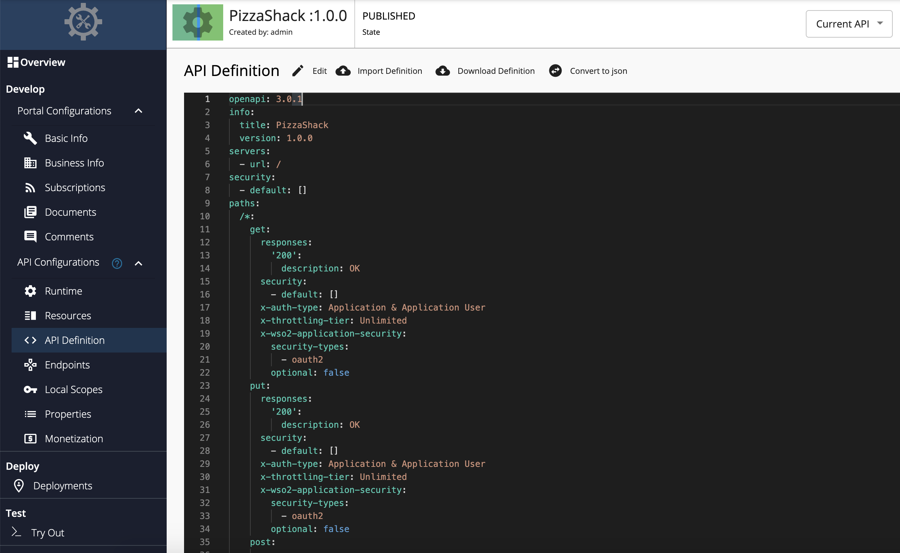

**API creation** is the process of linking an existing backend API implementation to the [API Publisher](../../../../../get-started/apim-architecture.mdx#api-publisher), so that you can manage and monitor the [API's lifecycle](../../lifecycle-management/api-lifecycle.mdx), documentation, security, community, and subscriptions. Alternatively, you can provide the API implementation in-line in the [API Publisher](../../../../../get-started/apim-architecture.mdx#api-publisher) itself.

Follow the instructions below to create a REST API using the basic flow:

1. Sign in to the WSO2 API Publisher.

    `https://<hostname>:9443/publisher` 

    Example: `https://localhost:9443/publisher`

    :::note
    The **Create API** button will only appear for a user who has the `creator` role permission.
    :::

2. Select **REST API** from the options available.

    

3.  Click **Start from Scratch**.

    

4.  Enter API details. 

     <table>
       <colgroup>
         <col />
         <col />
         <col />
       </colgroup>
       <tbody>
         <tr>
           <th colSpan="2">Field</th>
           <th>Sample value</th>
         </tr>
         <tr>
           <td colSpan="2">Name</td>
           <td>PizzaShack</td>
         </tr>
         <tr>
           <td colSpan="2">Version</td>
           <td colSpan="1">1.0.0</td>
         </tr>
         <tr>
           <td colSpan="2">Context</td>
           <td>

             `/pizzashack`

             The API context is used by the Gateway to identify the API. Therefore, the API context must be unique. This context is the API's root context when invoking the API through the Gateway.

             You can define the API's version as a parameter of its context by adding the `{version}` into the context. For example, `{version}/pizzashack`. The API Manager assigns the actual version of the API to the `{version}` parameter internally. For example, `https://localhost:8243/1.0.0/pizzashack`. Note that the version appears before the context, allowing you to group your APIs based on the versions.

           </td>
         </tr>
         <tr>
           <td colSpan="2">Endpoint</td>
           <td colSpan="1">

             [https://localhost:9443/am/sample/pizzashack/v1/api/](http://ws.cdyne.com/phoneverify/phoneverify.asmx)

             The endpoint that you add is automatically added as the production and sandbox endpoints.

           </td>
         </tr>
       </tbody>
     </table>

     :::note
     The **Create & Publish** option will only appear when a user who has `publisher` permission adds the details for the **Endpoint** which is an optional field.
     :::

      

5.  Click **Create** to create the API.

    

    
If you click Create & Publish

    If you click **Create & Publish**, WSO2 API Manager will automatically create a revision for the API, deploy the revision on the Gateway, and also publish your API to the Developer Portal.
    

    

    The overview page of the newly created API appears. 

    

6. Go to **Develop**, **Portal Configurations**, and click **Basic Info**.

     

     1. Configure the API design configurations.

        

         :::note
         By default, \*\*All\*\* users who have \`creator\` permission are allowed \*\*[Publisher Access Control](../../advanced-topics/enable-publisher-access-control-in-api-publisher-portal.mdx)\*\* and public \*\*[Developer Portal visibility](../../advanced-topics/control-api-visibility-and-subscription-availability-in-developer-portal.mdx)\*\*.
         :::

     2. Add a tag and press enter.

         Let's add a tag named **pizza**.

         :::info
         Tags can be used to filter out APIs matching specific search criteria. It is a good practice to add tags that explain the functionality and purpose of the API so that subscribers can search for APIs based on the tags.
         :::

     3. Optionally, select **Yes** for the **Make this the Default Version** option.

        

        
What happens when an API is the default version?

        -  The **API will be available in the Gateway without a version specified** in the Production and Sandbox URLs.
        -  If required, **you can create a new version of an API and set it as the default version**.              
            - This allows the same resources to be invoked in the client applications without changing the API Gateway URL.
            - This allows users to seamlessly switch to the new API version without doing any changes to the invocation URL.
        -  If required, **you can create new versions of an API with changes, while keeping the previous version as the default API**.
            - This allows the existing client applications to be invoked without the client having to change the URLs. 
            - This allows existing users to still use the old API because that is the default version.
            - Users need to explicitly call the respective version that corresponds to the new API to be able to invoke it. 
            - This provides the ability to run the new API in parallel to the old API; while, also allowing some new users to try out the new API.

        

     4. Click **Save**.

7. Configure the runtime configurations.

    1. Click **Runtime**, which is under the **API Configurations** section.

         Transport Level Security defines the transport protocol on which the API is exposed.  

         

    2. If you wish to limit the API availability to only one transport (e.g., HTTPS), deselect the **Transport Level Security** checkbox.

         Both HTTP and HTTPS transports are selected by default.

8. Configure the resources.

     By default, the API will have five resources with `/*` as the URL pattern.

     1. Click **Resources**, which is under the **API Configurations** section.

        

     2. Modify the resources as follows and click **Save** to update the resources.

          1. Click delete, as shown below, to remove all the existing resources.

              

          2. Select an appropriate **HTTP Verb** from the dropdown and click **(+)** to add a new resource.

             

             The newly added resource is displayed as follows.

             

          3. Expand the created **GET** operation to add details for the **Summary and Description** and **Operation governance** sections.

             1. Add a summary and description for the resource.
             2. Update the Security settings as required.
                - Turn the security setting **off** if you want to **make a certain operation of the API non-secured** and accessible without passing an access token.
                - To make the **whole API non-secured** and fully accessible without an access token, turn  the security setting **off** in **all the operations** of the API.

                

             3. Add resource parameters if required using the **Parameters** section.

                

                You can define the following parameter types based on the resource parameters that you add.

                | **Parameter Type**                          | **Description**                                                                                                                                                                                     |
                |-----------------------------------------|-------------------------------------------------------------------------------------------------------------------------------------------------------------------------------------------------|
                | `query`| Contains the fields added as part of the invocation URL, which contains the data to be used to call the backend service.                                                                             |
                | `header`| Contains the case-sensitive names followed by a colon (:) and then by its value that carries additional information with the request, which defines the operating parameters of the transaction. |
                | `cookie` | Operations can also pass parameters in the Cookie header, as `Cookie: name=value`. Multiple cookie parameters are sent in the same header, separated by a semicolon and space.                                                                                            |
                | `body`| An arbitrary amount of data of any type is sent with a POST message.                                                                                                                                |

9.  Optionally, view the API definition.

     Click **API Definition**. 

     The OpenAPI Specification (a.k.a Swagger definition) for the PizzaShack API appears.

     

Observe Linter results

You can observe results for the Linter rules you create by doing the following.

1. Navigate to the APIM Publisher Portal.

2. Log in using your credentials.

3. On the sidebar, navigate to **Develop > API Configuration > API Definition**.

4. Click on **Edit** from the toolbar.
     
    

5. Switch to the Linter view by clicking on the LINTER button on the top.

6. You will see the Linter error corresponding to the new rule you enforced.
    

Now, you have successfully created and configured a REST API. Next, [deploy the API](../../../deploy-and-publish/deploy-on-gateway/deploy-api/deploy-an-api.mdx), [test the API](./test-a-rest-api.mdx), and finally [publish the API](../../../deploy-and-publish/publish-on-dev-portal/publish-an-api.mdx).

## See Also

Learn more on the concepts that you need to know when creating a REST API:

-   [Endpoints](../../endpoints/endpoint-types.mdx)
-   [API Security](../../api-security/api-authentication/secure-apis-using-oauth2-tokens.mdx)
-   [Rate Limiting](../../rate-limiting/introducing-throttling-use-cases.mdx)
-   [Life Cycle Management](../../lifecycle-management/api-lifecycle.mdx)
-   [API Monetization](../../api-monetization/monetizing-an-api.mdx)
-   [API Visibility](../../advanced-topics/control-api-visibility-and-subscription-availability-in-developer-portal.mdx)
-   [API Documentation](../../api-documentation/add-api-documentation.mdx)
-   [Custom Properties](../../adding-custom-properties-to-apis.mdx)
