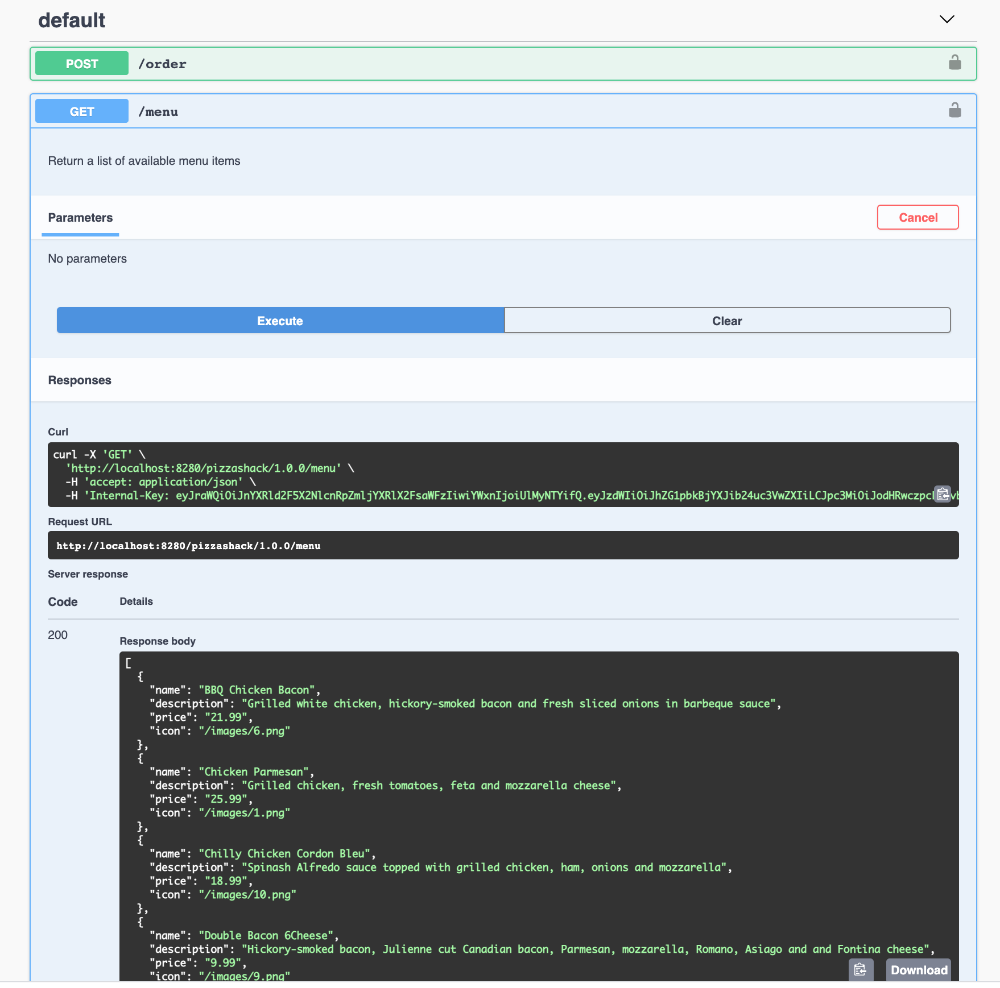

import SignInPublisher from '../../../../../../partials/sign-in-publisher.mdx';

Testing APIs refers to the process of trying out the APIs in the Publisher itself to make sure that the APIs meet the required functionalities and behavior.

WSO2 API Manager's Publisher offers an integrated API Console that allows API creators and API publishers to visualize the API contract and interact with API's resources.

Follow the instructions below to use the Publisher test console to test an API:

:::note
Create the `PizzaShack` REST API or an API of your choice before following the instructions below. For more information, see [Create a REST API.](./create-a-rest-api.mdx).
:::

1.  <SignInPublisher />

     The list of APIs that are available in the Publisher appears.

2. Click on the API that you wish to test.

     Let's use the sample `PizzaShack` REST API.

3.  Go to **Test** and click **Try Out**.

     :::note

     :::

     

4.  You can generate the internal key by clicking on the **Generate Key** button to invoke and test the PizzaShack API.

       :::note

       :::
      

5.  Expand the **GET**  method, click **Try it out**, and click **Execute**.

    Note the successful response for the API invocation.

    
