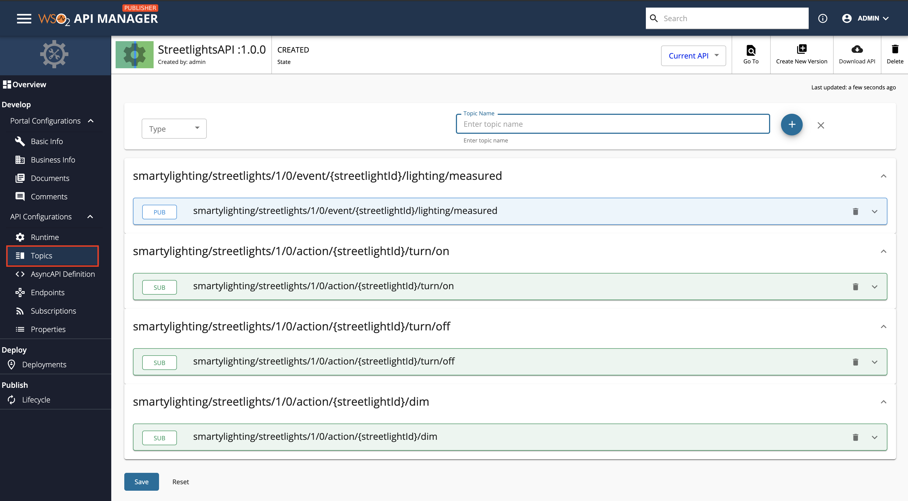
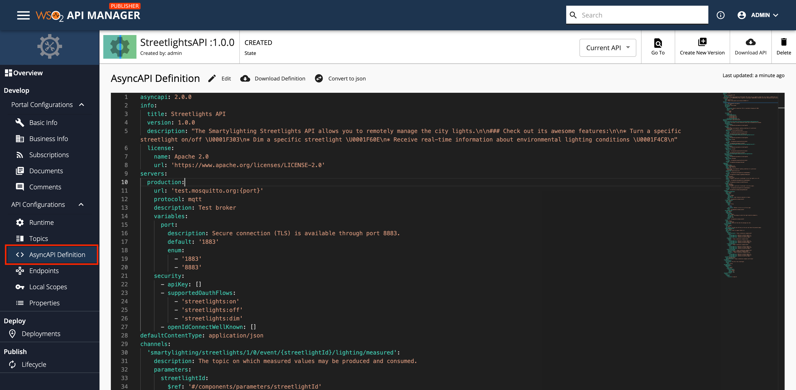

import SignInPublisher from '../../../../../../partials/sign-in-publisher.mdx';
import StreamMoreLinks from '../../../../../../partials/design/stream-more-links.mdx';

[AsyncAPI specification](https://www.asyncapi.com/) is a format that describes streaming APIs. An API Creator can import an existing AsyncAPI definition to WSO2 API Manager to create a streaming API using any one of the following protocols.

- [WebSocket](./create-a-websocket-streaming-api.mdx#overview)
- [WebSub (WebHooks)](./create-a-websub-streaming-api.mdx#overview)
- [Server Sent Events (SSE)](./create-a-sse-streaming-api.mdx#overview)

The API Creator can import the existing AsyncAPI definition by either uploading a file or by providing an Async API URL.

Follow the instructions below to create a Streaming API using an AsyncAPI definition for an existing API:

## Step 1 - Design a Streaming API {#step-1-design-a-streaming-api}

1. <SignInPublisher />

2. Click **CREATE API** and then click **Import AsyncAPI Definition**.

    :::note
    The **CREATE API** button will only appear if the user who has signed in has the creator role permission.
    :::

    

    The following two options to import the AsynAPI definition appears.

    * **AsyncAPI URL** - If you select this option, you need to provide a URL.
    * **AsyncAPI File** - If you select this option, click **Browse File to Upload** and upload a file, which contains an AsyncAPI definition.

3. Select the way in which you are going to import the AsynAPI definition, and click **Next**. 

      For this example, let's select **AsyncAPI URL**, provide the following URL, and click **Next**.

     ```bash
     https://raw.githubusercontent.com/asyncapi/spec/v2.0.0/examples/2.0.0/streetlights.yml
     ```

     [](../../../../../../assets/img/design/create-api/streaming-api/websocket-streaming-api-from-asyncapi-url-import.png)

4.  Edit the Streaming API information and click **Create**.

     :::note
     The AsynAPI definition of the Streaming API will contain the basic API definition, and **will not specify the protocol**, such as WebSocket, WebSub, WebHook, SSE, that the API has to use. You need to provide the Streaming API information here.
     :::

      For this example, let's design a WebSocket API using the following information.

      | **Field**   | **Sample value** |
      |-------------|------------------|
      | Name | StreetlightsAPI |
      | Context | /streetlights |
      | Version | 1.0.0 |
      | Protocol | WebSocket (or any other type of Streaming API) |
      | Endpoint | ws://localhost:8080 |

      [](../../../../../../assets/img/design/create-api/streaming-api/websocket-streaming-api-from-asyncapi-configure-values.png)

      Now, the **StreetlightsAPI API** overview page will appear.

     

## Step 2 - Configure Topics {#step-2-configure-topics}

Click **Topics** to navigate to the topics page.



You will notice that the topics have been created automatically from the AsyncAPI definition specified in the provided URL.

## Step 3 - View the AsyncAPI Definition {#step-3-view-the-asyncapi-definition}

Click **AsyncAPI Definition** under **API Configurations**. 

The AsyncAPI definition of the streaming API, which you just created, appears.

   [](../../../../../../assets/img/design/create-api/streaming-api/websocket-view-asyncapi.png)

Now, you have successfully created a Streaming API from an Async API Definition. 

Next, publish the API, for more information, see [Publish an API](../../../deploy-and-publish/publish-on-dev-portal/publish-an-api.mdx).

:::note[What's Next?]
Learn how to create Streaming APIs from scratch by trying out the following tutorials:

- [Create and Publish a WebSocket API](../../../../../get-started/tutorials/api-management-tutorials/streaming-api/create-and-publish-websocket-api.mdx)
- [Create and Publish a WebSub API](../../../../../get-started/tutorials/api-management-tutorials/streaming-api/create-and-publish-websub-api.mdx)
- [Create and Publish a Server Sent Events API](../../../../../get-started/tutorials/api-management-tutorials/streaming-api/create-and-publish-sse-api.mdx)
:::

## See Also

<StreamMoreLinks />
