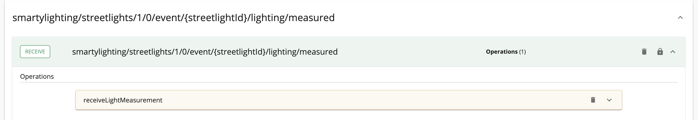
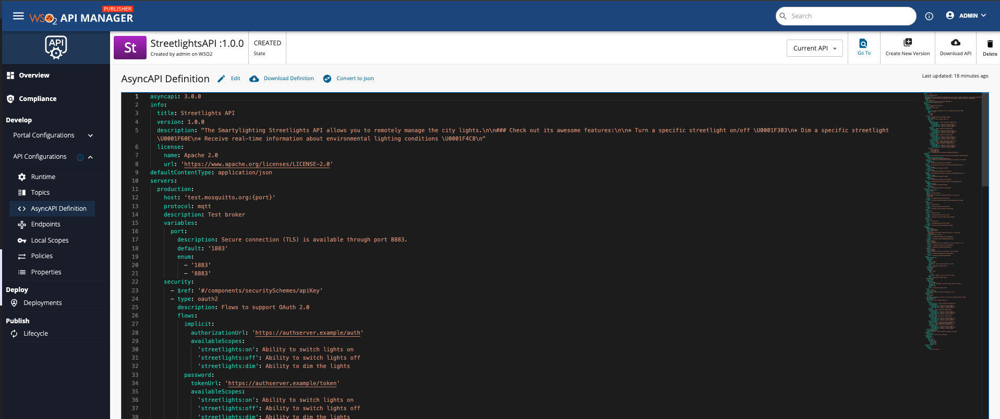

import SignInPublisher from '../../../../../../partials/sign-in-publisher.mdx';
import StreamMoreLinks from '../../../../../../partials/design/stream-more-links.mdx';

[AsyncAPI specification](https://www.asyncapi.com/) is a format that describes streaming APIs. An API Creator can import an existing AsyncAPI definition to WSO2 API Manager to create a streaming API using any one of the following protocols.

- [WebSocket](./create-a-websocket-streaming-api.mdx#overview)
- [WebSub (WebHooks)](./create-a-websub-streaming-api.mdx#overview)
- [Server Sent Events (SSE)](./create-a-sse-streaming-api.mdx#overview)

The API Creator can import the existing AsyncAPI definition by either uploading a file or by providing an Async API URL.

Follow the instructions below to create a Streaming API using an AsyncAPI definition for an existing API:

## Step 1 - Design a Streaming API {#step-1-design-a-streaming-api}

1. <SignInPublisher />

2. Click **CREATE API** and then click **Import AsyncAPI Definition**.

    :::note
    The **CREATE API** button will only appear if the user who has signed in has the creator role permission.
    :::

    

    The following two options to import the AsyncAPI definition appears.

    * **AsyncAPI URL** - If you select this option, you need to provide a URL.
    * **AsyncAPI File** - If you select this option, click **Browse File to Upload** and upload a file, which contains an AsyncAPI definition.

3. Select the way in which you are going to import the AsyncAPI definition, and click **Next**.

     :::note
     AsyncAPI import now supports both AsyncAPI v2.x and AsyncAPI v3.0 definitions.
     :::

     For this example, let's select **AsyncAPI File**, upload the following file, and click **Next**.

     [Download AsyncAPI V3 file](../../../../../../assets/attachments/103332601/streetlights_v3-def.yml)

     

4.  Edit the Streaming API information and click **Create**.

     :::note
     The AsyncAPI definition of the Streaming API will contain the basic API definition, and **will not specify the protocol**, such as WebSocket, WebSub, WebHook, SSE, that the API has to use. You need to provide the Streaming API information here.
     :::

      For this example, let's design a WebSocket API using the following information.

      | **Field**   | **Sample value** |
      |-------------|------------------|
      | Name | StreetlightsAPI |
      | Context | /streetlights |
      | Version | 1.0.0 |
      | Protocol | WebSocket (or any other type of Streaming API) |
      | Endpoint | ws://localhost:8080 |

      

      Now, the **StreetlightsAPI API** overview page will appear.

     

## Step 2 - Configure Topics {#step-2-configure-topics}

Click **Topics** to navigate to the topics page.

You will notice that the topics have been created automatically from the AsyncAPI definition specified in the provided URL.

Expand each topic to view the operations which are automatically created for each channel, as defined in the specification.

## Step 3 - View the AsyncAPI Definition {#step-3-view-the-asyncapi-definition}

Click **AsyncAPI Definition** under **API Configurations**. 

The AsyncAPI definition of the streaming API, which you just created, appears.

   

Now, you have successfully created a Streaming API from an Async API Definition.

If you have created the streaming API using an AsyncAPI v2.x definition, see [AsyncAPI v2.x for APIM 4.6.0](https://apim.docs.wso2.com/en/latest/api-design-manage/design/create-api/create-streaming-api/create-a-streaming-api-from-an-asyncapi-definition/).

Next, publish the API, for more information, see [Publish an API](../../../deploy-and-publish/publish-on-dev-portal/publish-an-api.mdx).

:::note[What's Next?]
Learn how to create Streaming APIs from scratch by trying out the following tutorials:

- [Create and Publish a WebSocket API](../../../../../get-started/tutorials/api-management-tutorials/streaming-api/create-and-publish-websocket-api.mdx)
- [Create and Publish a WebSub API](../../../../../get-started/tutorials/api-management-tutorials/streaming-api/create-and-publish-websub-api.mdx)
- [Create and Publish a Server Sent Events API](../../../../../get-started/tutorials/api-management-tutorials/streaming-api/create-and-publish-sse-api.mdx)
:::

## See Also

<StreamMoreLinks />
