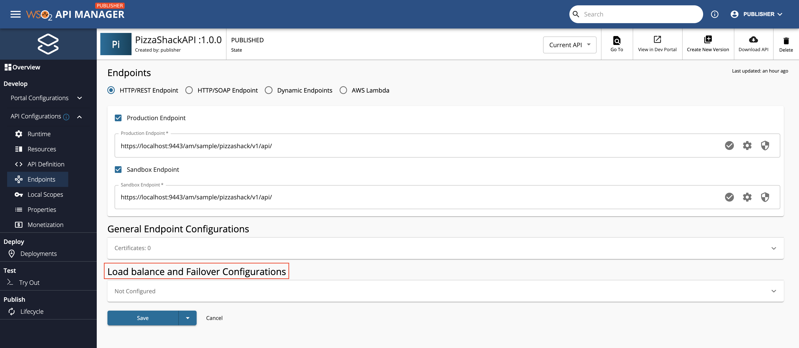
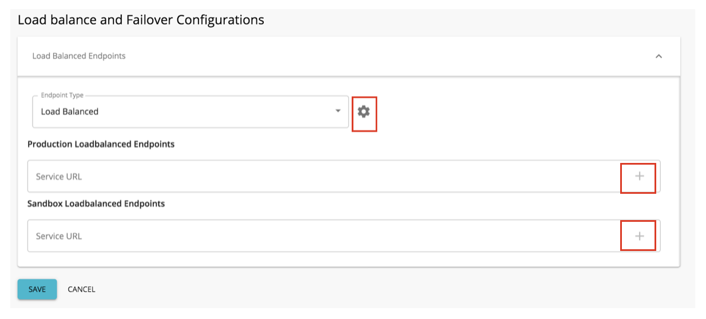
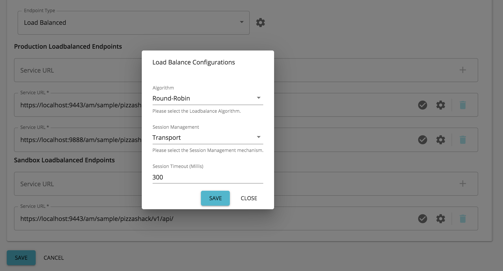
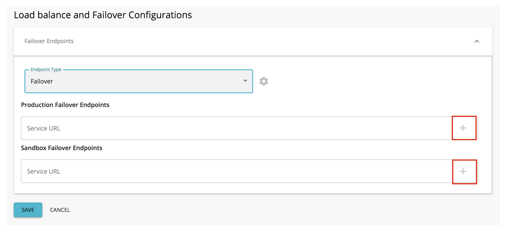
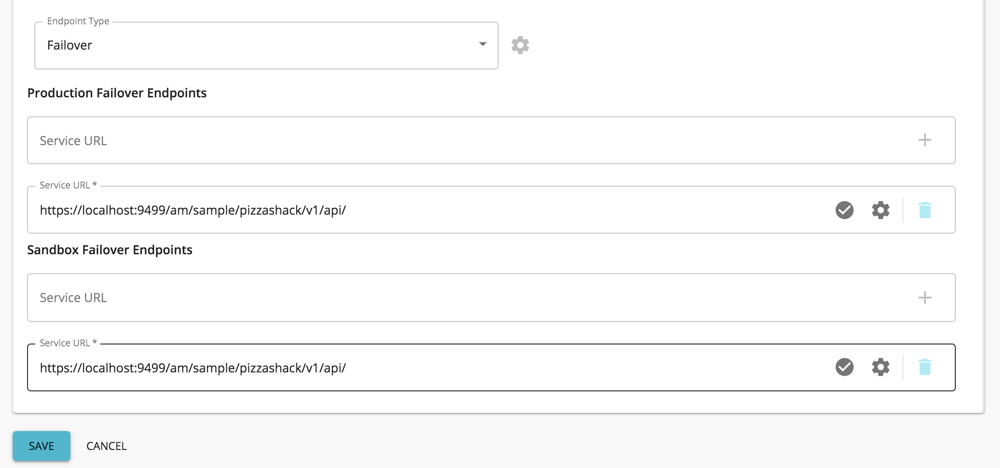

## Configuring Load Balancing Endpoints

When using WSO2 API Manager, you can configure load balancing endpoints via the API Publisher.

1. When you [create an API](../create-api/create-rest-api/create-a-rest-api.mdx), to configure load balancing endpoints go to the edit view of the API, click **Endpoint** to view the Endpoint page.

2. Expand **Load balance and Failover Configurations**.

     

3. Select **Load Balanced** as the endpoint type.

     

4. Configure the endpoint.

    

    The following are the other configurations that you need to define in order to specify a load balancing endpoint.
    <table>
      <colgroup>
        <col width="30%" />
        <col width="70%" />
      </colgroup>
      <tbody>
        <tr>
          <td>Production Endpoints</td>
          <td>

            Specify the set of production endpoints here where the requests need to be load balanced. If required, you can specify more than one endpoint by clicking **+**, and can delete the endpoints by clicking on the **bin** icon.

          </td>
        </tr>
        <tr>
          <td>Sandbox endpoints</td>
          <td>

            The set of sandbox endpoints can be specified here where the requests need to be load balanced. If required, you can specify more than one endpoint by clicking **+**, and can delete the endpoints by clicking on the **bin** icon.

          </td>
        </tr>
        <tr>
          <td>Algorithm</td>
          <td>

            The load balancing algorithm is specified here.

            Click on the cogwheel icon to define the algorithm.

            The default value is the **Round-Robin** Algorithm, which has the [org.apache.synapse.endpoints.algorithms.RoundRobin](https://synapse.apache.org/apidocs/org/apache/synapse/endpoints/algorithms/RoundRobin.html) className. If you select another algorithm, you need to specify the class name of the algorithm. Class names of other algorithms can be found [here](https://synapse.apache.org/apidocs/org/apache/synapse/endpoints/algorithms/package-summary.html).

          </td>
        </tr>
        <tr>
          <td>Session Management</td>
          <td>

            Click on the cogwheel icon to configure session management.

            This refers to a session management method from the load balancing group. The possible values are as follows:

            - **None** - If this is selected, session management is not used.
            - **Transport** - If this is selected, session management is done on the transport level using HTTP cookies.
            - **SOAP** - If this is selected, session management is done using SOAP sessions.
            - **Client ID** - If this is selected, session management is done using an ID sent by the client.

          </td>
        </tr>
        <tr>
          <td>Session Timeout</td>
          <td>

            The number of milliseconds after which the session would time out.

            Click on the cogwheel icon to set up session timeout

          </td>
        </tr>
      </tbody>
    </table>

5. Click **SAVE**.

## Configuring Failover Group of Endpoints
When using WSO2 API Manager, you can configure failover group endpoints via the API Publisher.

1. When you [create an API](../create-api/create-rest-api/create-a-rest-api.mdx), to configure failover endpoints go to the edit view of the API, click **Endpoint** to view the Endpoint page.

2. Expand **Load balance and Failover Configurations**.

     

3. Select **Failover** as the endpoint type.

4. Configure the endpoint.

     

     You need to add at least one failover endpoint as the production and sandbox (based on the endpoints that you have specified) endpoints. 

     If required, you can specify more than one endpoint by clicking <strong>+</strong>, and can delete the endpoints by clicking on the <strong>bin</strong> icon.

5. Click **SAVE**.
