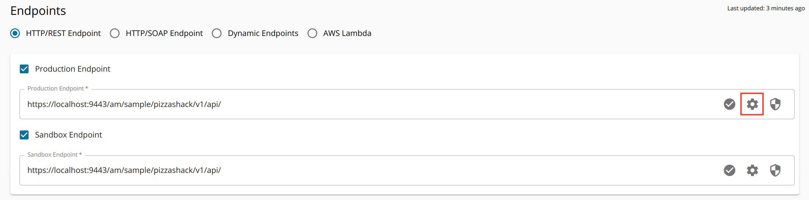

WSO2 API Manager allows you to control the production and sandbox endpoints using the Advanced Endpoint Configurations.

Configure the Advanced Endpoint Configurations as follows:

1. Sign in to the API Publisher Portal.

    `https://<hostname>:9443/publisher` 

    Example: `https://localhost:9443/publisher`

    Use your username and password to sign in.

2. Click on an API in the API Publisher Portal listing page.

3. Click **Endpoints** under **API Configurations**.

4. Click on the cogwheel, which is inline with the endpoint that you need to configure, and update the endpoint related configurations as required. 

     

     The Advanced Endpoint Configurations page appears.

    

The following are Advanced Endpoint Configurations that you can configure for both the production and sandbox endpoints.

<table>
  <tbody>
    <tr>
      <td>Endpoint Suspend State</td>
      <td>

        If you want to configure the suspension of an endpoint, you can use the **Endpoint Suspension State** section to define the error codes, maximum suspension time, and suspension factors.

        - **Error Codes:** The error codes that are associated with suspended endpoints. If the backend endpoint receives the selected error codes, the endpoint will be marked as suspended. Specify the [transport error codes](../../../../../reference/troubleshooting/error-handling.mdx#transport-error-codes) to define when the endpoint suspension should be triggered. You can select a single error code or multiple error codes.

        - **Initial duration:** The time duration for which the endpoint will be suspended when one or more suspend error codes are received from the endpoint for the first time.

          :::note
          When creating (or updating) failover endpoints via the Publisher Portal, you need to specify a set of Error Codes for the endpoint to failover on and also remove the **Initial Duration** by setting its value to -1.
          :::

        - **Max duration:** The maximum time duration for which the endpoint will be suspended.

        - **Factor:** The duration to suspend can vary from the first time suspension to suspension on subsequent occasions. This factor value defines the suspense duration variance between subsequent suspensions.

      </td>
    </tr>
    <tr>
      <td>Endpoint Timeout state</td>
      <td>

        You can define configurations related to retries, error codes, and delays in terms of endpoint timeouts in the **Endpoint Timeout State** section.

        - **Error Codes:** You can select a single error code or multiple error codes that you need to associate with endpoint timeouts. If these error codes are received from the endpoint, the request will be subjected to a timeout.
        - **Retries Before Suspension:**If the Gateway receives an error code that matches one of the selected codes, it will retry the request up to the specified number of times. If the endpoint continues to fail after the defined number of retries, it will then be marked as suspended.
        - **Retry Delay:** The delay between retries in milliseconds.

      </td>
    </tr>
    <tr>
      <td>Connection Timeout</td>
      <td>

        Duration and the response actions after a connection timeout can be configured here in the Advanced Endpoint Configuration.

        - **Action:** Response action to be performed after the connection timeout. You can select from one of the following options.

          - **Discard Message**
          - **Execute Fault Sequence**

          The default value is **Execute Fault Sequence**.

        - **Duration:** The time duration of the connection timeout in milliseconds.

          :::note
          If you want to change the endpoint connection timeout duration globally to affect all the APIs, carry out the following instructions.

          1. Open the `<APIM_HOME>/repository/conf/deployment.toml` file.
          2. Add or change the value of the timeout as follows: \`\`\`toml \[synapse_properties\] 'synapse.global_timeout_interval'=3000 \`\`\`
          3. Add or change the socket timeout value as follows: \`\`\`toml \[passthru_http\] 'http.socket.timeout'=3000 \`\`\`

          Note that the **socket timeout value** should be greater than both the Synapse global timeout and any endpoint timeouts given for your API.
          :::

      </td>
    </tr>
  </tbody>
</table>

For more information on endpoints and how to add, edit, or delete them, see Endpoint Properties.
