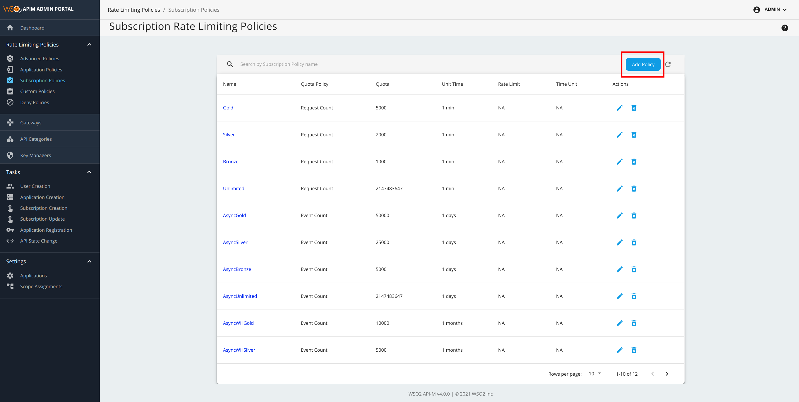
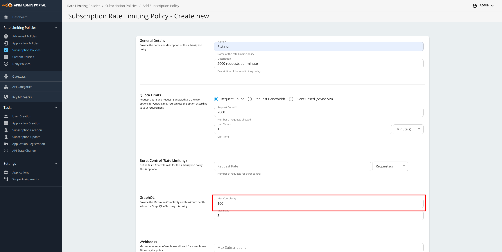
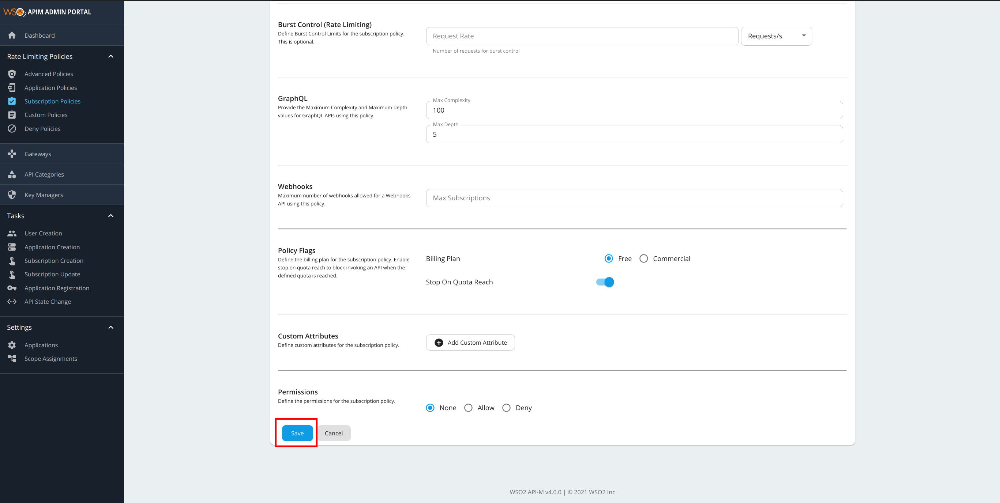
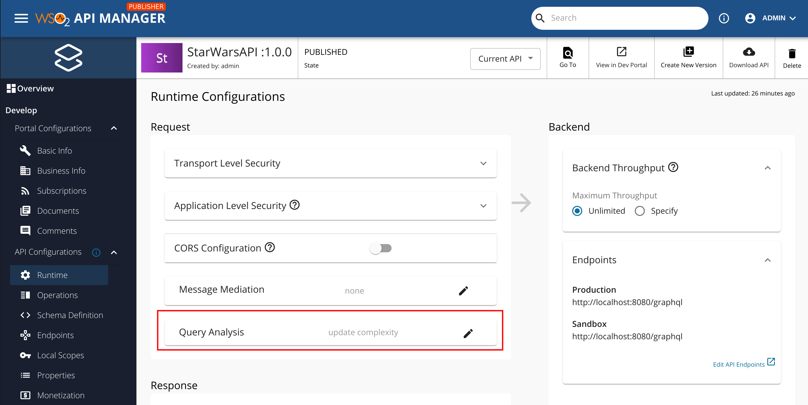
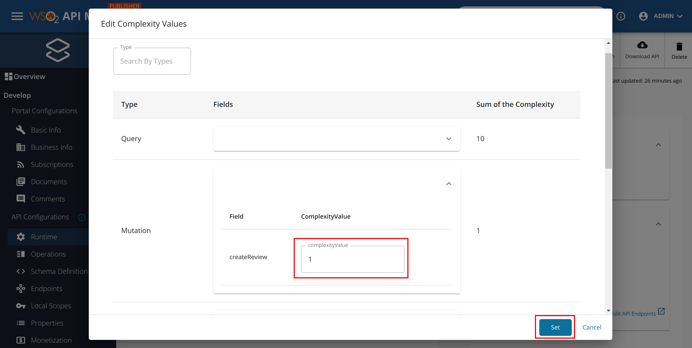
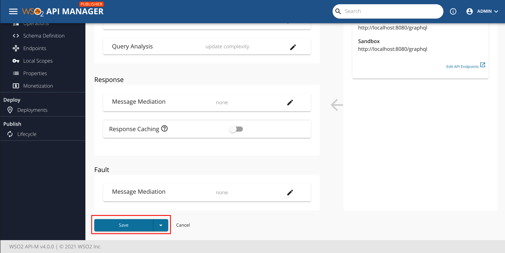
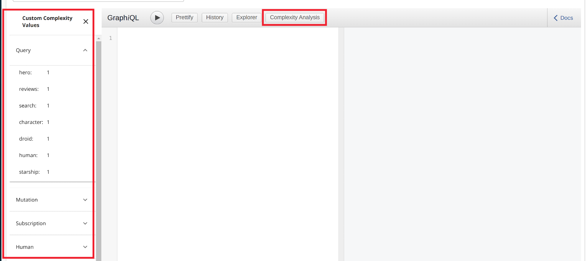
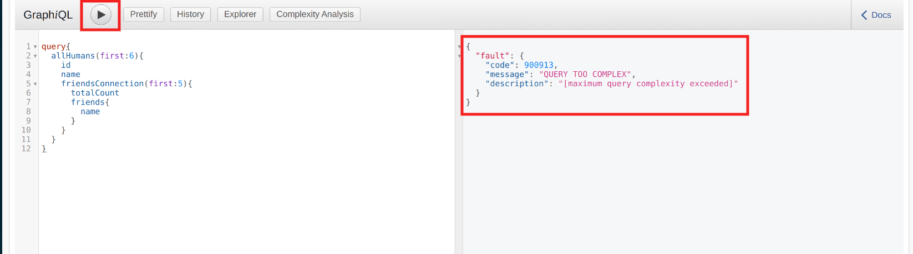

Often, limiting only the depth of a query is not sufficient to protect a GraphQL service from complex queries. 
The reason for this is that some fields in a GraphQL schema are more costly to compute than others. WSO2 API-Manager introduces  
**“Query Complexity Limitation”** to address such cases. 

With this strategy, a request allowed or rejected based on the complexity of the query, and the configured max complexity 
value of the subscription policy for the corresponding API.

Here we introduced the **complexity values for each of the Fields** in the schema. That **describes  
the computation cost of resolving the particular field**. 

:::note
If the field needs to call an expensive service to resolve itself, then the \*\*complexity should be at a high level\*\*, but if the field is easy to resolve(an inexpensive operation), the \*\*complexity should be at a low level\*\*. If \*\*no complexity defined\*\* for a field, \*\*by default it will get a value of 1.\*\*
:::

At runtime, a query will be blocked if its calculated complexity exceeds the specified max complexity.

Following is a simple example which can be used to understand how the calculation happens.

If there are no arguments provided in a query, the total complexity can be calculated by simply adding the individual complexity values of each field.

   ```text
      query {
              allFilms{                   # complexity 1
                 id                     # complexity 3
                title                  # complexity 1
                 planets {              # complexity 2
                       climate            # complexity 1
                 }
              }
      }
      
      # total complexity = 1 + 2 + 1 + 3 + 1 = 8
   ```

With arguments, complexity can be calculated values as follows.

   ```text
        query {
             allFilms(first: 5){          # complexity 1
                   id                       # complexity 1
                   title                    # complexity 1
                   planets(first: 2) {      # complexity 1
                         climate          # complexity 1
                   }
             }
        }
        
        # total complexity = ((( 1 + 1 ) * 2 ) + 1 + 1 + 1 ) * 5 = 35
   ```

   ```text
        query {
             allFilms(first: 5){                 #complexity 1
                   id                              #complexity 3
                   title                           #complexity 1
                   planets(first: 2) {             #complexity 2
                     climate                     #complexity 3
                    films(first: 5) {           #complexity 1
                         createdAt              #complexity 1
                         director               #complexity 1
                    } 
                   }
             }
        }

        # total complexity = ((((((1 + 1 + 1)* 5)+ 3 + 2 )* 2)+ 1 + 3 + 1)* 5) = 225
   ```

Let's see how **GraphQL Query Complexity Limitation** can be managed with your GraphQL API.

### Adding a new Subscription policy with GraphQL Max Complexity value

1.  Sign in to the Admin Portal using the URL `https://localhost:9443/admin` and your admin credentials 
(admin/admin by default).
2.  Click **Subscription Policies** under the **Rate Limiting Policies** section to see the set of existing 
subscription policies.
3.  To add a new Subscription Policy, click **Add Policy** .

4.  Fill in the required details.

5.  click **Save** Button.


### Design a GraphQL API

To design a GraphQL API, see [Create a GraphQL API](../../create-api/create-graphql-api/create-a-graphql-api.mdx).

:::note
Instead of giving Business Plans of GraphQL API related details in [Create a GraphQL API](../../create-api/create-graphql-api/create-a-graphql-api.mdx), Use Business Plans that you create in the previous steps.
:::

### Update field's complexity values of  a GraphQL API {#update-fields-complexity-values-of-a-graphql-api}
1.  Sign in to the Publisher Portal using the URL `https://localhost:9443/publisher`.
2.  Click **edit button** of the **Query Analysis** tab under the **Run time Configuration** section to see the set of default 
    field's complexity values.

3.  After Updating complexity values, click **Set** buttons.

4.  click **Save** buttons to update the API.


### Invoke a GraphQL API

To invoke a GraphQL API, see 
[Invoke a GraphQL API](../../../../api-developer-portal/invoke-apis-using-tools/integrated-api-console/invoke-an-graphql-api-using-the-integrated-graphql-console.mdx).

To perform **GraphQL Query Complexity Limitation**: 

   a. Click **Complexity Analysis** tab to see the Complexity values of the fields.
   

   b. Enter the following sample query. Then click on execute button as follows.

   ```text
    query{
      allHumans(first:6){
        id
        name
        friendsConnection(first:5){
          totalCount
          friends{
            name
          }
        }
      }
    }
   ```
   

You have now **successfully blocked a requested GraphQL query** using the **Max Complexity** value that you assigned before.
