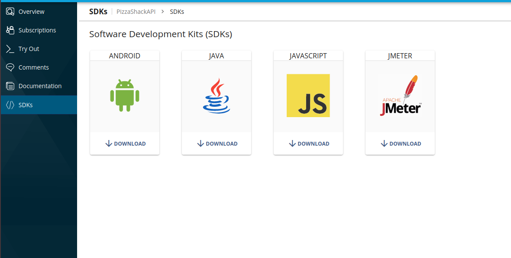
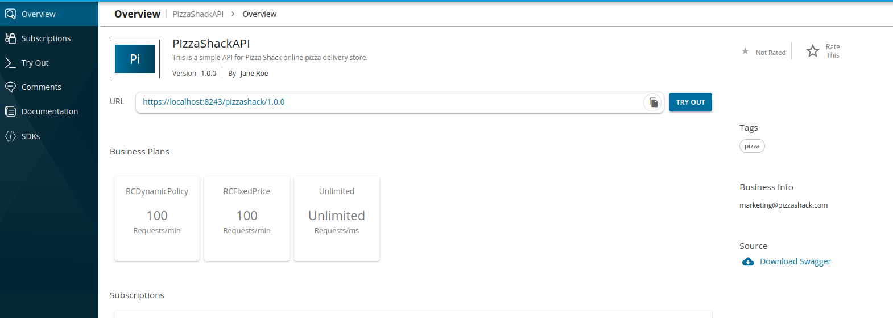

1.  Follow the steps in the [Quick Start Guide](../../../get-started/api-manager-quick-start-guide.mdx), to deploy the sample API, subscribe and generate keys.

    :::info
    **Access Token**

    Once the keys are generated, copy the access token. You can use this token to invoke APIs that you subscribe to using the same application.
    :::

2.  Go to the Developer Portal. Select your API and [download the SDK for Java](./generate-sdks-in-dev-portal.mdx). 



3.  In this example, you would have downloaded the `PizzaShackAPI_1.0.0_java.zip` file. This file name includes the API name, version, and language of the SDK. Unzip the `PizzaShackAPI_1.0.0_java.zip` file.
<details>
<summary>Expand to see the folder structure of the unzipped file...</summary>

\`\`\` java PizzaShackAPI_1.0.0_java ├── build.gradle ├── build.sbt ├── docs │   ├── DefaultApi.md │   ├── ErrorListItem.md │   ├── Error.md │   ├── MenuItem.md │   └── Order.md ├── git_push.sh ├── gradle │   └── wrapper │   ├── gradle-wrapper.jar │   └── gradle-wrapper.properties ├── gradle.properties ├── gradlew ├── gradlew.bat ├── pom.xml ├── README.md ├── settings.gradle └── src ├── main │   ├── AndroidManifest.xml │   └── java │   └── org │   └── wso2 │   └── client │   ├── api │   │   ├── ApiCallback.java │   │   ├── ApiClient.java │   │   ├── ApiException.java │   │   ├── ApiResponse.java │   │   ├── auth │   │   │   ├── ApiKeyAuth.java │   │   │   ├── Authentication.java │   │   │   ├── HttpBasicAuth.java │   │   │   ├── HttpBearerAuth.java │   │   │   ├── OAuthFlow.java │   │   │   ├── OAuth.java │   │   │   ├── OAuthOkHttpClient.java │   │   │   └── RetryingOAuth.java │   │   ├── Configuration.java │   │   ├── GzipRequestInterceptor.java │   │   ├── JSON.java │   │   ├── Pair.java │   │   ├── PizzaShackAPI │   │   │   └── DefaultApi.java │   │   ├── ProgressRequestBody.java │   │   ├── ProgressResponseBody.java │   │   └── StringUtil.java │   └── model │   └── PizzaShackAPI │   ├── Error.java │   ├── ErrorListItem.java │   ├── MenuItem.java │   └── Order.java └── test └── java └── org └── wso2 └── client ├── api │   └── PizzaShackAPI │   └── DefaultApiTest.java └── model └── PizzaShackAPI ├── ErrorListItemTest.java ├── ErrorTest.java ├── MenuItemTest.java └── OrderTest.java \`\`\`

</details>

4.  [Build the SDK using maven](https://maven.apache.org/run-maven/) .
    When it’s done, you can include this SDK as a dependency in your software project. Details of this maven dependency are included in the README.md file.
    <details>
    <summary>Expand to view Maven dependency</summary>

    \`\`\` xml

    \<dependency\>

    \<groupid\>org.wso2

    \<artifactid\>org.wso2.client.PizzaShackAPI

    \<version\>1.0.0

    \<scope\>compile

    \`\`\`

    </details>

    :::info
    **Build using maven**

    You can build the SDK using the \`mvn clean install\` command inside the root directory. For more information see \[Maven Start Guide\](https://maven.apache.org/guides/getting-started/).
    :::

5.  After creating a maven project, import the following with respect to the SDK. These classes will be accessible from the code once the SDK is built using maven and will be included as maven dependencies in the project.

    ```java
    import org.wso2.client.api.ApiClient;
    import org.wso2.client.api.PizzaShackAPI.DefaultApi;
    import org.wso2.client.model.PizzaShackAPI.Menu;
    ```

6.  Create an instance of the `DefaultApi` object in the java code. This instance is needed to get the API client which handles the operations related to consuming the API, using the resources of the API.

    ```java
    DefaultApi defaultApi = new DefaultApi();
    ```

7.  The API client of the `DefaultApi` object instance is used to set HTTP request headers with the required data. Note that these HTTP request headers might differ from one API to another, depending on the implementation of the API. A sample is shown below.

    ```java
    ApiClient apiClient = defaultApi.getApiClient();
    apiClient.addDefaultHeader("Accept", "application/json");
    ```

8.  Include the access token as a header in the API client object, to invoke the API. If the access token you generated above is a JSON Web Token (JWT), you can replace the ```accessToken``` string with the JWT obtained.

    ```java
    String accessToken = "bc392b16-6ce2-3208-9023-8938fbc376ea";
    apiClient.addDefaultHeader("Authorization", "Bearer " + accessToken);
    ```

    :::warning
    You need an access token to invoke the API. It is important to have a valid subscription before using the SDK, to obtain an access token. Note that the obtained access token has an \[expiration time\](/learn/consume-api/manage-application/generate-keys/obtain-access-token/changing-the-default-token-expiration-time).
    :::

9.  Set the base path to the API client.

    ```java
    apiClient.setBasePath("http://localhost:8280/pizzashack/1.0.0");
    ```
    The base path for the client application is the production (or sandbox) URL of the API. This could be found from the URL of the API in overview tab.

    The context of the API can be found from the API Overview in Developer Portal.
    

10. Once the `ApiClient` object has all the required data, set the `ApiClient` for the instance of the `DefaultApi` object.

    ```java
    defaultApi.setApiClient(apiClient);
    ```

11. Finally, we can call the available function in the SDK to get the response from the API.

    ```java
    List<MenuItem> menuItems = (List<MenuItem>) defaultApi.menuGet();
    ```

    :::info
    \`MenuItem\` is a model class generated with SDK
    :::

Complete java code can be found below.

```java
import org.wso2.client.api.ApiClient;
import org.wso2.client.api.ApiException;
import org.wso2.client.api.PizzaShackAPI.DefaultApi;
import org.wso2.client.model.PizzaShackAPI.MenuItem;
import java.util.HashMap;
import java.util.List;
import java.util.Map;

public class APIClient {

    public static void main(String[] args) throws ApiException {
        DefaultApi defaultApi = new DefaultApi();
        String accessToken = "bc392b16-6ce2-3208-9023-8938fbc376ea";
        Map<String, String> headers = new HashMap<String, String>();
        headers.put("Accept", "application/json");
        headers.put("Authorization", "Bearer " + accessToken);
        ApiClient apiClient = defaultApi.getApiClient();
        apiClient.addDefaultHeader("Accept", "application/json");

        apiClient.addDefaultHeader("Authorization", "Bearer " + accessToken);
        apiClient.setLenientOnJson(true);
        apiClient.setBasePath("http://localhost:8280/pizzashack/1.0.0");
        defaultApi.setApiClient(apiClient);
        List<MenuItem> menuItems = (List<MenuItem>) defaultApi.menuGet();

        System.out.println(menuItems);
    }

}
```
<details>
<summary>Expand to see the pom file</summary>

\`\`\` xml

\<project\>

\<modelversion\>4.0.0

\<groupid\>org.pizzashack.client

\<artifactid\>pizzashack-api

\<version\>1.0-SNAPSHOT

\<dependencies\>

\<dependency\>

\<groupid\>org.wso2

\<artifactid\>org.wso2.client.PizzaShackAPI

\<version\>1.0.0

\<scope\>compile

\`\`\`

</details>

#### Writing a Client Application using the SDK with a renewable access token

The previous custom client application explains a simple example that uses a hard coded access token when sending the request. However, in real use cases, we can't simply hard code the access token as it expires after a specific period.

The following example solves the latter mentioned issue by renewing and auto-generating access tokens before sending the API request. In addition, this example also supports regenerating the token and retrying the request upon failure. This custom client application uses an Interceptor that is plugged-in to the client in order to achieve the latter mentioned customization.

Complete java code is as follows.

```java
import com.squareup.okhttp.Interceptor;
import com.squareup.okhttp.Request;
import com.squareup.okhttp.Response;
import org.wso2.client.api.ApiClient;
import org.wso2.client.api.ApiException;
import org.wso2.client.api.PizzaShackAPI.DefaultApi;
import org.wso2.client.model.PizzaShackAPI.MenuItem;

import java.util.HashMap;
import java.util.List;
import java.util.Map;

public class APIClient {

    public static void main(String[] args) throws ApiException {
        DefaultApi defaultApi = new DefaultApi();
        ApiClient apiClient = defaultApi.getApiClient();

        // Creates an interceptor that intercepts every requests sent by the client to include the Authorization header
        Interceptor renewTokenInterceptor = new Interceptor() {
            String accessToken = null;

            public Response intercept(Chain chain) throws IOException {
                // If there is an access token already, use it for the next request, otherwise generate a token
                if (accessToken == null) {
                    getAccessToken();
                }

                // Send the original request with the Authorization header added and get the response
                Request originalRequest = chain.request().newBuilder().addHeader("Authorization", accessToken).build();
                Response response = chain.proceed(originalRequest);

                // If the response failed, retry the request with a new access token
                if (!response.isSuccessful()) {
                    getAccessToken();
                    Request newRequest = originalRequest.newBuilder().removeHeader("Authorization")
                            .addHeader("Authorization", accessToken).build();
                    response = chain.proceed(newRequest);
                }
                return response;
            }

            private void getAccessToken() throws IOException {
                // Implement this method to call the token API and retrieve the access token
                accessToken = "Bearer " + // set access token here
            }
        };

        // Set the interceptor to the client
        apiClient.getHttpClient().interceptors().add(renewTokenInterceptor);

        apiClient.addDefaultHeader("Accept", "application/json");
        apiClient.setLenientOnJson(true);
        apiClient.setBasePath("http://localhost:8280/pizzashack/1.0.0");
        List<MenuItem> menuItems = (List<MenuItem>) defaultApi.menuGet();

        System.out.println(menuItems);
    }
}
```
<details>
<summary>Expand to see the pom file</summary>

\`\`\` xml

\<project\>

\<modelversion\>4.0.0

\<groupid\>org.pizzashack.client

\<artifactid\>pizzashack-api

\<version\>1.0-SNAPSHOT

\<dependencies\>

\<dependency\>

\<groupid\>org.wso2

\<artifactid\>org.wso2.client.PizzaShackAPI

\<version\>1.0.0

\<scope\>compile

\<dependency\>

\<groupid\>com.squareup.okhttp

\<artifactid\>okhttp

\<version\>2.7.5

\<scope\>compile

\<dependency\>

\<groupid\>com.squareup.okhttp

\<artifactid\>logging-interceptor

\<version\>2.7.5

\<scope\>compile

\`\`\`

</details>
