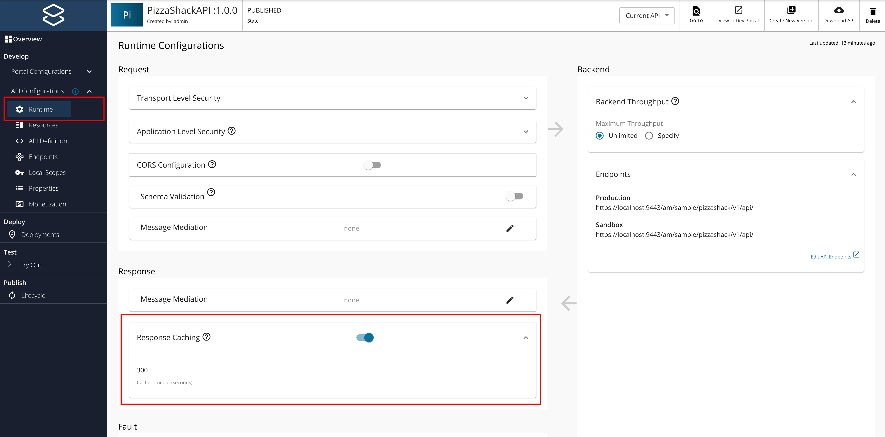
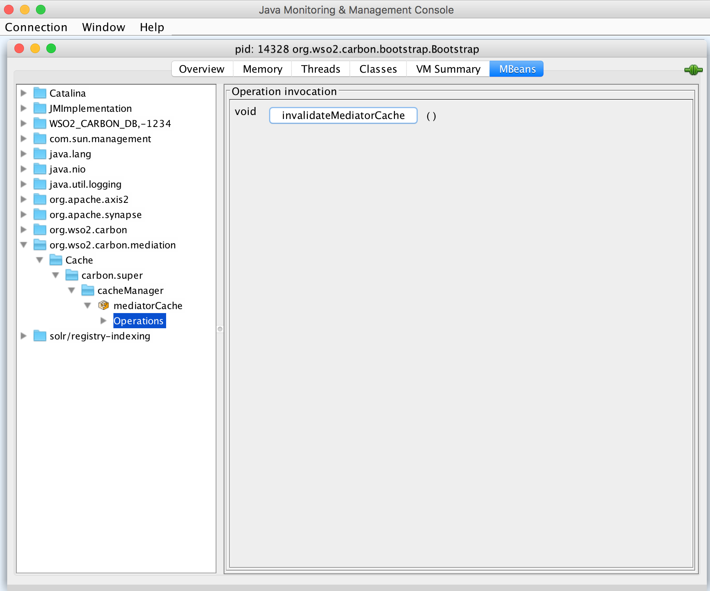

import Tabs from '@theme/Tabs';
import TabItem from '@theme/TabItem';

#Response caching

The API Manager uses [WSO2 ESB's cache mediator](https://docs.wso2.com/display/EI650/Cache+Mediator) to cache response messages for each API. Caching improves performance, because the backend server does not have to process the same data for a request multiple times. You need to set an appropriate timeout period to offset the risk of stale data in the cache.

##Enabling Response Caching for an API

You need to enable response caching when creating a new API or editing an existing API using the API Publisher.

Please follow below steps to enable response caching for an API.

1.  [Create an API](../../api-design-manage/design-apis/create-api/create-rest-api/create-a-rest-api.mdx).

2.  Navigate to the **Runtime** tab under **API Configurations** where you find the response caching configuration. Then turn on Response caching and give a timeout value. This enables the default response caching settings.

    

    ::::note
    When creating a new API by using a Swagger or Open API definition, response caching can be set up by defining an API-M supported Open API extension **“x-wso2-response-cache”**.

    :::note[Example]
    ```yaml
     x-wso2-response-cache: 
        enabled: true
        cacheTimeoutInSeconds: 400
    ```
    :::
    ::::

3.  If you want to change the default response caching settings, edit the following cache mediator properties in the `<API-M_HOME>/repository/resources/api_templates/velocity_template.xml` file:

    <table>
      <colgroup>
        <col width="30%" />
        <col width="70%" />
      </colgroup>
      <thead>
        <tr>
          <th>Property</th>
          <th>Description</th>
        </tr>
      </thead>
      <tbody>
        <tr>
          <td>` collector `</td>
          <td>

            - ` true ` : specifies that the mediator instance is a response collection instance.
            - ` false ` : specifies that the mediator instance is a cache serving instance.<br />

          </td>
        </tr>
        <tr>
          <td>

            ` max MessageSize `

          </td>
          <td>Specifies the maximum size of a message to be cached in bytes. An optional attribute, with the default value set to ` unlimited ` .</td>
        </tr>
        <tr>
          <td>` maxSize `</td>
          <td>Defines the maximum number of elements to be cached.</td>
        </tr>
        <tr>
          <td>

            ` hashGenerator `

          </td>
          <td>

            Defines the hash generator class.

            When caching response messages, a hash value is generated based on the request's URI, transport headers and the payload (if available). WSO2 has a default ` HttpRequestHashGenerator ` class written to generate the hash value. See sample [here](../../../../assets/attachments/103333424/103333429.java) . Please note that prior to API-M 4.0.0, a different hash generator implementation `REQUESTHASHGenerator` was used by default and from API-M 4.0.0, this new hash generator implementation is being used.

            If you want to change this default implementation (for example, to exclude certain headers), you can write a new hash generator implementation by extending the ` HttpRequestHashGenerator ` and overriding its ` getDigest() ` method. Once done, add the new class as the ` hashGenerator ` attribute of the ` <cache> ` element in the ` velocity_template.xml ` file and ` api_product_template.xml ` file.

          </td>
        </tr>
      </tbody>
    </table>

## Cache mediator syntax

You can use the cache mediator to control the hash generation behavior without providing a custom hash generator class. The following syntax shows the available cache mediator attributes:

<Tabs groupId="tabs">
<TabItem value="template" label="Template">

```xml
<cache [timeout="seconds"] [collector=(true | false)] [maxMessageSize="in-bytes"] >
   <onCacheHit [sequence="key"]>
    (mediator)+
   </onCacheHit>?
   <protocol type="http" >?
     <methods>string</methods>
     <headersToExcludeInHash>string</headersToExcludeInHash>
     <responseCodes>regular expression</responseCodes>
     <enableCacheControl>(true | false)</enableCacheControl>
     <includeAgeHeader>(true | false)</includeAgeHeader>
     <hashGenerator>class</hashGenerator>
   </protocol>
   <implementation [maxSize="int"]/>
</cache>
```

</TabItem>
<TabItem value="example" label="Example">

```xml
<cache scope="per-host" collector="false" hashGenerator="org.wso2.carbon.mediator.cache.digest.HttpRequestHashGenerator" timeout="$!responseCacheTimeOut">
    <implementation type="memory" maxSize="500"/>
    <onCacheHit>
        <property name="api.analytics.cacheHit" value="true" scope="default"/>
        <respond/>
    </onCacheHit>
    <protocol type="HTTP">
        <methods>*</methods>
        <headersToExcludeInHash>Postman-Token</headersToExcludeInHash>
        <headersToIncludeInHash/>
        <responseCodes>.*</responseCodes>
        <enableCacheControl>false</enableCacheControl>
        <includeAgeHeader>false</includeAgeHeader>
    </protocol>
</cache>
```

</TabItem>
</Tabs>

This configuration allows you to control aspects of hash generation, such as excluding specific headers, without implementing a custom hash generator class.

:::note
When running a distributed deployment, you need to enable the JSON stream builders on the Classic Gateway and maintain the standard builders on the API Developer Portal node.
:::

Follow the instructions below to enable the stream builders in the Classic Gateway:

1.  Open the `<API-M_HOME>/repository/conf/deployment.toml` file.
2.  Add following configuration.

    ```toml
    [message_builder]
    json = "org.apache.synapse.commons.json.JsonStreamBuilder"
    ```

## Invalidating Cached Responses Remotely

You can invalidate all cached response remotely by using any [JMX monitoring tool such as Jconsole](https://ei.docs.wso2.com/en/latest/micro-integrator/administer-and-observe/jmx_monitoring) using the exposed MBeans. You can use the `InvalidateMediatorCache()` operation of the `org.wso2.carbon.mediation` MBean for this as shown below.


