It is possible to integrate the WSO2 API Manager with an external Identity and Access Management server (IAM) using the Auth0 OAuth Authorization Server to manage the OAuth clients and tokens that are required by WSO2 API Manager. WSO2 API Manager has inbuilt support to consume APIs exposed by Auth0 OAuth.

Follow the instructions below to configure Auth0 as a third-party Key Manager:

:::info
For more information, see the [Getting Started Guide](https://auth0.com/docs/get-started), which is under the official Auth0 documentation.
:::

## Step 1 - Configure Auth0 {#step-1-configure-auth0}

1. Create an Auth0 account.

     Get the URL for the tenant and then sign in to the dashboard.

     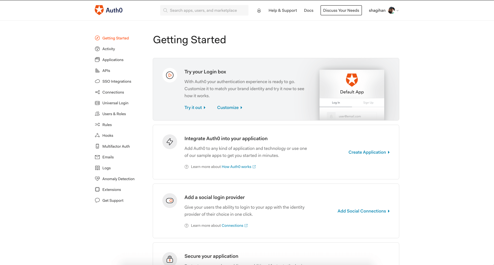

2. Create an application to use the management API.

     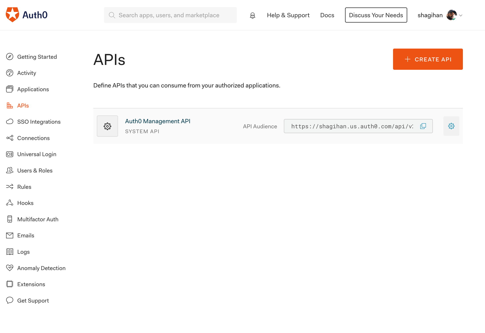

     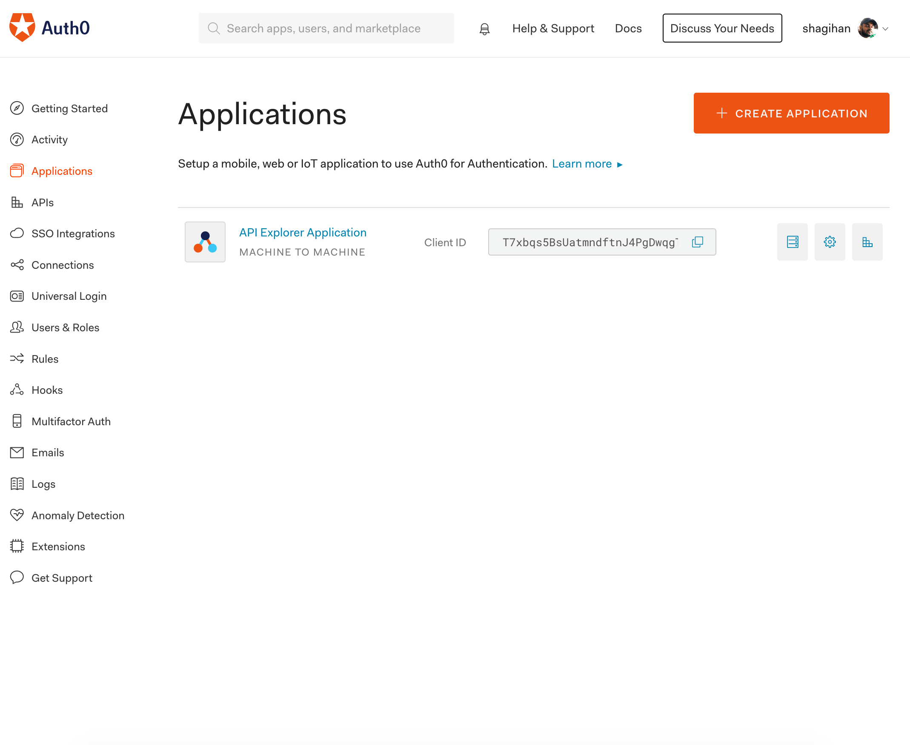

3. Allow that application to use the management API.

     Make sure that you have granted all the permissions to Create, Manage Apps, and Resource servers.

     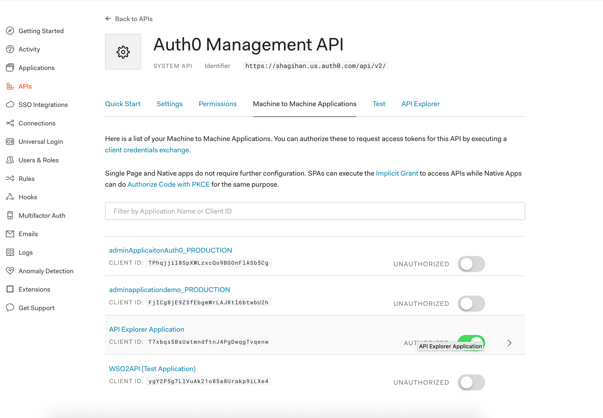

4. Navigate to the **APIs** section and create a custom API.

     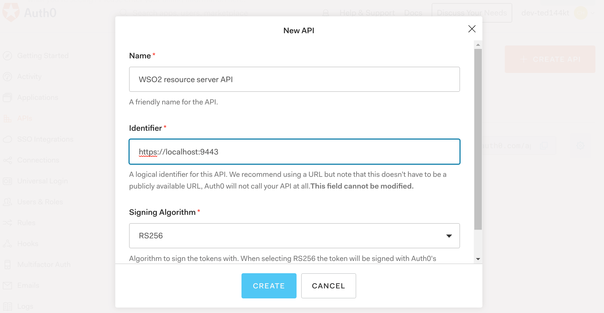

     <Anchor id="step1-4" />

5. Navigate to the **Permissions** tab in the custom API and create a new scope named `default` for the API.

     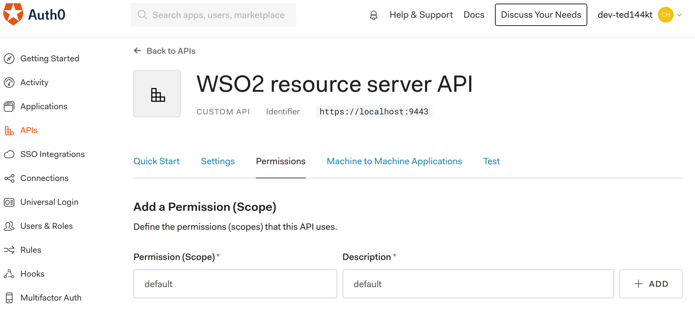

## Step 2 - Configure WSO2 API Manager {#step-2-configure-wso2-api-manager}

1. Start WSO2 API Manager.

2. Sign in to the Admin Portal.

     `https://<hostname>:9443/admin`

     `https://localhost:9443/admin`

3. Add a new Key Manager.

     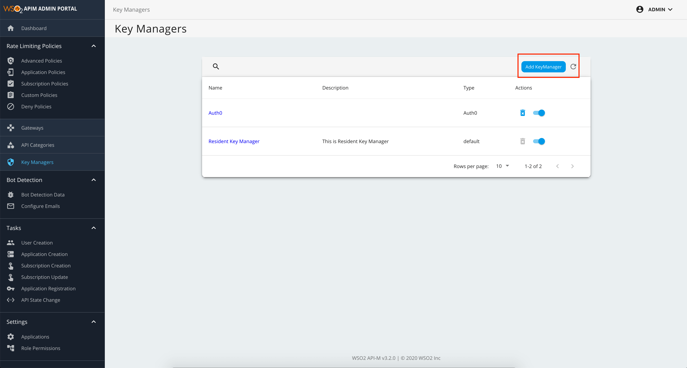

    1. Select the Key manager type as Auth0 and provide the relevant details in the fields accordingly.

        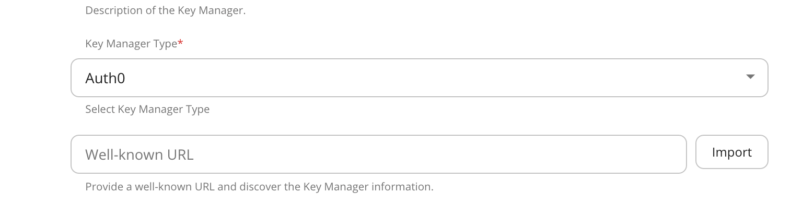

        :::info
           A list of well know addresses can be found in the advance section of the Auth0 Application settings

           Example: ```https://my-tenant.us.auth0.com/.well-known/openid-configuration```

        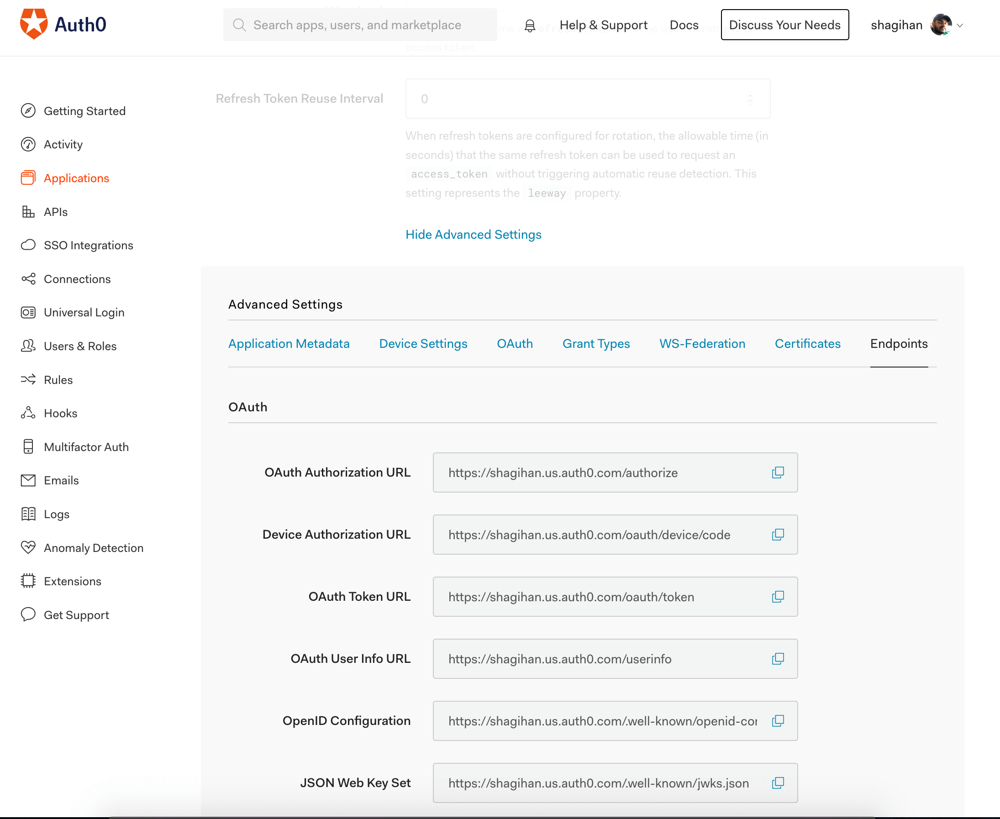

        - The introspection endpoint will not be populated as it is not exposed in Auth0. Therefore, set its value as `none`. 
        - Select the token validation method as `Self validate JWT` as shown below.

        [](../../../../../assets/img/administer/auth0-token-validation.png)
        :::

     2. Set the grant types which are allowed in Auth0.

         For information on the format of the grant types, go to [Application Grant Types](https://auth0.com/docs/applications/application-grant-types) in the official Auth0 documentation.

         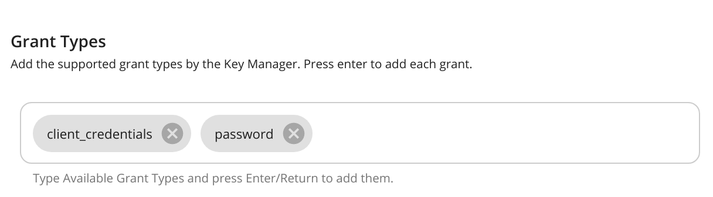

     3. Enter the client ID and client secret of the application that was created to invoke the Manage API.

         You can get to the audience value from Manage API. This is the Identifier value under **General Settings** for that API.

         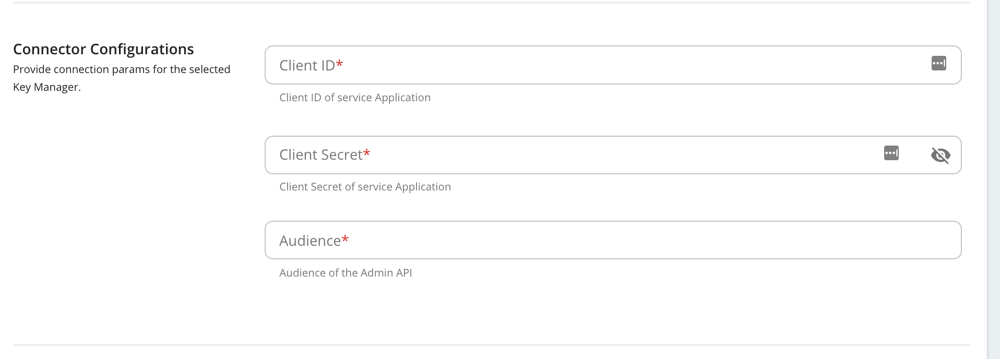

     The following table provides definitions for each of the Key Manager configurations.

     | **Configuration** | **Description** |  |
     | --- | --- | --- |
     | Name | The name of the authorization server. | Mandatory |
     | Display Name | A name to display in the UI. | Mandatory |
     | Description | A brief description of the Key Manager. | Optional |
     | Key Manager Type | The type of the Key Manager to be selected. | Mandatory |
     | Well-known-url | The well-known URL of the Authorization Server (Key Manager). <br /> If the well-known URL is provided, other endpoints can be imported. <br /> **Example:** <br />`https://dev-ted144kt.us.auth0.com/.well-known/openid-configuration` | Optional |
     | Issuer | The issuer that consumes or validates access tokens. <br />**Example:**<br /> https://dev-ted144kt.us.auth0.com/ | Optional |
     | **Key Manager Endpoints** |  |  |
     | Client Registration Endpoint | The endpoint that verifies the identity and obtains profile information of the end-user based on the authentication performed by an authorization server. | Optional if the well-known URI is provided. |
     | Introspection Endpoint | The endpoint that allows authorized protected resources to query the authorization server to determine the set of metadata for a given token that was presented to them by an OAuth client. | The introspection endpoint will not be populated as it is not exposed in Auth0. Therefore, set its value as `none` |
     | Token Endpoint | The endpoint that issues the access tokens. | Optional if the well-known URI is provided. |
     | Revoke Endpoint | The endpoint that revokes the access tokens. | Optional if the well-known URI is provided. |
     | Userinfo Endpoint | The endpoint that allows clients to verify the identity of the end-user based on the authentication performed by an authorization server, as well as to obtain basic profile information about the end-user. | Optional |
     | Authorize Endpoint | The endpoint is used to obtain an authorization grant from the resource owner via the user-agent redirection. | Optional |
     | Scope Management Endpoint | The endpoint is used to manage the scopes. | Optional |
     | **Connector Configurations** |  |  |
     | Client ID | The client ID generated when creating the Auth0 application. | Mandatory |
     | Client Secret | The client secret generated when creating the Auth0 application. | Mandatory |
     | Audience | Audience of the Admin API. Can be found by navigating to the \`Auth0 Management API\` in Auth0. | Mandatory |
     | **Claim URIs** | This provides claim URIs for the consumer key and the scopes. | Mandatory |
     | Consumer Key Claim URI | The claim URI for consumer key <br />**Example:** azp | Mandatory |
     | Scopes Claim URI | The claim URI for scopes <br />**Example:** scope | Mandatory |
     | Grant Types | The supported grant types. | Optional |
     | **Certificates** |  |  |
     | PEM | Either copy and paste the certificate in PEM format or upload the PEM file. | Optional |
     | JWKS | The JSON Web Key Set (JWKS) endpoint is a read-only endpoint. This URL returns the Auth0's public key set in JSON web key set format. This contains the signing key(s) the Relying Party (RP) uses to validate signatures from the Auth0. <br />**Example:**<br /> `https://dev-ted144kt.us.auth0.com/.well-known/jwks.json` | Optional |
     | **Permissions** |  |  |
     | Key Manager Permission | Permission type for role-based Key Manager restriction.<br /> e.g., `PUBLIC`, `ALLOW`, `DENY` | Optional |
     | Roles | Roles to Whitelist or Blacklist | Optional |
     | **Advanced Configurations** |  |  |
     | Token Generation | This enables token generation via the authorization server. | Optional |
     | Out Of Band Provisioning | This enables the provisioning of Auth clients that have been created without the use of the Developer Portal, such as previously created Auth clients. | Optional |
     | OAuth App Creation | This enables the creation of Auth clients. | Optional |
     | **Token Validation Method** | The method used to validate the JWT signature. This is not mandatory as the Token Validation Method cannot be **introspect** for Auth0. |  |
     | Self Validate JWT | The `kid` value is used to validate the JWT token signature. If the \``kid` value is not present, the `gateway_certificate_alias` is used. | Optional |
     | Use introspect | Cannot use this option as Auth0 does not expose an introspection endpoint. | Optional |
     | **Token Handling Options** | This provides a way to validate the token for this particular authorization server. | Optional. This is mandatory if the Token Validation Method is **introspect**. |
     | REFERENCE | The tokens that match a specific regular expression (regEx) are validated. |  |
     | JWT | The tokens that match a specific JWT is validated. |  |
     | CUSTOM | The tokens that match a custom pattern are validated. |  |
     | **Claim Mappings** | Local and remote claim mapping. | Optional |

     3. Save the configurations.

## Step 3 - Generate keys using the Auth0 Key Manager {#step-3-generate-keys-using-the-auth0-key-manager}

1. Sign in to the Developer Portal.

     `https://<hostname>:9443/devportal`

     `https://localhost:9443/devportal`

2. Click **Applications**.

3. Create a new application.

     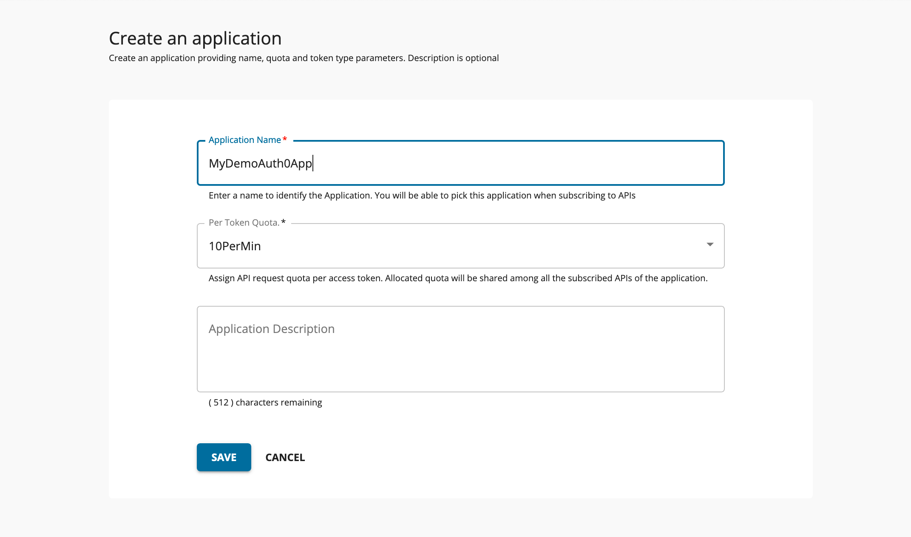

2. Click either "production" or "sandbox", select `Auth0`, and fill in the relevant information.

     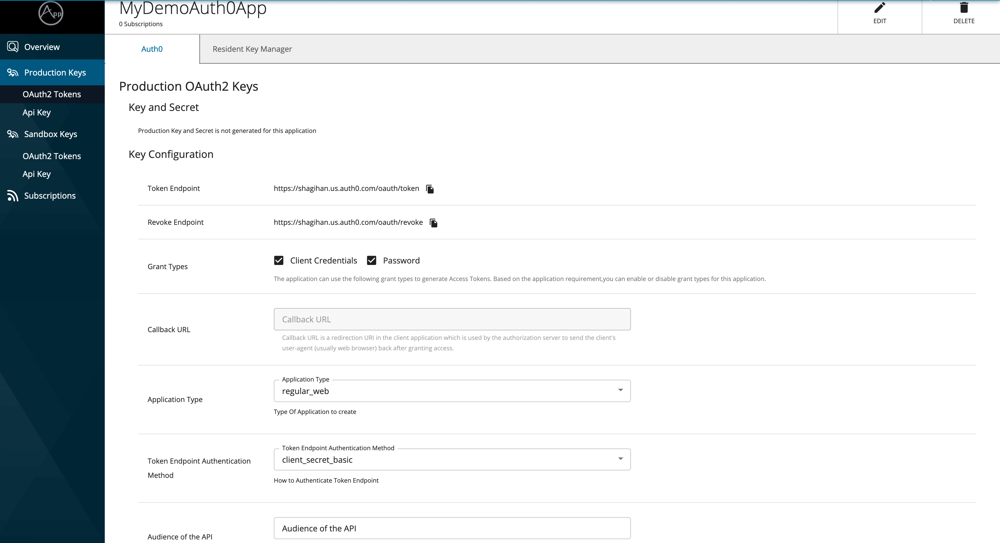

    :::note
       - Note that the API field named **audience** is mandatory to generate an access token for Auth0. Therefore, provide it when generating the application keys.
       - You can obtain the audience of the API by checking the API. This is the value from the Resource Server API.

    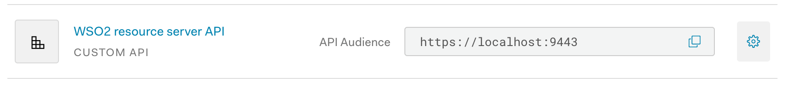

    After the keys are generated, it will reflect in the UI.

    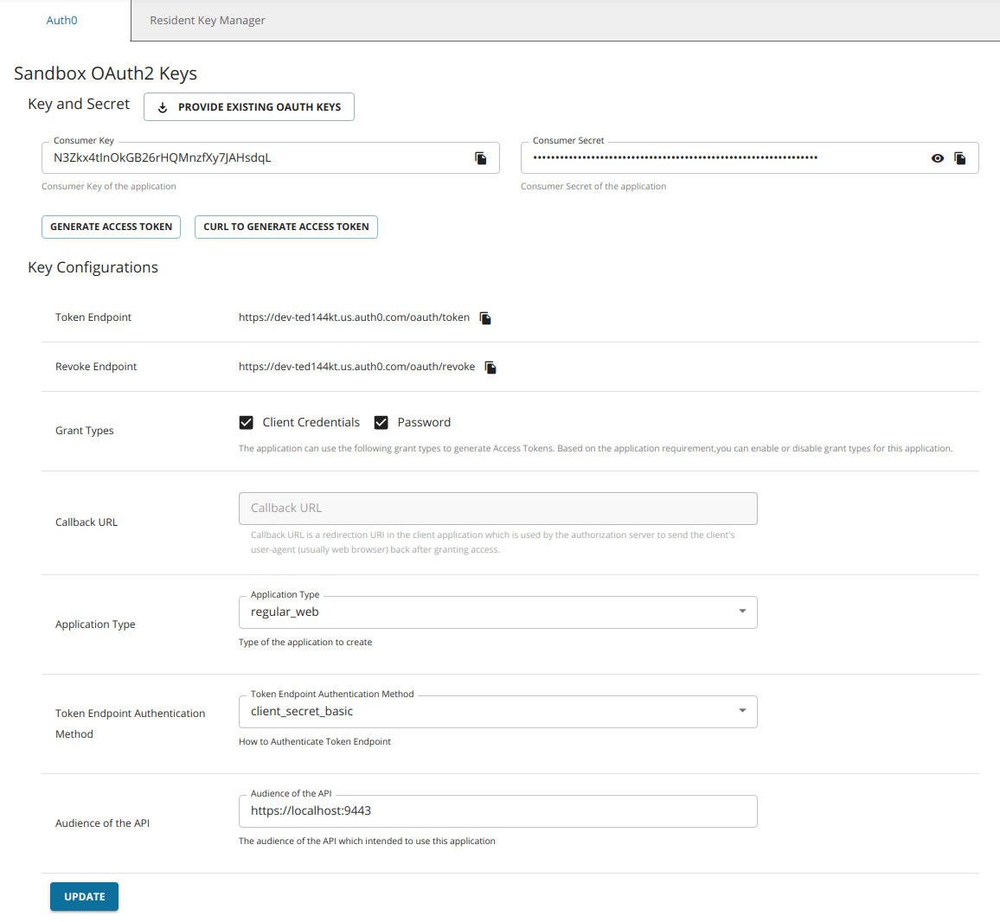
    :::

3. Click **Generate Keys**.

     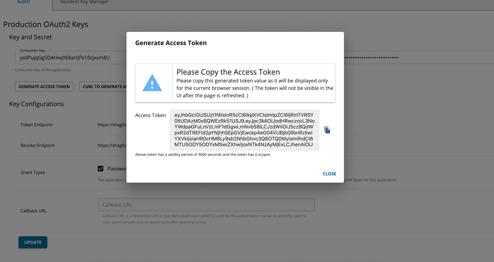

:::tip
If you want to generate the tokens with scopes, those scopes should have been defined in Auth0 as mentioned in [Step 1 - (4)](#step1-4).
:::
