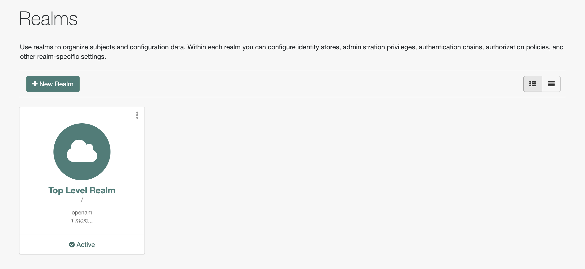
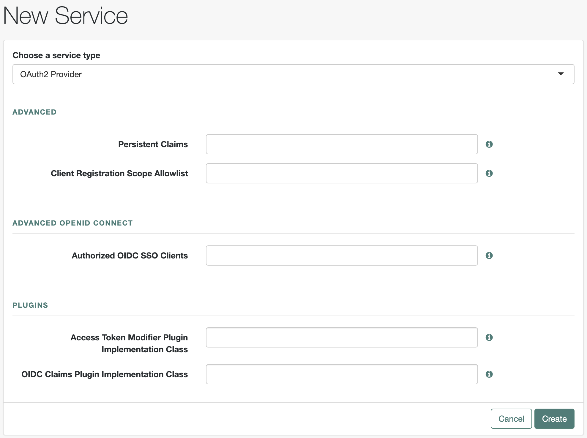
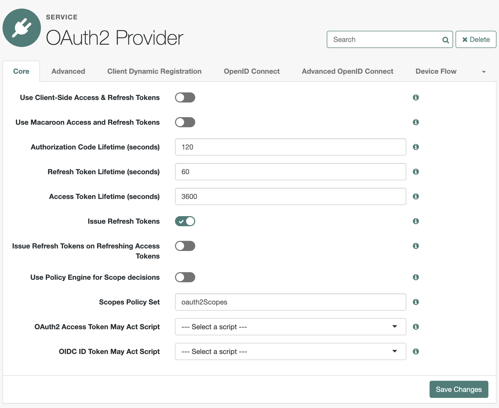
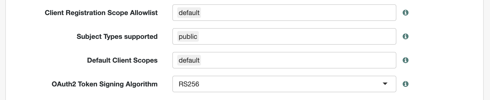
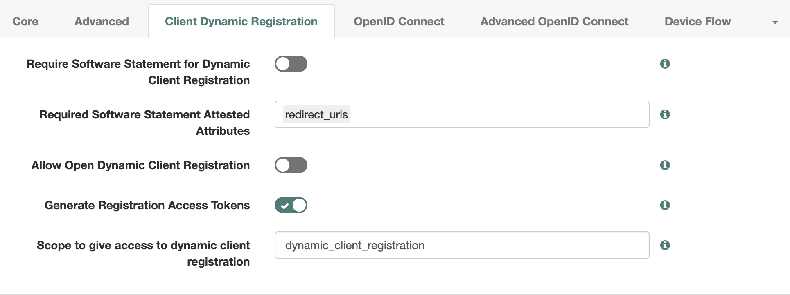
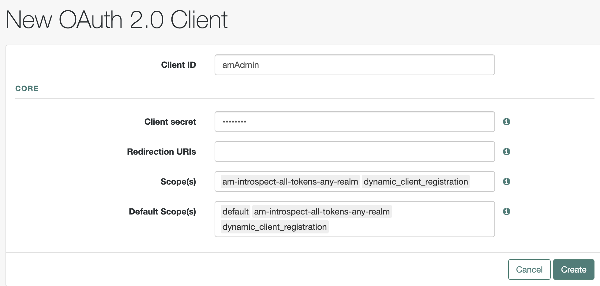
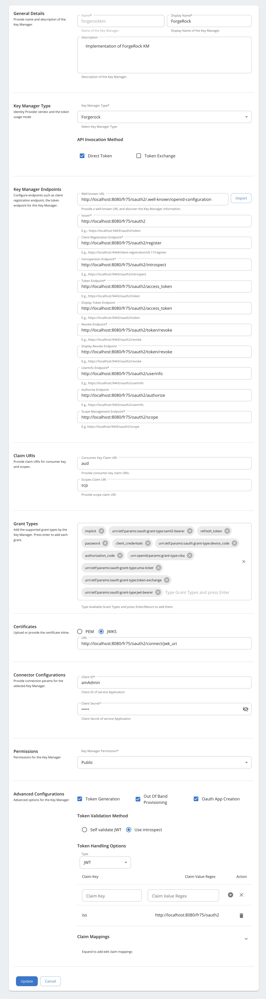
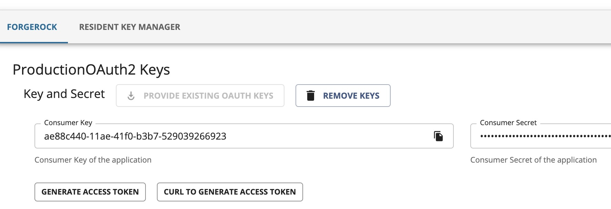

WSO2 API Manager has the capability to support multiple Key Managers at the same time. So with the use of connectors, it is capable of supporting any authorization server as a Key Manager. Additionally, WSO2 API Manager is prepacked with an inbuilt resident Key Manager.

WSO2 API Manager can connect to ForgeRock out-of-the-box using the [WSO2 API-M ForgeRock Connector](https://github.com/wso2-extensions/apim-km-forgerock).

Follow the instructions given below to configure ForgeRock as a third-party Key Manager:

## Before you begin

- Install ForgeRock.
- [Download and install WSO2 API Manager](../../../../deploy-and-operate/install-and-setup/install/installing-the-product/installing-api-m-runtime.mdx).

## Step 1 - Configure ForgeRock {#step-1-configure-forgerock}

Follow the instructions given below to configure the ForgeRock Authorization Server to work with WSO2 API Manager.

### Step 1.1 - Configure OAuth 2.0 Provider {#step-11-configure-oauth-20-provider}

1. Navigate to the URL where the ForgeRock Authorization server is deployed.

2. Navigate to **Realms** -> **Top Level Realm**. 

    :::note
    The examples and configurations in this guide are based on the root realm named **Top level realm**, which exists by default.
    :::

    

3. Navigate to **Root Realm** -> **Services** and add Oauth2 provider as a new service as follows,

    

4. Update the created OAuth provider based on the following values.

     | **Field** | **Value** |
     | --- | --- |
     | Realm | / |
     | Refresh Token Lifetime (seconds) | 60 |
     | Authorization Code Lifetime (seconds) | 120 |
     | Access Token Lifetime (seconds) | 3600 |
     | Issue Refresh Tokens | Enabled |
     | Issue Refresh Tokens on Refreshing Access Tokens | Disabled |

    

5. Navigate to the **Advanced** tab and configure the scopes and the signing algorithm of the created OAuth 2.0 Provider using the following values.

     | **Field** | **Value** |
     | --- | --- |
     | Client Registration Scope Allowlist | default |
     | Subject Types supported | public |
     | Default Client Scopes | default |
     | OAuth2 Token Signing Algorithm | RS256 |

    

7. Navigate to the **Dynamic client registration** tab and configure it to allow dynamic client registration using the following values.

     | **Field** | **Value** |
     | --- | --- |
     | Require Software Statement for Dynamic Client Registration | Disabled |
     | Required Software Statement Attested Attributes | redirect_uris |
     | Allow Open Dynamic Client Registration | Disabled |
     | Generate Registration Access Tokens | Enabled |
     | Scope to give access to dynamic client registration | dynamic_client_registration |

    

You can configure the other properties of the OAuth 2.0 provider based on your requirements.

### Step 1.2 - Configure an OAuth 2.0 client {#step-12-configure-an-oauth-20-client}

Create a static OAuth client as follows so that you can use the OAuth client keys for the purpose of dynamic client registration.

1. Navigate to **Realm** -> **OAuth 2.0** -> **Applications** -> **Add client** to create a client.

    :::note
       Ensure to add the mentioned two scopes when creating the client because these scopes are required for dynamic client registration and introspection.

    | **Field** | **Value** |
    | --- | --- |
    | Client ID | amAdmin |
    | Client secret | Enter a value of your choice. |
    | Scope(s) | `am-introspect-all-tokens-any-realm`  `dynamic_client_registration` |

    
    :::

2. Navigate to the above created client under **Applications** -> **Client ID of the App (amAdmin)** -> **Core** -> **Access Token LifeTime**.

3. Set a long value for the **Access Token LifeTime** to obtain a long living registration access token. You will use this token to register and update clients dynamically.

4. Navigate to the **Advanced** tab and configure the `client_credential` grant type that you need to use to obtain the access token.

If you want to work with scopes, then you need to assign the relevant scopes to the relevant OAuth clients beforehand.    

## Step 2 - Configure WSO2 API Manager {#step-2-configure-wso2-api-manager}

Follow the instructions given below to configure WSO2 API Manager to work with the ForgeRock Authorization Server.

1. [Start WSO2 API Manager](../../../../deploy-and-operate/install-and-setup/install/installing-the-product/running-the-api-m.mdx#starting-the-api-m-server).

     `<API-M_HOME>` refers to the root folder of the extracted WSO2 API-M distribution.

2. Add a Key Manager.

    1. Sign in to the Admin Portal. 

         `https://<hostname>:9443/admin`

    2. Click Key Manager and then click **Add Key Manager**.

         

    3. Add the following configuration to add a new Key Manager.

        

         The following table provides definitions for each of the configurations.

         <table>
           <tbody>
             <tr>
               <th>**Configuration**</th>
               <th>**Description**</th>
               <th></th>
             </tr>
             <tr>
               <td>Name</td>
               <td>The name of the authorization server.</td>
               <td>Mandatory</td>
             </tr>
             <tr>
               <td>Display Name</td>
               <td>A name to display on the UI.</td>
               <td>Mandatory</td>
             </tr>
             <tr>
               <td>Description</td>
               <td>A brief description of the Key Manager.</td>
               <td>Optional</td>
             </tr>
             <tr>
               <td>Key Manager Type</td>
               <td>The type of Key Manager to be selected.</td>
               <td>Mandatory</td>
             </tr>
             <tr>
               <td>Well-known-url</td>
               <td>The well-known URL of the authorization server (Key Manager).   If the well-known URL is provided, other endpoints can be imported.</td>
               <td>Optional</td>
             </tr>
             <tr>
               <td>Issuer</td>
               <td>The issuer that consumes or validates the access tokens   Example:  http://localhost:8080/openam/oauth2 </td>
               <td>Mandatory</td>
             </tr>
             <tr>
               <td>**Key Manager Endpoints**</td>
               <td></td>
               <td></td>
             </tr>
             <tr>
               <td>Client Registration Endpoint</td>
               <td>The endpoint to verify the identity and obtain profile information of the end-user based on the authentication performed by an authorization server.   Example:  http://localhost:8080/openam/oauth2/register</td>
               <td>Mandatory</td>
             </tr>
             <tr>
               <td>Introspection Endpoint</td>
               <td>The endpoint that allows authorized protected resources to query the authorization server to determine the set of metadata for a given token that was presented to them by an OAuth client.   Example:   http://localhost:8080/openam/oauth2/introspect </td>
               <td>Mandatory</td>
             </tr>
             <tr>
               <td>Token Endpoint</td>
               <td>The endpoint that issues the access tokens.   Example:   http://localhost:8080/openam/oauth2/access_token </td>
               <td>Mandatory</td>
             </tr>
             <tr>
               <td>Revoke Endpoint</td>
               <td>The endpoint that revokes the access tokens.</td>
               <td>Optional</td>
             </tr>
             <tr>
               <td>Userinfo Endpoint</td>
               <td>The endpoint that allows clients to verify the identity of the end-user based on the authentication performed by an authorization server, as well as to obtain basic profile information about the end-user.</td>
               <td>Optional</td>
             </tr>
             <tr>
               <td>Authorize Endpoint</td>
               <td>The endpoint that is used to obtain an authorization grant from the resource owner via user-agent redirection.</td>
               <td>Optional</td>
             </tr>
             <tr>
               <td>Scope Management Endpoint</td>
               <td>The endpoint that is used to manage the scopes.</td>
               <td>Optional</td>
             </tr>
             <tr>
               <td>**Connector Configurations**</td>
               <td></td>
               <td></td>
             </tr>
             <tr>
               <td>Client ID</td>
               <td>The client Id of the static client to invoke the introspection endpoint.</td>
               <td>Mandatory</td>
             </tr>
             <tr>
               <td>Client Secret</td>
               <td>The client secret of the static client to invoke the introspection endpoint.</td>
               <td>Mandatory</td>
             </tr>
             <tr>
               <td>**Claim URIs**</td>
               <td>Provide the claim URIs for the consumer key and the scopes.</td>
               <td></td>
             </tr>
             <tr>
               <td>Consumer Key Claim URI</td>
               <td>The claim URI for the consumer key.</td>
               <td>Optional</td>
             </tr>
             <tr>
               <td>Scopes Claim URI</td>
               <td>The claim URI for scopes.</td>
               <td>Optional</td>
             </tr>
             <tr>
               <td>Grant Types</td>
               <td>The supported grant types.</td>
               <td>Optional</td>
             </tr>
             <tr>
               <td>**Certificates**</td>
               <td></td>
               <td></td>
             </tr>
             <tr>
               <td>PEM</td>
               <td>Either copy and paste the certificate in PEM format or upload the PEM file.</td>
               <td>Optional</td>
             </tr>
             <tr>
               <td>JWKS</td>
               <td>The JSON Web Key Set (JWKS) endpoint is a read-only endpoint. This URL returns ForgeRock's public key set in JSON web key set format. This contains the signing key(s) the Relying Party (RP) uses to validate signatures from ForgeRock.</td>
               <td>Optional</td>
             </tr>
             <tr>
               <td>**Permissions**</td>
               <td></td>
               <td></td>
             </tr>
             <tr>
               <td>Key Manager Permission</td>
               <td>Permission type for role-based Key Manager restriction.  e.g., `PUBLIC`, `ALLOW`, `DENY`</td>
               <td>Optional</td>
             </tr>
             <tr>
               <td>Roles</td>
               <td>Roles to Whitelist or Blacklist</td>
               <td>Optional</td>
             </tr>
             <tr>
               <td>**Advanced Configurations**</td>
               <td></td>
               <td></td>
             </tr>
             <tr>
               <td>Token Generation</td>
               <td>Enables token generation via the authorization server.</td>
               <td>Optional</td>
             </tr>
             <tr>
               <td>Out Of Band Provisioning</td>
               <td>This enables the provisioning of Auth clients that have been created without the use of the Developer Portal, such as previously created Auth clients.</td>
               <td>Optional</td>
             </tr>
             <tr>
               <td>Oauth App Creation</td>
               <td>This enables the creation of Auth clients.</td>
               <td>Optional</td>
             </tr>
             <tr>
               <td>**Token Validation Method**</td>
               <td>The method used to validate the JWT signature.</td>
               <td></td>
             </tr>
             <tr>
               <td>Self Validate JWT</td>
               <td>The kid value is used to validate the JWT token signature. If the kid value is not present, \`gateway_certificate_alias\` is used.</td>
               <td>Optional</td>
             </tr>
             <tr>
               <td>Use introspect</td>
               <td>The JWKS endpoint is used to validate the JWT token signature. If this option is used to validate the tokens it is mandatory to add a Token Handling Option.</td>
               <td>Optional</td>
             </tr>
             <tr>
               <td>**Token Handling Options**</td>
               <td>

                 Provides a way to validate the token for this particular authorization server.

                 - **JWT**:

                   - Requires a unique claim mapping to identify the token.

                   - **Example Claim Mapping for JWT:**

                     - **Claim Key**: `iss`
                     - **Claim Value**: `http://localhost:8080/cr75/oauth2`

                 - **REFERENCE**:

                   - Requires a regular expression to specify the token length.
                   - **Example for REFERENCE**: `^[\w-]{27}$` (defines a token length of 27 characters)

               </td>
               <td>Optional. This is mandatory if the Token Validation Method is **introspect**.</td>
             </tr>
             <tr>
               <td>REFERENCE</td>
               <td>The tokens matching a specific regular expression (regEx) is validated.</td>
               <td>Optional</td>
             </tr>
             <tr>
               <td>JWT</td>
               <td>The tokens matching a specific JWT is validated.</td>
               <td>Optional</td>
             </tr>
             <tr>
               <td>CUSTOM</td>
               <td>The token matching a custom pattern is validated.</td>
               <td>Optional</td>
             </tr>
             <tr>
               <td>**Claim Mappings**</td>
               <td>Local and remote claim mapping.</td>
               <td>Optional</td>
             </tr>
           </tbody>
         </table>

## Step 3 - Generate keys using the ForgeRock Key Manager {#step-3-generate-keys-using-the-forgerock-key-manager}

1. Sign in to the Developer Portal.

    `https://<hostname>:9443/devportal`

2. Click **Applications**.
3. Create a new application or use the default application.
4. Click **Production Keys**.

     

5. Click **Generate Keys**.
