It is possible to integrate the WSO2 API Manager with an external Identity and Access Management server (IAM) using the Okta OAuth Authorization Server to manage the OAuth clients and tokens that are required by WSO2 API Manager. WSO2 API Manager has inbuilt support to consume APIs exposed by Okta OAuth.

Follow the instructions below to configure Okta as a third-party Key Manager:

## Step 1 - Configure Okta {#step-1-configure-okta}

1. Navigate to the [Okta sign up page](https://developer.okta.com/signup/) and singup to **Workforce Identity Cloud**. We have created an account in **Developer Edition** for this.

     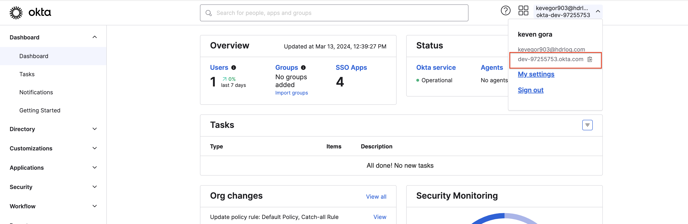

     Create an Okta account and get the Okta instance URL.

     Example:

     [https://dev-97255753.okta.com](https://dev-97255753.okta.com)

2. Obtain the authorization server ID.

    1. Click **API** under **Security** and then click **Authorization Servers** in the Okta Developer Dashboard.
    2. Create a new authorization server.

         Alternatively, you can use the default server.

         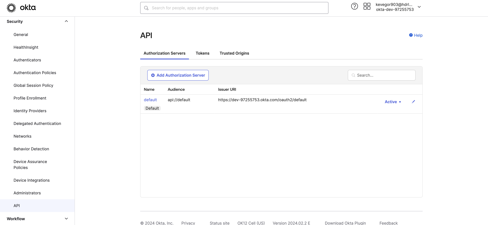

         <Anchor id="step12c" />

    3. Add a default scope. 

         1. Select the authorization server (e.g., default) and click **Scopes** to navigate to the Scopes section.

         2. Create a new scope (e.g., default). 

         3. Select **Default Scope**.

             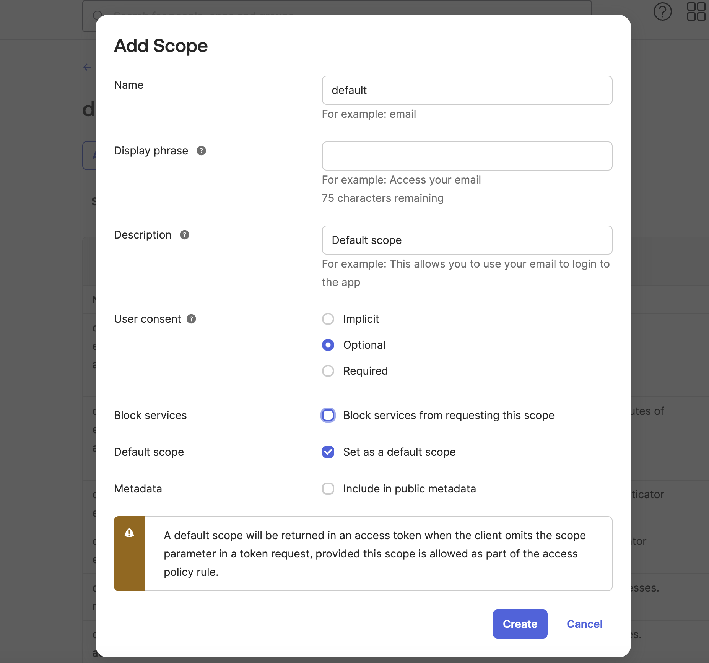

             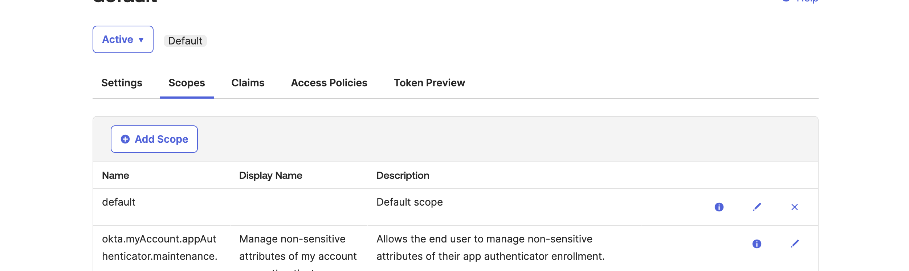

3. Get the API key.

    1. Click **API** under **Security** and then click **Tokens** in the Okta Developer Dashboard.
    2. Click **Create Token** and enter a name for the token.
    3. Copy the token value and keep it for future use.

         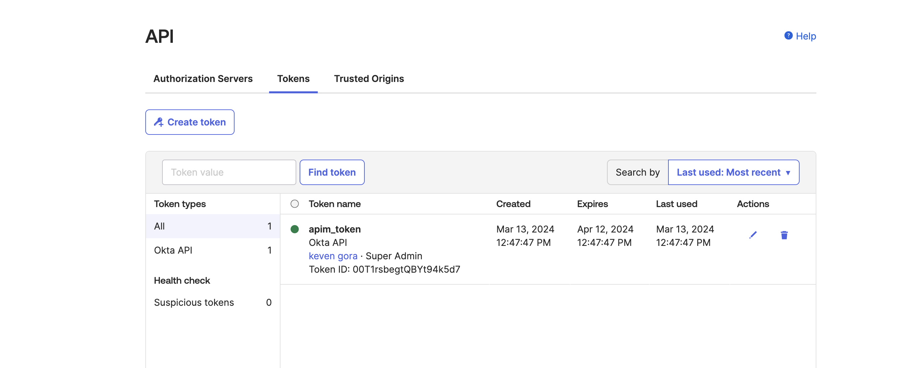

4. Create access policies.

     If you already have at least one access policy in your authorization server, skip the following steps and go to [Step 1 - (5)](#step15).

    1. Click **API** under **Security** and then click **Authorization Servers** in the Okta Developer Dashboard.
    2. Select an Authorization Server.
    3. Click **Access Policies** and then click **Add New Access Policy**
    4. Enter the required information.

        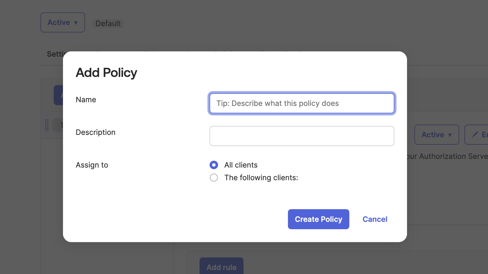

    5. Click **Create Policy** to save the policy.

     <Anchor id="step15" />

5. Create Rules for the Access Policy.

     If you already have at least one rule in your access policy, skip the following steps and go to [Step 1 - (6)](#step16).

     1. Click **API** under **Security** and then click **Authorization Servers** in the Okta Developer Dashboard.
     2. Select the name of an authorization server, and select **Access Policies**.
     3. Select the name of an access policy, and click **Add Rule**.

         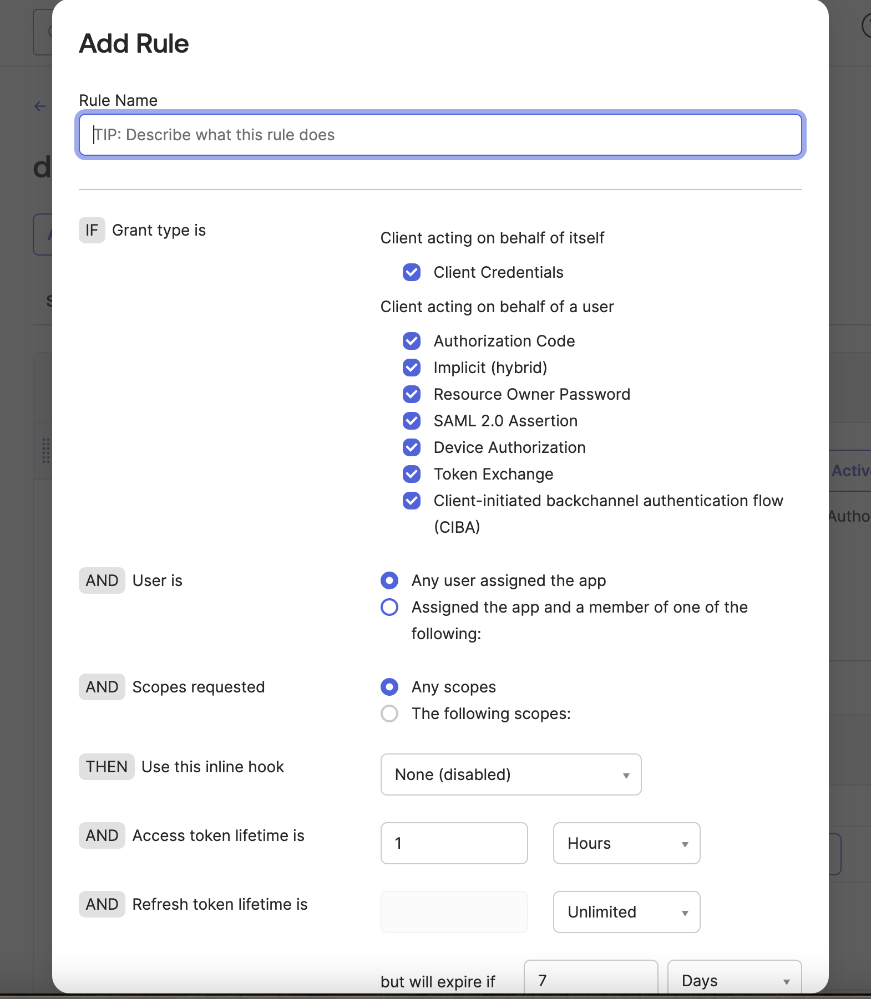

    4. Enter the requested information.
    5. Click **Create Rule** to save the rule.

       <Anchor id="step16" />

6. Create an OAuth application to get the credentials to access the introspect API:

    1. Click **Applications** and then click **create app integration**.
    2. Click **API Services** and then click **Next**.

         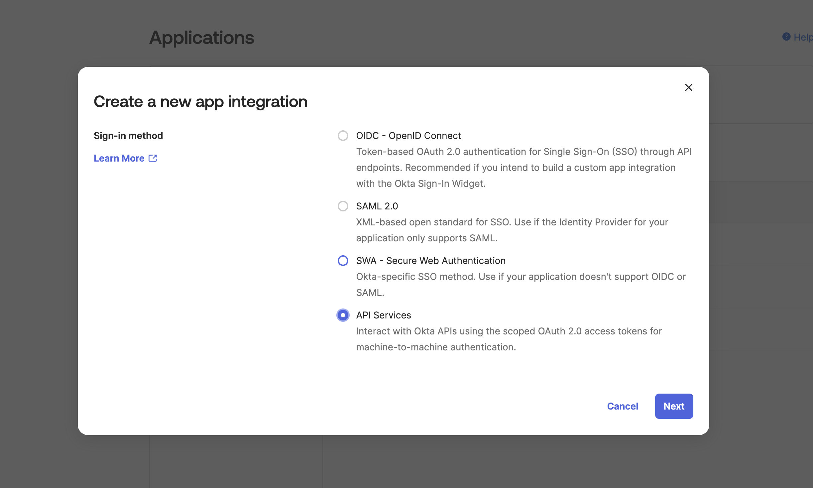

         <Anchor id="section6" />

    3. Navigate to the **Grant type allowed** section and select **Client Credentials**.
    4. After the application is created, note down the **Client ID** and **Client secret** that appears under the **Client Credentials** section.

7. Note down the Authorization server's settings.

    1. Click **API** under **Security** and then click **Authorization Servers**.
    2. Select the authorization server.
    3. Note down the settings related to the Authorization server.

     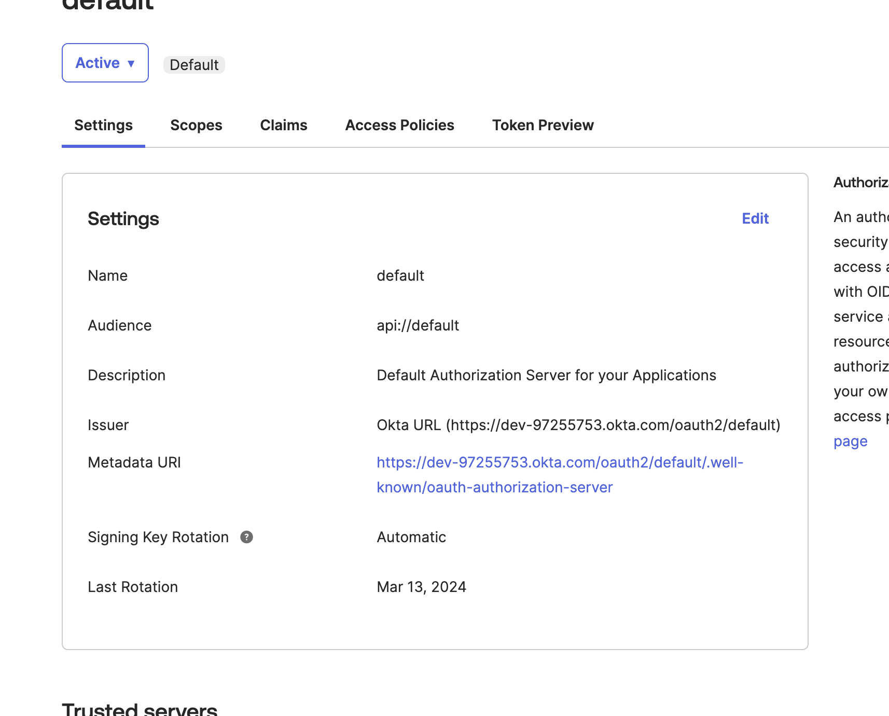

## Step 2 - Configure WSO2 API Manager {#step-2-configure-wso2-api-manager}

1. Start WSO2 API Manager.

2. Sign in to the Admin Portal.

     `https://<hostname>:9443/admin`

     `https://localhost:9443/admin`

3. Add a new Key Manager.

     1. Click **Key Managers** and then click **Add Key Manager**.

         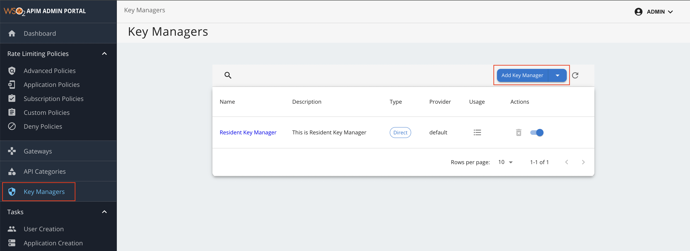

     2. Add the following Key Manager configurations.

           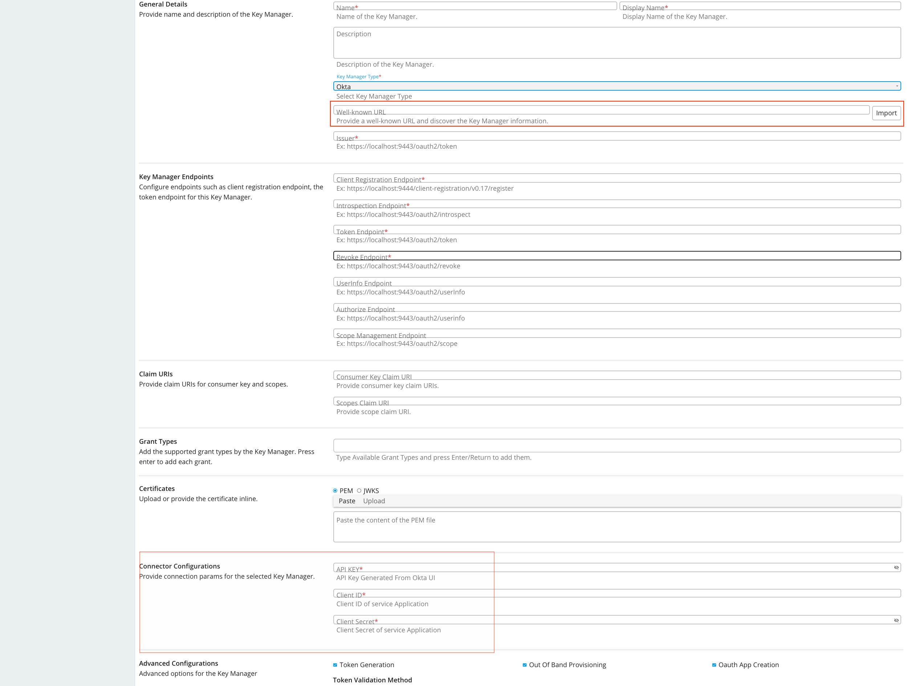

        :::note[Auto-filling Key Manager configurations]
           The Key Manager configurations can be auto-filled by clicking the **Import** button after providing the well-known endpoint of Okta. The well-known-URL is the **Metadata URI**, under **Settings** section.

        The following table provides definitions for each of the Key Manager configurations.

         | **Configuration** | **Description** |  |
         | --- | --- | --- |

         Name

         The name of the authorization server.

         Mandatory
         Display Name

         A name to display in the UI.

         Mandatory
         Description

         A brief description of the Key Manager.

         Optional
         Key Manager Type

         The type of the Key Manager to be selected.

         Mandatory
         Well-known-url

         The well-known URL of the Authorization Server (Key Manager).   If the well-known URL is provided, other endpoints can be imported.   Example:  https://dev-599740.okta.com/oauth2/default/.well-known/oauth-authorization-server

         Optional
         Issuer

         The issuer that consumes or validates access tokens.  Example:  https://dev-599740.okta.com/oauth2/default

         Optional
         **Key Manager Endpoints**
         Client Registration Endpoint

         The endpoint that verifies the identity and obtain profile information of the end-user based on the authentication performed by an authorization server.

         Optional if the well-known URI is provided.
         Introspection Endpoint

         The endpoint that allows authorized protected resources to query the authorization server to determine the set of metadata for a given token that was presented to them by an OAuth client.

         Optional if the well-known URI is provided.
         Token Endpoint

         The endpoint that issues the access tokens.

         Optional if the well-known URI is provided.
         Revoke Endpoint

         The endpoint that revokes the access tokens.

         Optional if the well-known URI is provided.
         Userinfo Endpoint

         The endpoint that allows clients to verify the identity of the end-user based on the authentication performed by an authorization server, as well as to obtain basic profile information about the end-user.

         Optional
         Authorize Endpoint

         The endpoint used to obtain an authorization grant from the resource owner via the user-agent redirection.

         Optional
         Scope Management Endpoint

         The endpoint used to manage the scopes.

         Optional
         **Connector Configurations**
         API Key

         The API key generated from section 3.

         Mandatory
         Client ID

         The client ID generated from [section 6](#section6).

         Mandatory
         Client Secret

         The client secret generated from [section 6](#section6).

         Mandatory
         **Claim URIs**

         This provides claim URIs for the consumer key and the scopes.

         Mandatory
         Consumer Key Claim URI

         The claim URI for consumer key  Example:  cid

         Mandatory
         Scopes Claim URI

         The claim URI for scopes  Example:  scp

         Mandatory
         Grant Types

         The supported grant types.

         Optional
         **Certificates**
         PEM

         Either copy and paste the certificate in PEM format or upload the PEM file.

         Optional
         JWKS

         The JSON Web Key Set (JWKS) endpoint is a read-only endpoint. This URL returns the Okta's public key set in JSON web key set format. This contains the signing key(s) the Relying Party (RP) uses to validate signatures from the Okta.   Example:  https://dev-599740.okta.com/oauth2/default/v1/keys

         Optional
         **Permissions**
         Key Manager Permission

         Permission type for role-based Key Manager restriction.  e.g., `PUBLIC`, `ALLOW`, `DENY`

         Optional
         Roles

         Roles to Whitelist or Blacklist

         Optional
         **Advanced Configurations**
         Token Generation

         This enables token generation via the authorization server.

         Optional
         Out Of Band Provisioning

         This enables the provisioning of Auth clients that have been created without the use of the Developer Portal, such as previously created Auth clients.

         Optional
         OAuth App Creation

         This enables the creation of Auth clients.

         Optional
         **Token Validation Method**

         The method used to validate the JWT signature. This is mandatory if the Token Validation Method is **introspect**
         Self Validate JWT

         The `kid` value is used to validate the JWT token signature. If the \``kid` value is not present, the `gateway_certificate_alias` is used.

         Optional
         Use introspect

         The JWKS endpoint is used to validate the JWT token signature. If this option is used to validate the tokens it is mandatory to add a Token Handling Option For Okta it should be **JWT** and it is required to specify a claim mapping as a unique identifier.  Example:  Claim Key : iss  Claim Value : https://dev-599740.okta.com/oauth2/default

         Optional
         **Token Handling Options**

         This provides a way to validate the token for this particular authorization server.

         Optional This is mandatory if the Token Validation Method is **introspect**
         REFERENCE

         The tokens that match a specific regular expression (regEx) are validated.
         JWT

         The tokens that match a specific JWT is validated.
         CUSTOM

         The tokens that match a custom pattern are validated.
         **Claim Mappings**

         Local and remote claim mapping.

         Optional
        :::
        

## Step 3 - Generate keys using the Okta Key Manager {#step-3-generate-keys-using-the-okta-key-manager}

1. Sign in to the Developer Portal.

    `https://<hostname>:9443/devportal`

    `https://localhost:9443/devportal`

2. Click **Applications**.
3. Create a new application or use the default application.
4. Click **Sandbox Keys**.

     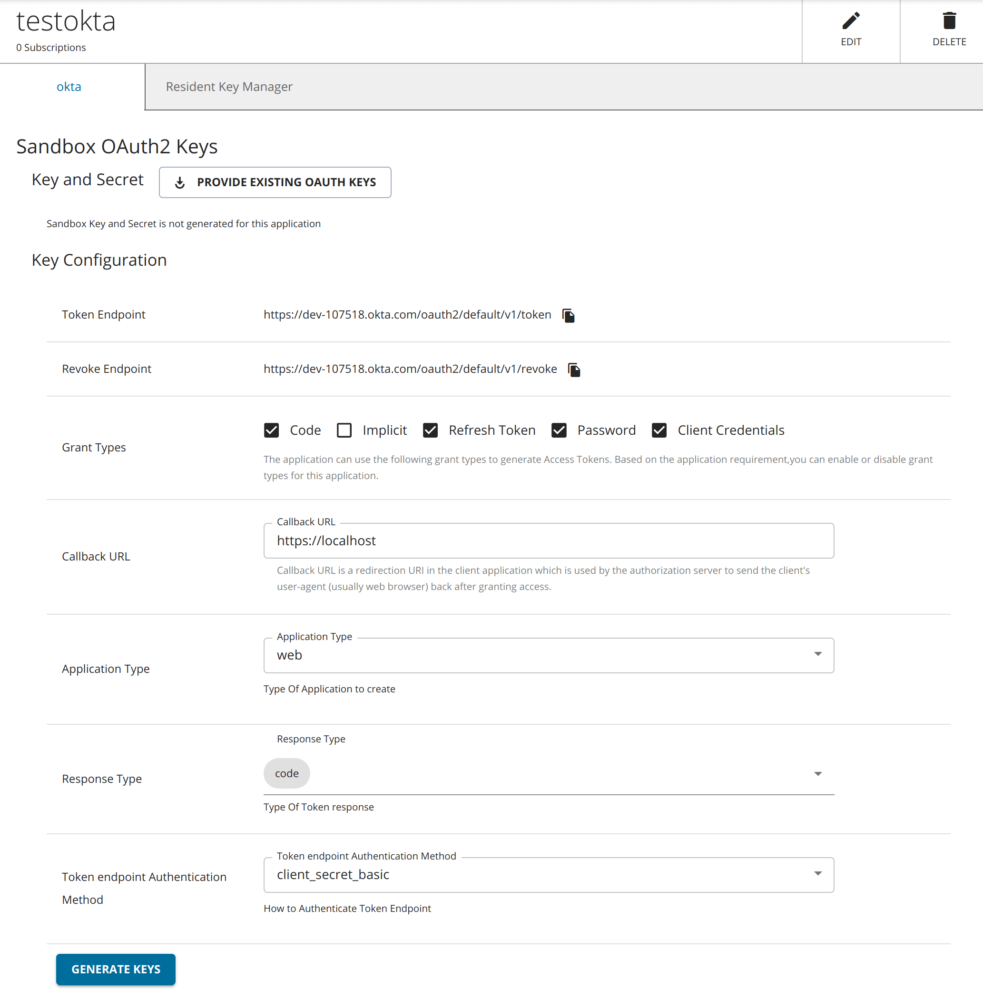

5. Select the **Response Type**.

6. Click **Generate Keys**.

    :::tip
    If you want to generate the tokens with scopes, those scopes should have been defined in Okta as mentioned in the [Step 1 - (2) c](#step12c).
    :::
