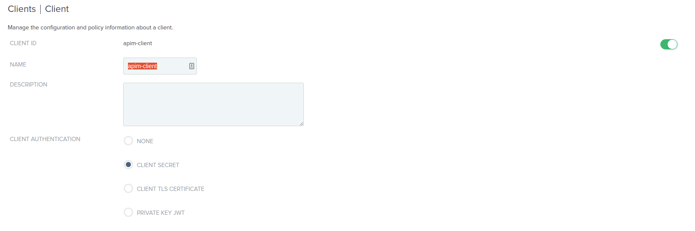
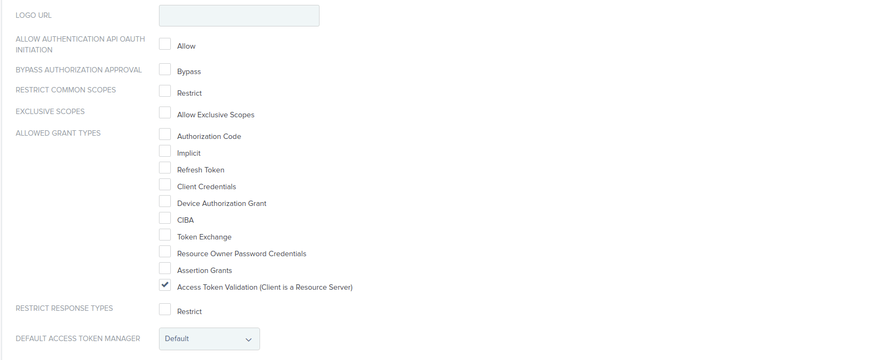
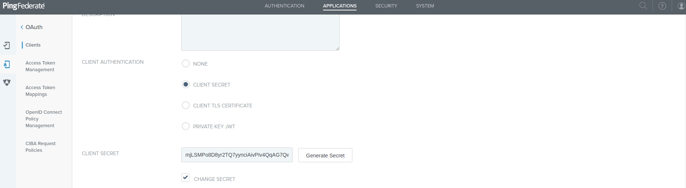
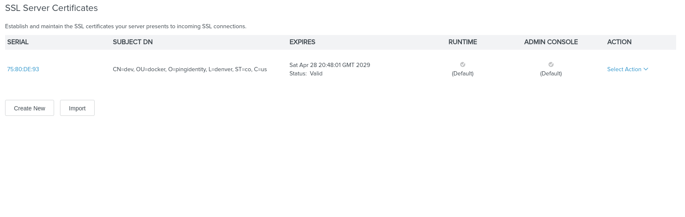
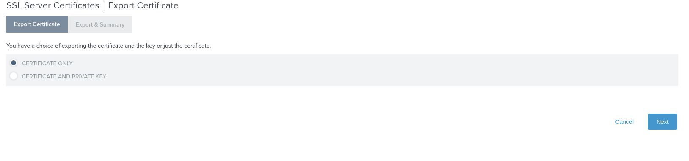
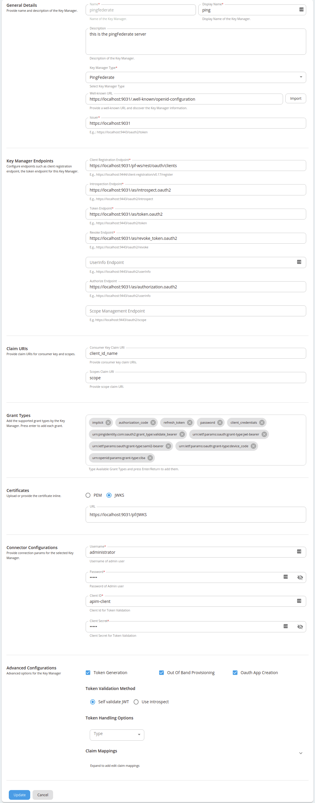
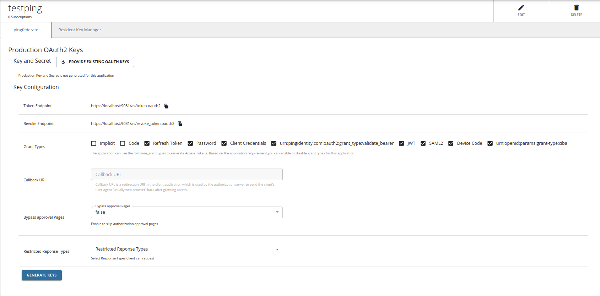

WSO2 API Manager supports multiple Key Managers at the same time. As a result, WSO2 API Manager is prepacked with an inbuilt resident Key Manager, and with the use of connectors, it is capable of supporting any authorization server as a Key Manager.

WSO2 API Manager can connect PingFederate out-of-the-box using the [WSO2 API-M PingFederate Connector](https://github.com/wso2-extensions/apim-km-pingfederate).

Follow the instructions given below to configure PingFederate as a third-party Key Manager:

## Step 1 - Configure PingFederate {#step-1-configure-pingfederate}

1. Sign in to the PingFederate Management Console.

    `https://localhost:9999/pingfederate/app`

2. Click **OAuth Clients** and create a client with the following information in order to introspect the tokens.

     <table>
       <tbody>
         <tr>
           <td>**CLIENT ID**</td>
           <td>apim-client</td>
         </tr>
         <tr>
           <td>**ALLOWED GRANT TYPES**</td>
           <td>Access Token Validation (Client is a Resource Server)</td>
         </tr>
       </tbody>
     </table>

    

    

3. Generate and store the Client Secret.

     

## Step 2 - Configure PingFederate {#step-2-configure-pingfederate}

1. Import the PingFederate certificate into the WSO2 API Manager truststore.

    1. The default PingFederate keystore can found under the **Certificate & Key Management** section on the **SSL Server Certificates** page.

         

    2. Export the certificate from SSL server certificates.

         

    3. Import the certificate into the WSO2 API-M truststore.

          ```text
          keytool -import -trustcacerts -alias pingfederate -file ping.crt -keystore client-truststore.jks -storepass wso2carbon -noprompt
          ```

2. Start WSO2 API Manager.

     `<API-M_HOME>` refers to the root folder of the extracted WSO2 API-M distribution.

3. Add a Key Manager.

    1. Sign in to the Admin Portal. 

         `https://<hostname>:9443/admin`

         `https://localhost:9443/admin`

    2. Click Key Manager and then click **Add Key Manager**.

         

    3. Add the following configuration to add a new Key Manager.

         

         The following table provides definitions for each of the configurations.

         | **Configuration** | **Description** |  |
         | --- | --- | --- |
         | Name | The name of the authorization server. | Mandatory |
         | Display Name | A name to display on the UI. | Mandatory |
         | Description | A brief description of the Key Manager. | Optional |
         | Key Manager Type | The type of Key Manager to be selected. | Mandatory |
         | Well-known-url | The well-known URL of the authorization server (Key Manager). <br /> If the well-known URL is provided, other endpoints can be imported. | Optional |
         | Issuer | The issuer that consumes or validates the access tokens <br /> Example: <br />https://localhost:9031<br /> https://localhost:9031 | Mandatory |
         | **Key Manager Endpoints** |  |  |
         | Client Registration Endpoint | The endpoint to verify the identity and obtain profile information of the end-user based on the authentication performed by an authorization server. <br /> Example: <br />https://localhost:9031/pf-ws/rest/oauth/clients | Mandatory |
         | Introspection Endpoint | The endpoint that allows authorized protected resources to query the authorization server to determine the set of metadata for a given token that was presented to them by an OAuth client. <br /> Example: <br /> https://localhost:9031/as/introspect.oauth2 <br /> | Mandatory |
         | Token Endpoint | The endpoint that issues the access tokens. <br /> Example: <br /> https://localhost:9031/as/token.oauth2<br /> | Mandatory |
         | Revoke Endpoint | The endpoint that revokes the access tokens. | Optional |
         | Userinfo Endpoint | The endpoint that allows clients to verify the identity of the end-user based on the authentication performed by an authorization server, as well as to obtain basic profile information about the end-user. | Optional |
         | Authorize Endpoint | The endpoint that is used to obtain an authorization grant from the resource owner via user-agent redirection. | Optional |
         | Scope Management Endpoint | The endpoint that is used to manage the scopes. | Optional |
         | **Connector Configurations** |  |  |
         | Username | The Administrative user's username to invoke the client registration endpoint. | Mandatory |
         | Client Secret | The Administrative user's password to invoke the client registration endpoint. | Mandatory |
         | Client ID | The client ID obtained from PingFederate to validate tokens from Introspection endpoint | Mandatory |
         | Client Secret | The client secret obtained from PingFederate to validate tokens from Introspection endpoint. | Mandatory |
         | **Claim URIs** | Provide the claim URIs for the consumer key and the scopes. |  |
         | Consumer Key Claim URI | The claim URI for the consumer key. | Optional |
         | Scopes Claim URI | The claim URI for scopes. | Optional |
         | Grant Types | The supported grant types. | Optional |
         | **Certificates** |  |  |
         | PEM | Either copy and paste the certificate in PEM format or upload the PEM file. | Optional |
         | JWKS | The JSON Web Key Set (JWKS) endpoint is a read-only endpoint. This URL returns PingFederate's public key set in JSON web key set format. This contains the signing key(s) the Relying Party (RP) uses to validate signatures from PingFederate. | Optional |
         | **Permissions** |  |  |
         | Key Manager Permission | Permission type for role-based Key Manager restriction.<br /> e.g., `PUBLIC`, `ALLOW`, `DENY` | Optional |
         | Roles | Roles to Whitelist or Blacklist | Optional |
         | **Advanced Configurations** | Token Generation |  |
         | Token Generation | Enables token generation via the authorization server. | Optional |
         | Out Of Band Provisioning | This enables the provisioning of Auth clients that have been created without the use of the Developer Portal, such as previously created Auth clients. | Optional |
         | Oauth App Creation | This enables the creation of Auth clients. | Optional |
         | **Token Validation Method** | The method used to validate the JWT signature. |  |
         | Self Validate JWT | The kid value is used to validate the JWT token signature. If the kid value is not present, \`gateway_certificate_alias\` is used. | Optional |
         | Use introspect | The JWKS endpoint is used to validate the JWT token signature. If this option is used to validate the tokens it is mandatory to add a Token Handling Option. For the PingFederate it should be **JWT** and it is required to specify a claim mapping as a unique identifier. <br /> Example: <br /> Claim Key : iss <br />Claim Value : https://localhost:9031 | Optional |
         | **Token Handling Options** | Provides a way to validate the token for this particular authorization server. This is mandatory if the Token Validation Method is **introspect** |  |
         | REFERENCE | The tokens matching a specific regular expression (regEx) is validated. | Optional |
         | JWT | The tokens matching a specific JWT is validated. | Optional |
         | CUSTOM | The token matching a custom pattern is validated. | Optional |
         | **Claim Mappings** | Local and remote claim mapping. | Optional |

## Step 3 - Generate keys using the PingFederate Key Manager {#step-3-generate-keys-using-the-pingfederate-key-manager}

1. Sign in to the Developer Portal.

    `https://<hostname>:9443/devportal`

    `https://localhost:9443/devportal`

2. Click **Applications**.
3. Create a new application or use the default application.
4. Click **Production Keys**.

     

5. Click **Generate Keys**.
