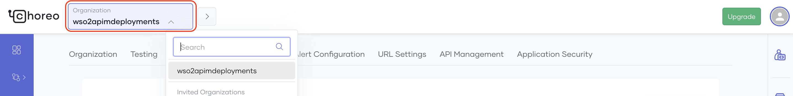
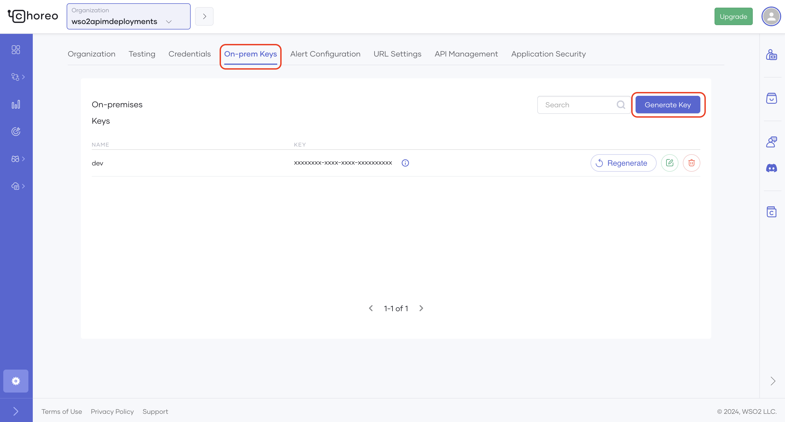

API Manager offers analytics as a cloud service. Therefore, you need to register with the analytics cloud in order to use API Manager Analytics. Follow the instructions below to get started with analytics:

## Step 1 - Sign in to Choreo {#step-1-sign-in-to-choreo}

Follow the instructions below to sign in to Choreo.

1. Navigate to Choreo using the following URL. 

     [https://console.choreo.dev](https://console.choreo.dev/?apianalytics=true?utm_source=apim_docs).

2. Sign-in to Choreo.

    

## Step 2 - Register your environment {#step-2-register-your-environment}

Follow the instructions below to register your on-premise environment:

1. Click the **Settings** on the bottom left corner.

     

2. If you are a member of multiple organizations, select the appropriate organization from the top left-hand corner. 

     For more information on handling users with role-based access control in organizations, see [Role-based Access Control for API Analytics](./role-based-access-control.mdx).

     

3. Select the **On-prem Keys** tab and click **Generate keys**.

     

4. Enter a suitable name for your environment (e.g., customer1-dev).

5. Click **Generate**.

      :::info
      The validity period of the key and the number of keys that you are allowed to generate vary based on the type of user as explained below:

      <table>
        <tbody>
          <tr>
            <th>**User Type**</th>
            <th>**Descrption**</th>
            <th>**Validity Period**</th>
            <th>**Number of Keys Allowed**</th>
          </tr>
          <tr>
            <td>Free user</td>
            <td>Refers to users who do not have a valid subscription for Choreo.</td>
            <td>

              2 weeks<br />

              **NOTE:** The validity of the keys can be temporarily extended by [contacting sales](https://wso2.com/contact/) and submitting a request.

            </td>
            <td>3 keys</td>
          </tr>
          <tr>
            <td>Subscription customers</td>
            <td>Refers to users who have a valid subscription for Choreo.</td>
            <td>1 year</td>
            <td>unlimited</td>
          </tr>
        </tbody>
      </table>
      :::

6. Copy the key that was generated before closing the dialog box.

## Step 3 - Configure the Gateway {#step-3-configure-the-gateway}

API Analytics is delivered via the API Analytics Cloud. Therefore, the API Manager Gateway needs to be configured to publish analytics data into the cloud.

The Gateway configuration process varies based on the Gateway that you are using.

If your system connects to the service through a proxy server/firewall, you need to grant access to the following endpoints to access the Choreo Analytics Cloud service to publish data.

| Host                                             | Port | Protocol |
|--------------------------------------------------|------|----------|
| `analytics-prod-incoming.servicebus.windows.net` | 5671 | AMQP     |
| `analytics-prod-incoming.servicebus.windows.net` | 5672 | AMQP     |
| `analytics-event-auth.choreo.dev`                | 443  | HTTPS    |

### Basic configurations

Follow the instructions below to publish analytics data to the analytics cloud via the API Gateway:

1. Open the `<API-M_HOME>/repository/conf/deployment.toml` file and update the `[apim.analytics]` config segment as follows:

     ```toml
     [apim.analytics]
     enable = true
     config_endpoint = "https://analytics-event-auth.choreo.dev/auth/v1"
     auth_token = "<use token that you generate>"
     ```

      :::note
      - This is the basic configuration that you need to publish analytics data to the analytics cloud.

      - If you need to change the following default values of the Worker Thread Count, Queue Size or Client Flushing Delay, see the [Advanced configurations](#advanced-configurations).

        | **Parameter** | **Default Value** |
        | --- | --- |
        | `worker.thread.count` | 1 thread |
        | `queue.size` | 20000 requests |
        | `client.flushing.delay` | 10 seconds |
      :::

2. Enter the on-premise token, which you obtained via the Choreo Portal in the **Register your environment** step, as the Auth token field.

3. Restart the API Gateway.

### Advanced configurations

This section explains the additional configurations that you can carry out to fine-tune the analytics data publishing process. The following configurations are set to default values derived through testing by default. However, based on other factors, you may need to fine-tune these parameters.

#### Worker Thread Count

This property defines the number of threads that publish analytics data into the Analytics Cloud. The default value is one thread. One thread can serve up to 3200 requests per second with unrestricted internet bandwidth. In case a single thread is not enough to meet the load handled by your Gateway, you will encounter the following error message in Gateway logs. 

```text
Event queue is full. Starting to drop analytics events.
```

If you get the above-mentioned error during an API invocation spike, then increase the `Queue Size` as explained in next section. However, if you are getting this error repeatedly, then you should increase the worker thread count as shown below.

```toml
[apim.analytics]
enable = true
config_endpoint = "https://analytics-event-auth.choreo.dev/auth/v1"
auth_token = “<use token that you generate>”
properties.'worker.thread.count' = 2
```

#### Queue Size

This property denotes the number of analytics events that the Gateway keeps in-memory and uses to handle request bursts. The default value is set to 20000. As explained in the previous section, if you get the following error message in the Gateway logs during API invocation spikes, you should consider increasing queue size. 

```text
Event queue is full. Starting to drop analytics events.
```

However, another factor that you should consider when increasing the queue size is the memory footprint. A single analytics publishing event is around 1 KB. Therefore, you should plan the capacity to not hinder the JVM heap. To tweak the property, add the configuration as shown below.

```toml
[apim.analytics]
enable = true
config_endpoint = "https://analytics-event-auth.choreo.dev/auth/v1"
auth_token = “<use token that you generate>”
properties.'queue.size' = 10000
```

#### Client Flushing Delay

This property denotes the guaranteed frequency (in milliseconds) that the analytics events will be published to the cloud. Currently, analytics events are batched before being sent. Once a given batch is full, it is published into the Analytics Cloud. However, under low throughput, there might be a slight delay for a batch to be filled. The **Client Flushing Delay** property is used when such delays happen. A separate publisher will publish the analytics events after every Client Flushing Delay if the Event Queue, mentioned above, is empty and also if none of the worker threads are currently publishing. By default, this is set to 10 seconds. To tweak the property, add the configuration as shown below.

```toml
[apim.analytics]
enable = true
config_endpoint = "https://analytics-event-auth.choreo.dev/auth/v1"
auth_token = “<use token that you generate>”
properties.'client.flushing.delay' = 15000
```

## Step 4 - View the Analytics Dashboards {#step-4-view-the-analytics-dashboards}

Invoke APIs and open [Choreo Insights](https://console.choreo.dev/insights/overview) to view the dashboards.

After opening Choreo Insights, make sure to select the correct analytics environment from the dropdown in the top-right corner of the page. Select the environment name that you gave when creating the key in Step 2 (e.g., customer1-dev).

For more detailed information on the Choreo Insights dashboards and their usage, go to the [View API Insights](https://wso2.com/choreo/docs/insights/view-api-insights/) page of the Choreo documentation.

## What's Next?

Enterprises and companies who want to use the Choreo Insights collaboratively can utilize the organization concept in Choreo. For more information, see [Role-based Access Control for API Analytics](./role-based-access-control.mdx).
