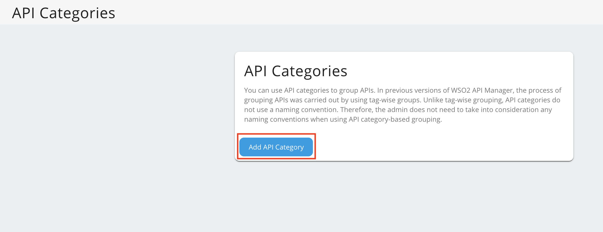
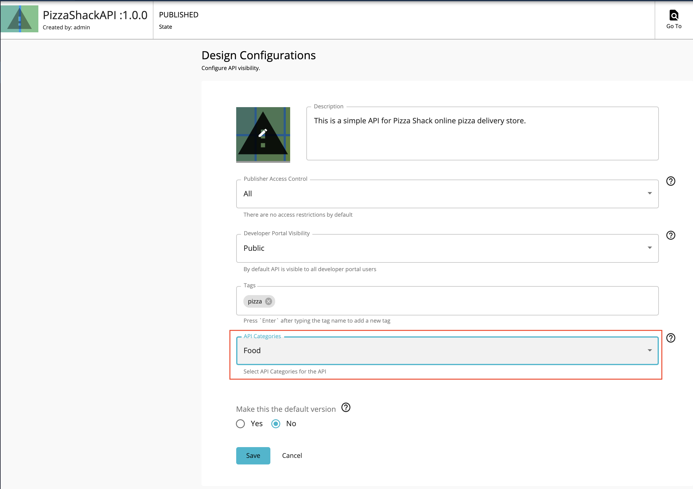
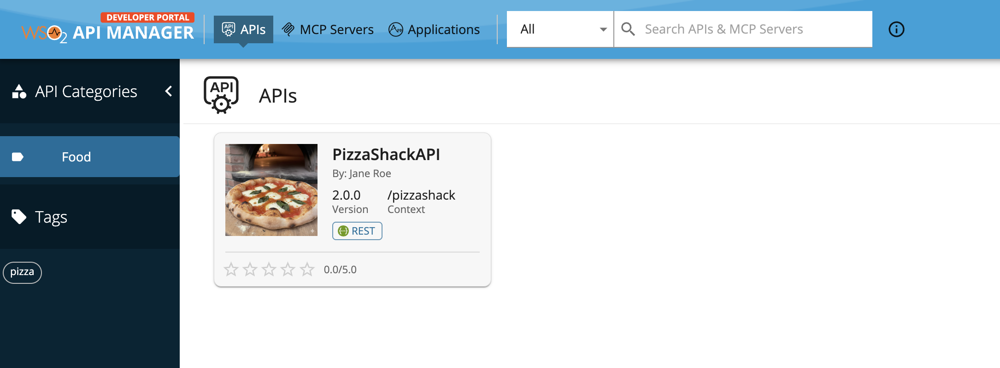

You can use API categories to group APIs. API categories do not use a naming convention. Therefore, the admin does not need to take into consideration any naming conventions when using API category based grouping.

Initially, the Admins will define API categories. Thereafter, API providers will add API categories to APIs when designing them via the API Publisher. API categories allow API providers to categorize APIs that have similar attributes. When a categorized API gets published to the Developer Portal, its categories appear as clickable links to the API consumers. The API consumers can use the available API categories to quickly jump to a category of interest.

## Step 1 - Add an API Category {#step-1-add-an-api-category}

You can add an API category using any of the following methods:

- [Add an API Category using the Admin Portal UI](#add-an-api-category-using-the-admin-portal-ui)
- Add an API Category using the Admin REST API. (You can use the POST resource in the **API Category (Individual)** section [here](../../../../apis/admin-v4/index.mdx))

### Add an API Category using the Admin Portal UI

1. Sign in to the Admin Portal.

    [https://localhost:9443/admin](https://localhost:9443/admin) 

2. Click **API Category** and then click **API Categories**.

    

3. Click **Add New Category**.

    

4. Enter a name and a description for the API category.

     | Field          |  Value                 |
     |----------------|------------------------|
     |  Name          |  Food                  |
     |  Description   |  Fast food related APIs     |

    

5. Click **Save**.

## Step 2 - Attach the API Category to an API {#step-2-attach-the-api-category-to-an-api}

1. Sign in to the Publisher.

    [https://localhost:9443/publisher](https://localhost:9443/publisher) 

2. Click on an API.

3. Click **Portal Configurations > Basic Info**. 

     

4. Select the API category.

     

5. Click **Save**.

## Step 3 - List APIs in Developer Portal {#step-3-list-apis-in-developer-portal}

1. Sign in to the Developer Portal.

     [https://localhost:9443/devportal](https://localhost:9443/devportal) 

2. Expand the **Tag Cloud** menu. 

3. Click on the specific API category under **API Categories**. 

     All APIs that belong to the selected category appear.

     
