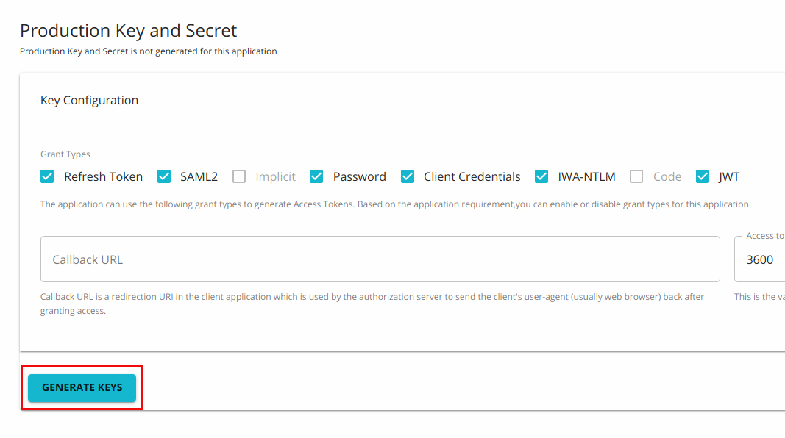

In a typical WSO2 API Manager (WSO2 API-M) deployment, different components talk to the **KeyManager** interface to achieve different tasks. 

For instance, after creating an application in the Developer Portal, subscribers would click on the `Generate Keys` button to register an application. 

-   At this point, the Developer Portal talks to the **KeyManager** interface to create an *OAuth client* and get the *Consumer Key/Secret* and the *Application Access token*.

-   When the Gateway receives a request, it talks to the **KeyManager** interface and gets the token validated. The **KeyManager** interface checks if the token is active and whether the token can be used to invoke the resource that is being accessed. If the token is valid, the Gateway uses additional details about the token (i.e., the Throttling Tier for the subscription and Consumer key) to determine if the request should be passed to the backend or not.

Therefore, the **KeyManager** interface acts as the bridge between the OAuth Provider and WSO2 API Manager (WSO2 API-M).

## Extending the Key Manager Interface {#extending-the-key-manager-interface_1}

When you need to write your own implementation to plug an external OAuth2 Authorization Server that will act as the Key Manager, you should implement a third-party Key Manager Connector as explain in 
[Configure a Custom Key Manger](../../../../guides/api-security/key-management/third-party-key-managers/configure-custom-connector.mdx)

The following are the methods that the `KeyManager` interface uses to carry out operations.

| **Method** | **Description** |
| --- | --- |
| **createApplication** | Creates a new OAuth application in the Authorization Server. |
| **updateApplication** | Updates an OAuth application. |
| **retrieveApplication** | Retrieves an OAuth application. |
| **getNewApplicationAccessToken** | The Developer Portal calls this method to get a new application Access Token. This method is called when getting the token for the first time and when the Developer Portal needs to refresh the existing token. |
| **getTokenMetaData** | Gets details about the access token. |
| **getKeyManagerConfiguration** | Gets the Key Manager implementation details from the `deployment.toml` file. |
| **buildAccessTokenRequestFromJSON** | This method will pass the JSON input and will add those additional values to the Access Token Request. If it is needed to pass any parameters in addition to those specified in the `AccessTokenRequest`, those parameters can be provided in the JSON input. |
| **mapOAuthApplication** | You need to use this method when creating an OAuth application in semi-manual mode when you have a consumer key and secret already generated from a Key Manager and you need to map the key and secret with the existing API-M application. |
| **buildAccessTokenRequestFromOAuthApp** | This method creates an Access Token Request using the OAuth Application information. If the token request is null, this method creates a new object, else it modifies the provided Access Token request. |
| **loadConfiguration** | This method is used to read the Key Manager configuration. |
| **registerNewResource** | This method talks to the `APIResource` registration endpoint of the Authorization Server and creates a new resource. |
| **getResourceByApiId** | This method retrieves the registered resource by the given API ID. |
| **updateRegisteredResource** | This method contains information about all the API resources by its `resourceId`. |
| **deleteRegisteredResourceByAPIId** | Deletes the registered resource based on the API ID. |
| **deleteMappedApplication** | Deletes mapping records of OAuth applications. |
| **getActiveTokensByConsumerKey** | Provides all the Active tokens issued against the provided Consumer Key. |
| **getAccessTokenByConsumerKey** | Provides details of the Access Token that is displayed on the Developer Portal. |
| **updateApplicationOwner** | Provides the capability to update the application owner of OAuth Application. |
| **deleteApplication** | Provides the capability to remove an OAuth Application based on the consumer key. |
| **buildFromJSON** | Provides the capability to build a Model object for the OAuth application creation. |
| **registerScope** | Provides the capability to register the scope in the OAuth server. |
| **getScopeByName** | Provides the capability to get the scope by name from the OAuth server. |
| **attachResourceScopes** | Provides the capability to attach the scope to resources in the Resource server. |
| **updateResourceScopes** | Provides the capability to update resources that correspond to scope mapping in the OAuth server. |
| **detachResourceScopes** | Provides the capability to delete resources that correspond to scope mapping in the OAuth server. |
| **deleteScope** | Provides the capability to delete scope by name in the OAuth server. |
| **updateScope** | Provides the capability to update the scope in the OAuth server. |
| **isScopeExists** | Provides the capability to check the existence of scope. |
| **validateScopes** | Provides the capability to validate scopes from the OAuth server. |
| **getUserClaims** | Provide the capability to retrieve user claims from the OAuth server that corresponds to thee access token or user. |
