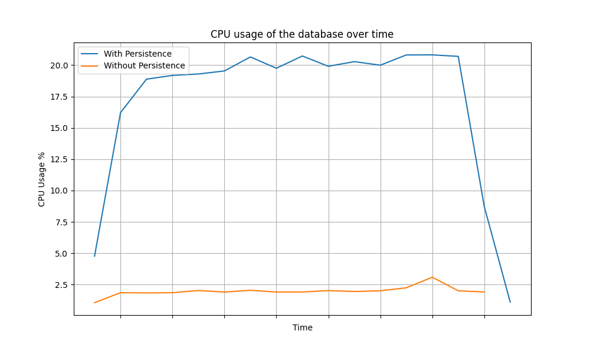
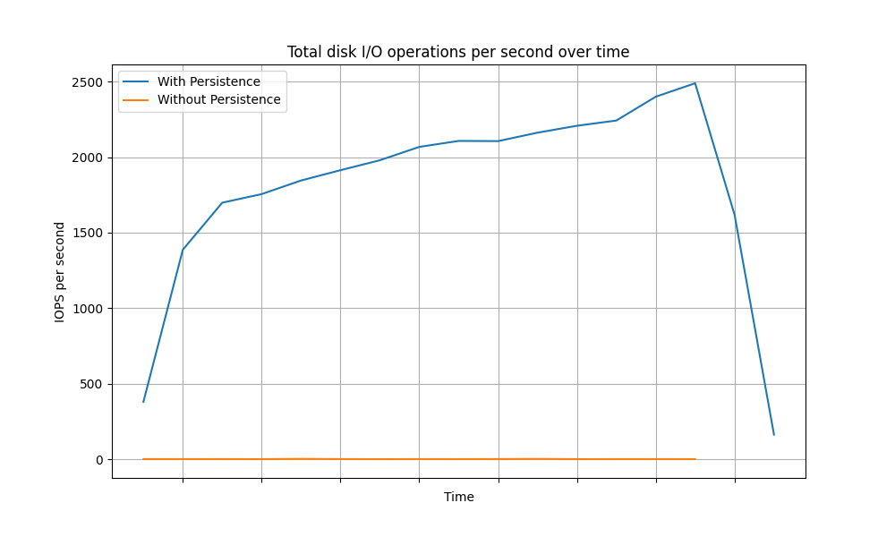
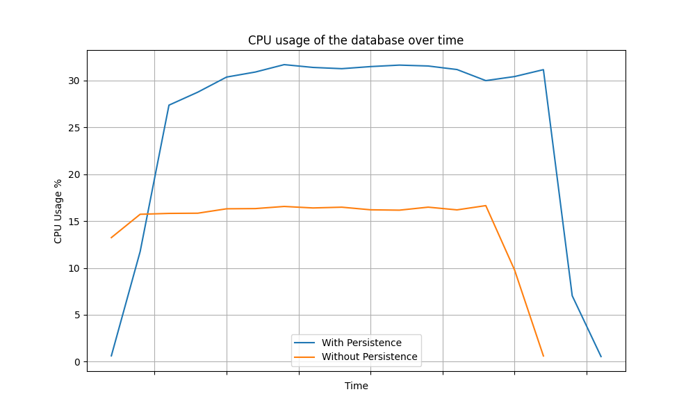
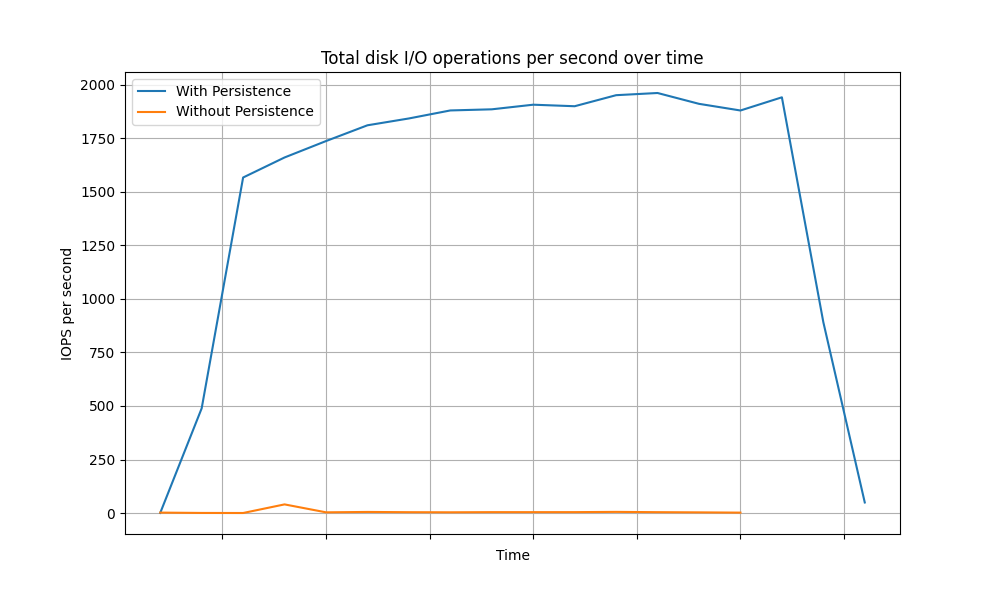
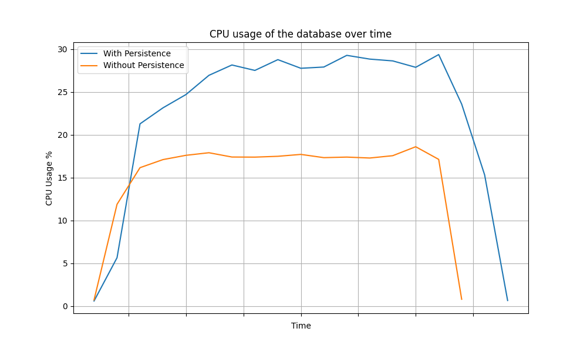
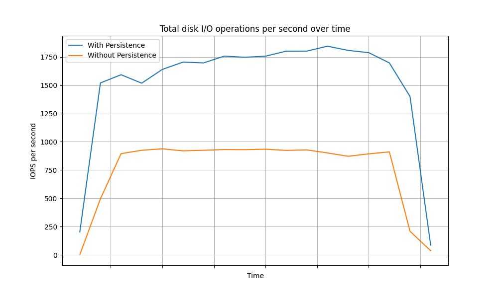

The token endpoint's performance was assessed in the WSO2 API Manager, both with and without token persistence. The tests were conducted with **100** concurrent users and **10** Developer Portal applications. Tokens were generated with device scopes to simulate high load, mimicking scenarios where thousands of tokens are generated within a short period of time. Tests covered Client Credentials, Passwords, and Refresh grant types. Please refer the [Token Persistence Management](../../guides/api-security/key-management/tokens/token-persistence.mdx) documenation to get more insights about the use cases in which this feature should be used.

A few key performace metrics were used to measure the performance of each grant type.

- Throughput: The number of tokens generated by the API-M key manager within a specific time frame (e.g. per second).
- APIM CPU Usage: CPU usage of the API Manager during tests. This metric is crucial as token generation and signing are CPU-intensive tasks.
- CPU and IOPS of the database: CPU usage and total I/O operations of the database during testing. This metric is vital in understanding how the database performance is affected when token persistence is removed.

## Testing Environment Configurations

| Name | EC2 Instance Type | vCPU | Mem(GiB) |
| --- | --- | --- | --- |
| Apache JMeter Client | c5.large | 2 | 4 |
| WSO2 API Manager | c5.xlarge | 4 | 8 |
| Database | db.m5.2xlarge | 4 | 8 |

- Token type: JWT
- Operating System: Ubuntu 22.04
- MySQL version of the RDS: 8.0
- Java version: Temurin JDK 17

## Results

The following table shows the throughput values of different grant types for each scenario.

| Grant Type | With Persistence | Without Persistence |
| --- | --- | --- |
| Client Credentials | 764/s | 973/s |
| Password | 434/s | 368/s |
| Refresh | 333/s | 415/s |

**Key Observations**

- The throughput has seen an increase in both Client Credentials and Refresh grant types. With tokens no longer persisted in the database for the Client Credentials grant, performance can scale freely until it encounters a bottleneck with CPU usage on the API Manager instance. Similarly, for the Refresh Token grant, the benefits of removing token persistence outweigh the increase in CPU requirements on the APIM instance for token generation.
- Under the test conditions, there's a decrease in TPS for the Password grant. This is due to the fact that the refresh token being generated as a JWT, unlike the default scenario (when token persistence is enabled) where it's an Opaque token. Generating and signing a JWT requires more computing power, resulting in the CPU of the API Manager instance becoming a bottleneck despite reduced load on the database. However, this issue can be addressed by vertically scaling the API Manager instance, thereby increasing available CPU resources.

:::note
:::
The tests for Refresh grant were carried out by immediately regenerating a new access token using the refresh token, without waiting for the original token to expire.

The following graphs show the CPU usage of API Manager instance over time for different grant types.

**Client Credentials Grant**

**Password Grant**

**Refresh Grant**

The following graphs depict the variance of the CPU usage of the database over time for different grant types.

**Client Credentials Grant**

CPU Usage                  |  Total IOPS
:-------------------------:|:----------------------:
  |  

**Password Grant**

CPU Usage                  |  Total IOPS
:-------------------------:|:----------------------:
  |  

**Refresh Grant**

CPU Usage                  |  Total IOPS
:-------------------------:|:----------------------:
  |  

:::note
The above data clearly shows a significant reduction in database load (CPU and IOPS) for each grant type when token persistence optimization is enabled. In summary, enabling token persistence optimization can enhance system performance, especially in scenarios where the database is a limiting factor.
:::