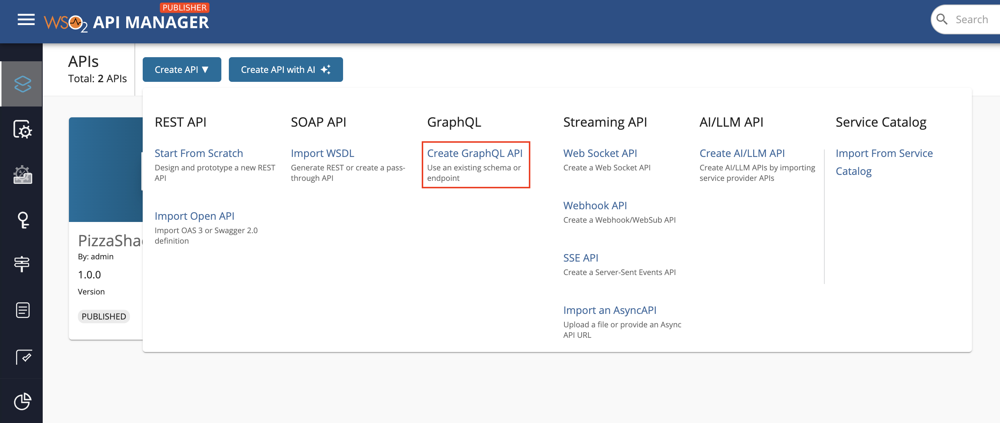
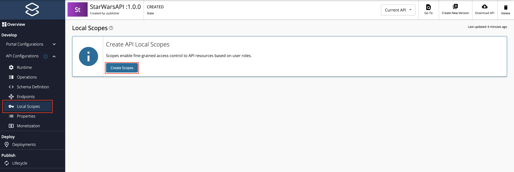
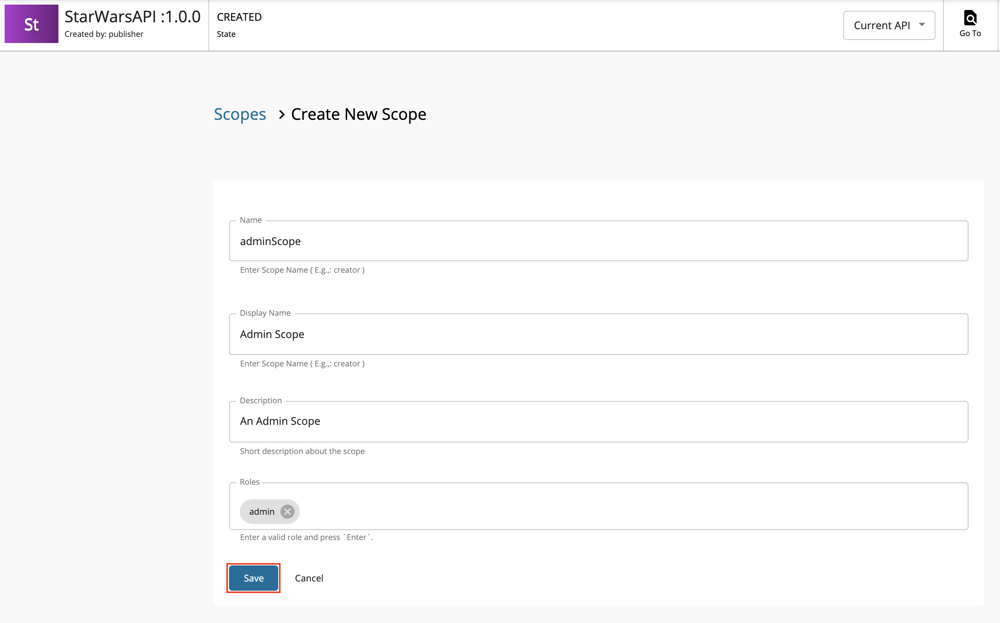

### Step 1 - Start the GraphQL backend server {#step-1-start-the-graphql-backend-server}

Let's use the Star Wars sample backend server as the backend for the GraphQL API.

1. Clone the [WSO2 API Manager Samples](https://github.com/wso2/samples-apim) repository.

    ```text
    git clone https://github.com/wso2/samples-apim
    ```

2. Navigate to `graphql-backend` directory.

    ```text
    cd samples-apim/graphql-backend
    ```

3. Run `npm install` to install the necessary node modules.

4. Run `npm start` to start the server.

    Once the above steps are done, the Star Wars server will be running on `http://localhost:8080`.

    

    You can use `http://localhost:8080/graphql` as the endpoint when creating the GraphQL API.

### Step 2 - Design a GraphQL API {#step-2-design-a-graphql-api}

1. Sign in to the API Publisher Portal.

    `https://<hostname>:9443/publisher` 

    Example: `https://localhost:9443/publisher`

    Let's use `admin` as the username and password to sign in.

2. Click **Create API** and then click **Create GraphQL API**.

     

3. Select one of the following options:

    * **GraphQL File/Archive** - If you select this option, drag and drop or click **Browse File to Upload** to upload the file.
    * **GraphQL SDL URL** - If you select this option, you need to provide the URL of the schema definition.

    Let's use the [StarWarsAPI schema definition](../../assets/attachments/learn/schema_graphql.graphql) to create the schema file. 

4. Select **GraphQL File/Archive** and import the schema by dragging and dropping the file or by uploading the file. Click **Next**.

    :::note
    - You need to define the SDL Schema based on the \[GraphQL schema design best practices\](https://graphql.org/learn/best-practices).
    - The file extension can be either \`.graphql\`, \`.txt\`, or \`.json\`.
    - The file name can be any name, which is based on your preference.
    :::

    

5. Enter the GraphQL API related details and click **Create**.

    Let's create an API named "StarWarsAPI" using the following sample data.

    <table>
      <thead>
        <tr>
          <th>

            **Field**

          </th>
          <th>

            **Description**

          </th>
        </tr>
      </thead>
      <tbody>
        <tr>
          <td>

            Name

          </td>
          <td>

            StarWarsAPI

          </td>
        </tr>
        <tr>
          <td>

            Context

          </td>
          <td>

            `/swapi`

          </td>
        </tr>
        <tr>
          <td>

            Version

          </td>
          <td>

            1.0.0

          </td>
        </tr>
        <tr>
          <td>

            Endpoint

          </td>
          <td>

            [http://localhost:8080/graphql](http://localhost:8080/graphql)

            :::note
            - When you provide the HTTP URL as the backend endpoint, WSO2 API-M will internally derive the corresponding WebSocket URL `ws://localhost:8080/graphql`.
            - Thereafter, the API Gateway will use this WebSocket URL as the backend subscription endpoint of the GraphQL API.
            :::

          </td>
        </tr>
      </tbody>
    </table>

    

6. Optionally, modify the existing GraphQL schema definition.

    1. Navigate to **Develop**, **API Configurations**, and click **Schema Definition**.

    2. Click **Download Definition**.

         The existing GraphQL API schema gets downloaded.

         

    3. Update the schema definition as required.

    4. Click **Import Definition** to import the updated schema definition.

7. Update the GraphQL API operations as required.

    Instead of resources, which get populated for REST APIs, operations get populated for GraphQL APIs.

    1. Click **Show More** under the **Operations** section in the **Overview** page to navigate to the operations page.

           

    2. Update the operations as required.

        The Publisher can add Rate Limiting policies, scopes and enable/disable security for each of the GraphQL API operations.

        1. **Create scopes**.

            Repeat the following sub-steps to create two scopes named `adminScope` and `FilmSubscriberScope`.

            1. Click **Local Scopes**, and then click **Create Scopes**.

                

            2. Enter the required details.

                   :::note
                   - The role that you enter **should be a valid role that already exists in WSO2 API Manager**. Make sure to assign the role to the user.
                   - For more information, see [Adding Users](../../docs/deploy-and-operate/administer/managing-users-and-roles/manage-users-for-api-manager/managing-users.mdx) and [Adding User Roles](../../docs/deploy-and-operate/administer/managing-users-and-roles/manage-users-for-api-manager/managing-user-roles.mdx).
                   :::

                   Enter the following details for this example scenario.

                   | **Name** | **Role** |
                   |----------|----------|
                   | `FilmSubscriber` | `FilmSubscriber` |
                   | `adminScope` | `admin` |

                   

            3. Press `Enter` to add each role. 

            4. Click **Save**.

                 

         2. **Define the operation level configurations**.

            1. Click **Operations**.

            2. Click **Operation Level** to apply Rate Limiting for operations.

                 

            3. Select a Rate Limiting Policy, scope, and enable or disable security for each of the operations. 

                   Apply the following scopes to the respective operations.

                   | **Operation** | **Scope** |
                   |----------|----------|
                   | `allDroids` |`FilmSubscriber` |
                   | `allCharacters` |`adminScope` |

            4. Click **Save**.

                 If you check the list of scopes, it should appear as follows:

                 
