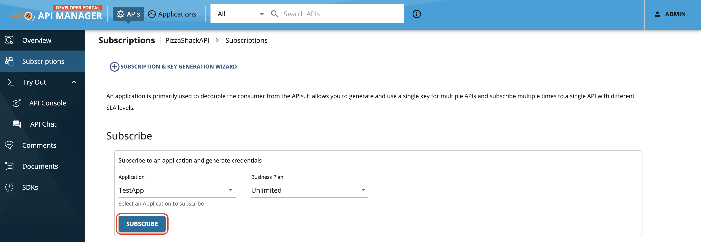
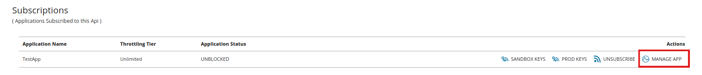

1. Sign in to the Developer Portal.  

     `https://<hostname>:9443/devportal`

2. Click **APIs** and click on the respective API (e.g., `PizzaShackAPI`).

3. Click **Subscriptions**.

4. Select an application and select a throttling policy.

      :::note
      API Keys can work with any application, which is either JWT or OAuth.
      :::

5. Click **Subscribe**.

     

6. Click **MANAGE APP**, corresponding to the application that you used to subscribe to the API.

     

7. Click **API KEY** and click **GENERATE KEY**.

     

8. Optionally, define a validity period for the token.

     By default, the API Key does not expire. However, optionally, you can define a validity period for the token as follows:

    1. When you click **Generate Keys,** deselect the **API Key with infinite validity period** option in the pop-up.

    2. Enter the expiry time in seconds.

9.  Copy the API key.

     
